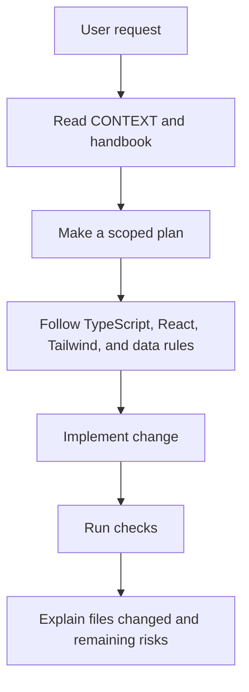

# Tech Stack

## AI coding guardrails

- You are building a React application.
- Use TypeScript.
- Use React Router. Keep route definitions in `src/routes.tsx`; they are rendered by `src/App.tsx`
- Always put source code in the src folder.
- Put pages into src/pages/
- Put components into src/components/
- The public homepage is `src/pages/public/Index.tsx`
- Update the relevant route page or feature entry point when adding visible UI; otherwise, users will not see the new component.
- ALWAYS try to use the shadcn/ui library.
- Tailwind CSS: always use Tailwind CSS for styling components. Utilize Tailwind classes extensively for layout, spacing, colors, and other design aspects.

Available packages and libraries:

- The lucide-react package is installed for icons.
- You ALREADY have ALL the shadcn/ui components and their dependencies installed. So you don't need to install them again.
- You have ALL the necessary Radix UI components installed.
- Use prebuilt components from the shadcn/ui library after importing them. Note that these files shouldn't be edited, so make new components if you need to change them.
