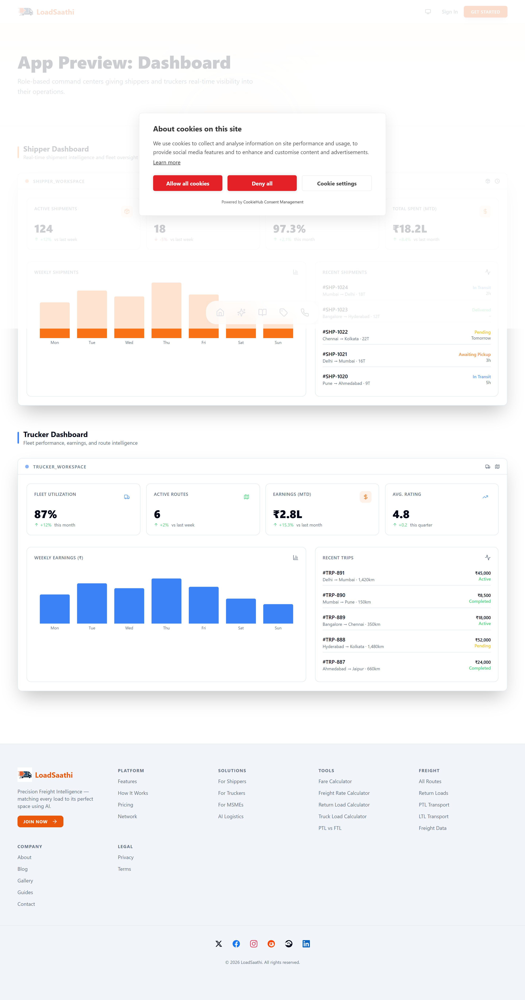
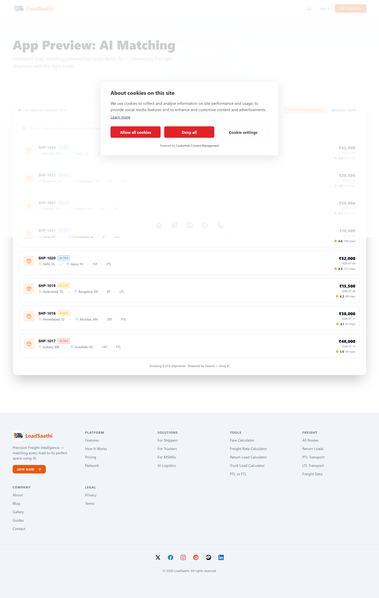
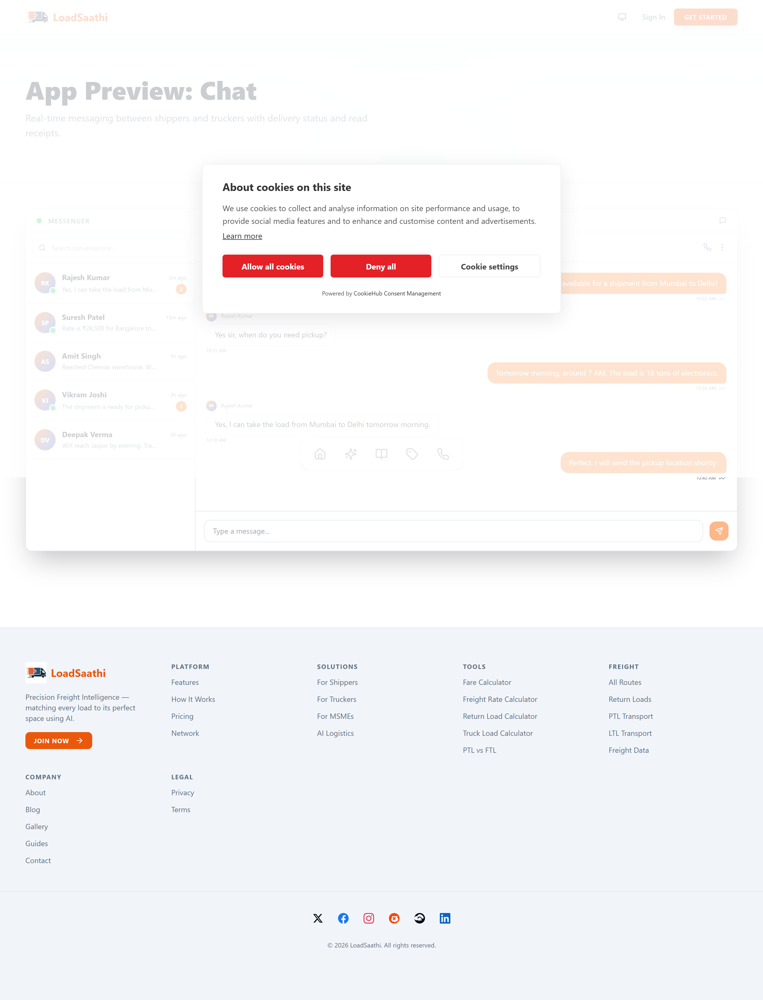
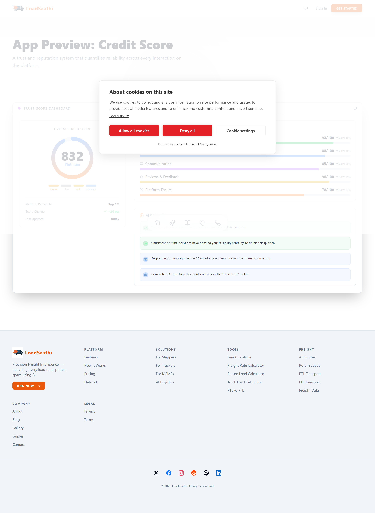
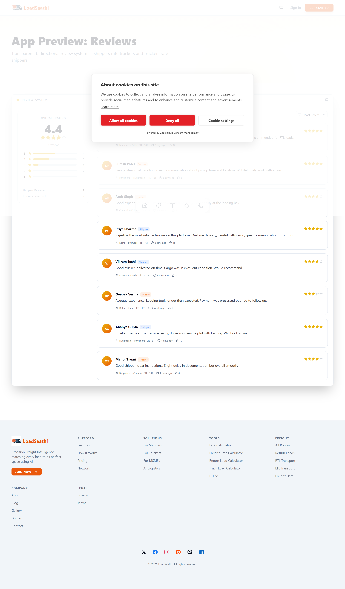
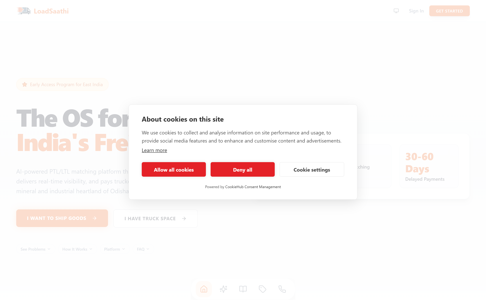
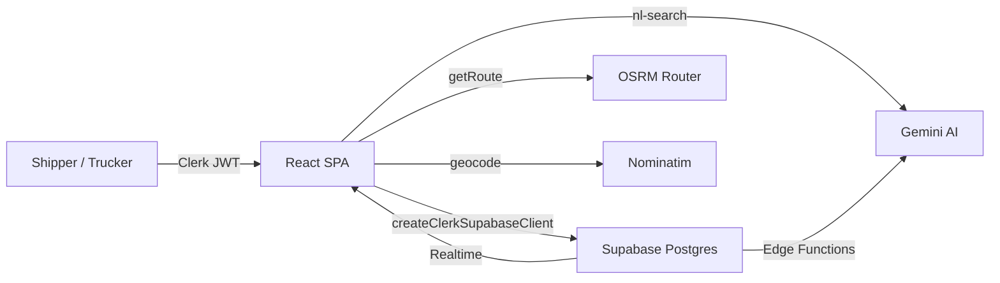

<div align="center">


# LoadSaathi

**India's AI-Powered Shared Freight Marketplace**

Connecting shippers and truckers for PTL / LTL loads across East India — with AI matching, real-time GPS tracking, and digital credit scores.

[loadsaathi.in](https://loadsaathi.in) · [support@loadsaathi.in](mailto:support@loadsaathi.in)


[](https://github.com/sanjayofficial-glitch/LOAD-SAATHI-APP-1-OSRM/actions/workflows/ci.yml)
[](LICENSE)


</div>

---

## Table of Contents

- [Start here](#start-here)
- [What is LoadSaathi?](#what-is-loadsaathi)
- [Screenshots](#screenshots)
- [Features](#features)
- [Architecture](#architecture)
- [Tech Stack](#tech-stack)
- [Repository Layout](#repository-layout)
- [Getting Started](#getting-started)
- [Development Workflow](#development-workflow)
- [Documentation](#documentation)
- [Project Status](#project-status)
- [Contributing](#contributing)
- [License](#license)

---

## Start here

| Reader | Best starting point | Outcome |
| --- | --- | --- |
| Founder, stakeholder, or business partner | [Plain-language overview](docs/handbook/01-overview-non-technical.md) | Understand the problem, users, product value, and current capabilities |
| New developer | [Architecture and stack](docs/handbook/02-architecture-and-stack.md) | Find the code, services, data boundaries, and route structure |
| Product or engineering team | [Core Flows](docs/handbook/03-core-flows.md) | See the important journeys and data movement as diagrams |
| AI coding agent | [AI Restructure Brief](docs/handbook/07-ai-restructure-brief.md) | Follow the repository constraints and safe improvement plan |
| DevOps, hiring, or handover | [Handover checklist](docs/handbook/08-handover-checklist.md) | Set up, test, deploy, and troubleshoot the project |

> **Core Flows are preserved.** The handbook reorganizes the explanation of the repository without changing business logic, route URLs, database tables, or external service integrations.

---

## What is LoadSaathi?

LoadSaathi is India's AI-powered shared freight marketplace connecting shippers
and truckers for PTL (Partial Truckload) and LTL (Less Than Truckload) loads
across East India. The platform uses AI matching, real-time GPS tracking,
digital credit scores, and escrow-backed payments to eliminate empty return
trips and reduce freight costs by up to 40%.

Founded by **Sanjaya Sahu** (FTBI alumnus, NIT Rourkela) after seeing truckers
return empty and shippers struggle to find reliable carriers, LoadSaathi brings
transparency, trust, and intelligence to Indian freight.

### Who It's For

- **Shippers** — SMEs and enterprises in Odisha, Jharkhand, and West Bengal moving goods on the Rourkela–Ranchi–Burdwan corridor and beyond.
- **Truckers & Fleet Owners** — Independent truckers and fleet operators looking to fill empty capacity, find return loads, and build a digital reputation.

### Key Service Areas

Rourkela, Ranchi, Bhubaneswar, Kolkata, Jamshedpur, and 50+ cities across
Odisha, Jharkhand, and West Bengal — with 25+ active freight corridors
including Rourkela–Ranchi–Burdwan, Rourkela–Kolkata, and Bhubaneswar–Kolkata.

---

## Screenshots

|                           Trucker & Shipper Dashboard                           |                                AI Smart Matching                                 |
| :-----------------------------------------------------------------------------: | :------------------------------------------------------------------------------: |
|  |  |

|                              In-App Chat                              |                                 Digital Credit Score                                  |
| :-------------------------------------------------------------------: | :-----------------------------------------------------------------------------------: |
|  |  |

|                            Bidirectional Reviews                            |                                  Landing Page                                  |
| :-------------------------------------------------------------------------: | :----------------------------------------------------------------------------: |
|  |  |

---

## Features

- **AI-Powered Matching** — A multi-factor scoring engine (route, capacity, price, reliability) that matches shippers with truckers in seconds.
- **Real-Time GPS Tracking** — Live location sharing with ETAs, route visualization, and geofence alerts.
- **Digital Freight Credit Score** — 300–900 score for every participant based on completion rates, on-time performance, and reviews.
- **AI Price Prediction** — Market-aligned pricing suggestions based on route, demand, fuel costs, and historical data.
- **Trust and payment roadmap** — Escrow-backed payments and dispute resolution are documented as a future product direction unless the relevant implementation is present.
- **Bidirectional Reviews** — Both shippers and truckers rate each other after every completed trip.
- **In-App Chat & Negotiation** — Real-time messaging between matched parties.
- **Smart Route Optimization** — OSRM-powered routing, distance, and duration estimation.
- **Templates & Reusable Loads** — Save frequent shipments/trips as templates.
- **Admin Command Center** — Live map monitoring, user management, and moderation tools.

---

## Architecture

```
┌─────────────────────── Clients ───────────────────────┐
│  Web SPA (Vercel)            Android App (Capacitor)   │
│  React 19 + TS + Vite        Same web build            │
└───────────────────────┬───────────────────────────────┘
                        │  HTTPS
┌───────────────────────▼───────────────────────────────┐
│                      Services                          │
│  ┌───────────┐   ┌──────────────┐   ┌───────────────┐ │
│  │  Clerk    │   │  Supabase    │   │     OSRM      │ │
│  │ Auth+JWT  │──▶│ Postgres+RLS │   │  Routing      │ │
│  │           │   │ Realtime     │   │               │ │
│  │           │   │ Edge Fns     │   │               │ │
│  └───────────┘   └──────┬───────┘   └──────┬────────┘ │
│                         │                  │          │
└─────────────────────────┼──────────────────┼──────────┘
                          ▼                  ▼
                 ┌──────────────┐   ┌─────────────────┐
                 │   Gemini AI  │   │   Nominatim     │
                 │ NL search    │   │   Geocoding     │
                 └──────────────┘   └─────────────────┘
```

### Core Flows



- **Auth:** Clerk issues a JWT → `AuthContext` syncs the profile from Supabase → role-based routes are guarded.
- **Matching:** `useSmartMatch` scores every trip/shipment pair on route overlap, capacity, price, date, and rating → sorted match % shown to users.
- **Realtime:** Anonymous Supabase client subscribes to `trips`, `shipments`, `requests`, `messages`, and `notifications` for instant updates.

---

## Tech Stack

| Layer      | Technology                             |
| ---------- | -------------------------------------- |
| Framework  | React 19 + TypeScript (strict)         |
| Build Tool | Vite 6                                 |
| UI Library | shadcn/ui + Radix UI                   |
| Styling    | Tailwind CSS 3.4                       |
| State/Data | TanStack React Query 5                 |
| Auth       | Clerk 5                                |
| Database   | Supabase (PostgreSQL + RLS + Realtime) |
| Maps       | Leaflet + React-Leaflet                |
| Charts     | Recharts 3                             |
| Forms      | React Hook Form + Zod                  |
| Animation  | Framer Motion                          |
| Analytics  | PostHog, Vercel Analytics, GA          |
| Routing    | React Router DOM 7                     |
| Mobile     | Capacitor 8 (Android)                  |
| Hosting    | Vercel                                 |

### Key Services

- **Clerk** — Authentication, user management, JWT issuance
- **Supabase** — PostgreSQL database, Realtime subscriptions, Edge Functions
- **OSRM** — Open Source Routing Machine for truck route calculation
- **Nominatim** — OpenStreetMap geocoding
- **Gemini** — Google AI for natural-language freight search parsing

---

## Repository Layout

```
.
├── src/                          # React application source
│   ├── features/                 # Feature-scoped modules
│   │   ├── home/sections/        #   Landing page sections
│   │   ├── marketing/screens/    #   Public app previews
│   │   └── shipper/components/   #   Shipper-dashboard widgets
│   ├── components/               # Shared UI components
│   │   ├── ui/                   #   shadcn/ui primitives
│   │   └── maps/                 #   Leaflet map widgets
│   ├── pages/                    # Route-level pages
│   │   ├── public/               #   Marketing pages (PublicLayout)
│   │   ├── trucker/              #   Trucker dashboard pages
│   │   ├── shipper/              #   Shipper dashboard pages
│   │   ├── admin/                #   Admin-only pages
│   │   └── blog/                 #   Blog system
│   ├── hooks/                    # Custom React hooks
│   ├── contexts/                 # Auth + Theme providers
│   ├── data/                     # Static data (routes, blog, locations)
│   ├── lib/                      # Utilities (cn, logger, gemini)
│   ├── utils/                    # Business logic (matching, osrm, geocode)
│   ├── types/                    # TypeScript type definitions
│   └── test/                     # Vitest test files
├── supabase/                     # Database + Edge Functions
│   ├── functions/                #   Deno Edge Functions
│   └── migrations/               #   SQL migration files
├── android/                      # Capacitor Android project
├── public/                       # Static assets (served as-is)
├── docs/                         # Project documentation
├── scripts/                      # Utility scripts
├── .github/workflows/            # CI pipeline
├── index.html                    # SPA entry point (JSON-LD schemas)
└── vercel.json                   # Vercel deployment config
```

---

## Getting Started

### Prerequisites

- Node.js >= 22
- pnpm >= 9
- A Clerk application
- A Supabase project

### Installation

```bash
# 1. Install dependencies
pnpm install

# 2. Configure environment variables
cp .env.example .env
# Fill in your Clerk and Supabase keys

# 3. Start the dev server
pnpm dev
```

> **Security note:** Never commit real `.env.*` values. Only `.env.example`
> is tracked; local `.env.development` / `.env.production` files are gitignored.

### Available Scripts

| Command          | Description                         |
| ---------------- | ----------------------------------- |
| `pnpm dev`       | Start Vite dev server               |
| `pnpm build`     | Production build                    |
| `pnpm preview`   | Preview production build            |
| `pnpm lint`      | Run ESLint                          |
| `pnpm typecheck` | Run TypeScript type checking        |
| `pnpm format`    | Format code with Prettier           |
| `pnpm test`      | Run Vitest tests                    |
| `pnpm check`     | Run lint + typecheck + test + build |

---

## Development Workflow

1. **Branch** — Work on a feature branch (e.g. `feat/xxx`).
2. **Check** — Run `pnpm check` locally before pushing (lint, typecheck, tests, build).
3. **Format** — Run `pnpm format` to keep the codebase consistent.
4. **PR** — Open a pull request against `main`; CI runs the full quality gate automatically.

See [CONTRIBUTING.md](CONTRIBUTING.md) for the complete contribution guide.

---

## Documentation

Detailed documentation lives in [`docs/`](docs/README.md). For a guided, audience-specific reading order, start with the [Repository Handbook](REPO_HANDBOOK.md) or the [Handbook Index](docs/handbook/00-index.md).

### Audience handbook

| Reader | Document |
| --- | --- |
| Everyone | [Non-technical overview](docs/handbook/01-overview-non-technical.md) |
| Developers | [Architecture and stack](docs/handbook/02-architecture-and-stack.md) · [Core Flows](docs/handbook/03-core-flows.md) |
| Visual/product readers | [Screens and visual assets](docs/handbook/04-screens-and-visuals.md) |
| AI agents | [AI restructure brief](docs/handbook/07-ai-restructure-brief.md) · [CONTEXT.md](CONTEXT.md) |
| Handover and operations | [Handover checklist](docs/handbook/08-handover-checklist.md) |

### Technical reference


| Document                                     | Description                       |
| -------------------------------------------- | --------------------------------- |
| [Architecture](docs/architecture.md)         | System architecture deep-dive     |
| [Getting Started](docs/getting-started.md)   | Full local setup guide            |
| [Data Models](docs/data-models.md)           | Database schema reference         |
| [Authentication](docs/authentication.md)     | Clerk ↔ Supabase auth flow        |
| [Matching Algorithm](docs/matching.md)       | AI smart-matching scoring         |
| [Realtime](docs/realtime.md)                 | Supabase Realtime subscriptions   |
| [Edge Functions](docs/edge-functions.md)     | Supabase Edge Functions reference |
| [Deployment](docs/deployment.md)             | Vercel + Capacitor deployment     |
| [Mobile (Android)](docs/mobile-android.md)   | Android build guide               |
| [SEO / GEO](docs/seo/README.md)              | SEO & AI-engine optimization      |
| [Analytics](docs/analytics/posthog-setup.md) | Analytics instrumentation         |

---

## Project Status

**Status:** Active development & pre-launch / early launch

- **Product:** Web app (Vercel) + Android app (Capacitor)
- **Auth:** Live with Clerk
- **Database:** Live with Supabase
- **Analytics:** PostHog, Vercel Analytics, GA instrumented

See [CHANGELOG.md](CHANGELOG.md) for version history and the
[Roadmap](docs/roadmap.md) for planned work.

---

## Contributing

We welcome contributions. Please read:

- [Contributing Guidelines](CONTRIBUTING.md)
- [Code of Conduct](CODE_OF_CONDUCT.md)
- [AI Coding Agent Rules](AI_RULES.md)

---

## License

This project is **proprietary**. See [LICENSE](LICENSE) for details.
All rights reserved. © 2026 LoadSaathi.

---

<div align="center">

**LoadSaathi** · [loadsaathi.in](https://loadsaathi.in) · [support@loadsaathi.in](mailto:support@loadsaathi.in)

</div>
