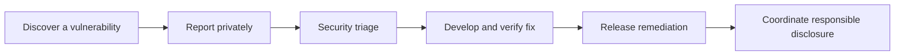

# Security Policy

## Vulnerability-reporting path



## Reporting a Vulnerability

We take security seriously. If you discover a security vulnerability, **please
do not open a public issue**. Instead, report it privately.

**Email:** security@loadsaathi.in

Please include in your report:

- The type of issue (e.g., SQL injection, XSS, broken access control)
- Full paths of the affected source files (from the repository)
- The location of the affected source code (file + line number)
- Any special configuration required to reproduce the issue
- Step-by-step instructions to reproduce
- Proof-of-concept or exploit code (if possible)
- Impact of the issue, including how an attacker might exploit it

We will acknowledge receipt within **48 hours** and work with you to
understand and resolve the issue. We will notify you when the issue is resolved
and publicly credit you for the report (unless you prefer to remain anonymous).

## Supported Versions

This is a proprietary, pre-release application under active development.
Security fixes are applied to the current `main` branch. Only the latest
deployment is supported.

## Security Posture

### Authentication

- Authentication is handled by **Clerk** (SOC 2 Type II compliant).
- Clerk JWTs are exchanged for Supabase tokens via Clerk's custom JWT template.
- Row Level Security (RLS) on Supabase enforces per-user access.

### Data Protection

- All traffic is HTTPS-only (HSTS enabled via `vercel.json`).
- Strict Content Security Policy (CSP) headers configured in `vercel.json`.
- Sensitive environment variables are **never** committed.
  - `.env` files are gitignored. Use `.env.example` for reference.
  - Only publishable keys (`pk_test_...`, anon keys) may appear in client code.

### Database (Supabase)

- RLS enabled on all tables (see `src/integrations/supabase/final-schema.sql`).
- All queries go through the authenticated Supabase client.
- **Never** disable RLS on tables that hold user data.
- Edge Functions validate JWTs before executing (unless explicitly a public
  endpoint).

### Secrets Management

| Secret Type | Storage | Rule |
|-------------|---------|------|
| Clerk publishable key | Client env | Safe to ship (prefix `pk_`) |
| Clerk secret key | Server only | Never commit |
| Supabase anon key | Client env | Safe to ship (RLS protects) |
| Supabase service role key | Server only | Never commit |
| PostHog / GA keys | Client env | Publishable by design |
| Gemini API key | Supabase Edge Function | Never commit |

## Dependency Management

Dependencies are pinned via `pnpm-lock.yaml`. Update dependencies through a
dedicated PR and review for known vulnerabilities using:

```bash
pnpm audit
```

## Security Best Practices for Contributors

1. Never log secrets, tokens, or PII to the console.
2. Never commit `.env` files or real API keys.
3. Use the authenticated Supabase client (`useSupabase()`) — never raw clients.
4. Add RLS policies when adding tables.
5. Validate all user input with Zod schemas.
6. Sanitize any HTML rendered to the DOM.

## Contact

Security: **security@loadsaathi.in**
General: **support@loadsaathi.in**
