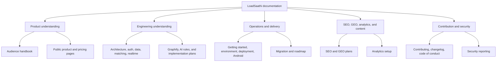

# LoadSaathi Diagram Directory

This page is the visual index for the repository documentation. Each major product, engineering, operations, growth, and governance document now opens with a Mermaid diagram that explains its central idea before the detailed prose and tables.

## How to read the diagrams

| Diagram type | Best for | Visual meaning |
| --- | --- | --- |
| `flowchart` | Architecture, algorithms, plans, and pipelines | Directional movement from one step or boundary to another |
| `sequenceDiagram` | Authentication, realtime, and Edge Functions | Conversation between users, clients, services, and databases |
| `erDiagram` | Data models | Tables/entities and their relationships |
| `stateDiagram-v2` | Lifecycle documentation | State transitions and allowed movement |
| `mindmap` | Handbook navigation and taxonomies | Grouping related ideas around a central concept |

## Visual coverage map

## Product and handbook

| Document | Central diagram |
| --- | --- |
| [Repository Handbook](REPO_HANDBOOK.md) | Reader paths into one shared understanding |
| [Visual Guide](VISUAL_GUIDE.md) | One-glance visual story of the app, features, and history |
| [Handbook Index](handbook/00-index.md) | Mindmap of non-technical, developer, AI, and operations paths |
| [Non-technical Overview](handbook/01-overview-non-technical.md) | Shipper/trucker marketplace value loop |
| [Architecture and Stack](handbook/02-architecture-and-stack.md) | Layered application and service view |
| [Core Flows](handbook/03-core-flows.md) | Detailed behavioral source of truth with 11 diagrams |
| [Screens and Visuals](handbook/04-screens-and-visuals.md) | Asset system from brand files to product understanding |
| [Graphify and Code Memory](handbook/05-graphify-and-code-memory.md) | AST/semantic extraction pipeline |
| [Improvements and Roadmap](handbook/06-improvements-and-roadmap.md) | Audit-to-investment prioritization loop |
| [AI Restructure Brief](handbook/07-ai-restructure-brief.md) | Safe AI coding change loop |
| [Handover Checklist](handbook/08-handover-checklist.md) | Access-to-operations journey |

## Engineering and operations

| Document | Central diagram |
| --- | --- |
| [Architecture](architecture.md) | Client, UI, state, integrations, and services |
| [Authentication](authentication.md) | Clerk to Supabase identity handoff |
| [Data Models](data-models.md) | Core marketplace entity relationships |
| [Matching](matching.md) | Input normalization to ranked match result |
| [Realtime](realtime.md) | Database event loop back to the UI |
| [Edge Functions](edge-functions.md) | Hook, function, model, and database request path |
| [Environment Variables](environment-variables.md) | Browser-safe versus server-only configuration boundary |
| [Getting Started](getting-started.md) | First-run developer journey |
| [Deployment](deployment.md) | Branch, CI, Vercel, and Android delivery |
| [Mobile Android](mobile-android.md) | Vite build to APK/App Bundle |
| [Supabase Migration Notes](../supabase/MIGRATION_NOTES.md) | Auth migration and RLS path |
| [Audit Report](AUDIT_REPORT.md) | Full-repository audit findings and severity fixes |
| [Product Roadmap](roadmap.md) | MVP to launch, growth, and network effects |
| [Firebase Chat Migration Plan](FIREBASE-CHAT-MIGRATION-PLAN.md) | Assessment, prototype, parallel validation, and cutover |

## Growth and governance

| Document | Central diagram |
| --- | --- |
| [SEO & GEO](seo/README.md) | Content to search discovery and AI citations |
| [SEO Launch Playbook](seo-launch-playbook.md) | Entity clarity to measurable demand |
| [SEO/GEO Implementation Plan](seo/geo-implementation-plan.md) | Phased technical and content sequence |
| [SEO Recovery Plan](seo/loadsaathi_seo_recovery_plan.md) | Diagnose, fix, measure, and repeat |
| [Directory Backlinks](seo/backlinks.md) | Tiered authority-building funnel |
| [SEO Strategy](seo/SEO-STRATEGY.md) | Search and AI-citation strategy for loadsaathi.in |
| [Security B1 Remediation](SECURITY-B1-REMEDIATION.md) | Credential-hygiene remediation and verification steps |
| [PostHog Setup](analytics/posthog-setup.md) | User action to product decision |
| [Contributing](../CONTRIBUTING.md) | Idea to reviewed and merged change |
| [Security Policy](../SECURITY.md) | Private report to responsible disclosure |
| [AI Rules](../AI_RULES.md) | Request, context, guardrails, checks, and handoff |
| [Changelog](../CHANGELOG.md) | Implemented change to release history |
| [Code of Conduct](../CODE_OF_CONDUCT.md) | Respectful participation to community improvement |

> **Preservation note:** The Core Flows in [03-core-flows.md](handbook/03-core-flows.md) were not removed. The new diagrams around them explain neighboring concepts and point readers back to the detailed flow reference.
