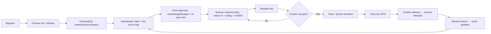
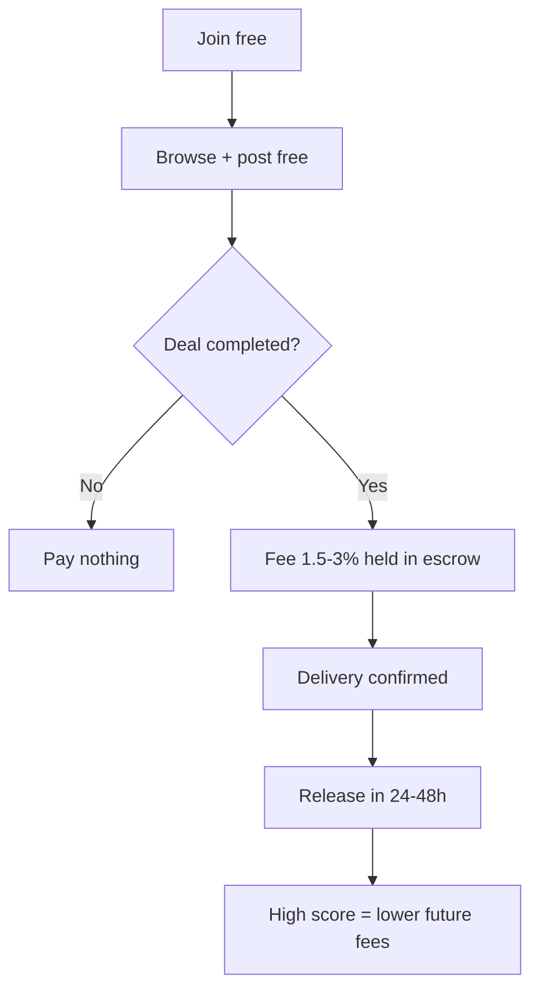

# LoadSaathi — Product Manager's Product Brief

> Plain-language guide to the whole product: users, journeys, money, trust, metrics.
> Generated from code + knowledge graph. No engineering detail — only what changes what a user sees, pays, trusts, or decides.
> Last updated: 2026-09-23. Dashboard: `http://127.0.0.1:5173/?token=0093d49ca7f4573456b2da476edcf5b8`

---

## 1. Product snapshot (one page)

| | |
|---|---|
| **What** | AI-powered shared freight marketplace for part-load (PTL) and full-load (LTL/FTL) trucking across East India |
| **Who** | Shippers (have goods) + Truckers (have trucks). Admin runs the marketplace |
| **Problem** | Trucks run empty on return legs; shippers overpay brokers (10–20% margins) and can't track goods |
| **Solution** | Post trip/shipment → AI match score → request/accept → in-app chat → live GPS → escrow payment → review |
| **Money** | Free to join. 1.5–3% fee per completed transaction (shippers), 1.5–2.5% (truckers). Escrow holds funds until delivery. Enterprise (50+ loads/mo): custom pricing + API |
| **Moat** | Credit score (300–900) + reviews + verification + AI matching + live tracking |
| **HQ / market** | Rourkela, Odisha. Hero corridor: Rourkela–Ranchi–Burdwan. Claim: save up to 40% on freight |
| **Coverage data** | 30+ freight corridors (`supabase/src/data/routes.ts`), 1,000+ cities (`supabase/src/data/locations.json`) |

---

## 2. Users, signup, onboarding

**Three roles:** shipper (blue), trucker (orange), admin (purple). One person picks one role at signup, can switch later from profile settings.

**Signup flow (4 steps):**
1. Register (Clerk: email/phone + password, or OAuth) → 2. **ChooseRole** screen — two big cards:
   - "I am a Shipper — I have goods to transport…"
   - "I am a Trucker — I have a truck…" (+ optional checkbox: *"Get help from an experienced trucker on my route"* — mentor opt-in, truckers only)
3. **Onboarding** (3 mini-steps): welcome → profile (name, phone, company) → done → 4. lands on role dashboard. First suggested action: **post** (trip or shipment).

**PM notes:**
- Time-to-first-value is short: signup → post in minutes. Good.
- Mentor opt-in for new truckers is a built-in activation lever — check how many tick it and whether mentored truckers retain better.
- Role switching is allowed — watch for gaming (bad score → switch role → fresh start). Same for fresh accounts (new = 550 "fair").

**Dashboard:** Layers → search `ChooseRole`, `OnboardingFlow`. **Skip:** `AuthContext`, Clerk, JWT, `AuthSync` (login plumbing).

---

## 3. Supply & demand enter the system (posting)

Both forms share the same skeleton: location pick → date → capacity/weight → price/budget → AI price hint → submit. Differences:

| | Trucker: PostTrip | Shipper: PostShipments |
|---|---|---|
| Core inputs | Origin, destination, departure date, available capacity (tonnes), price per tonne, vehicle type + number | Origin, destination, departure date, goods description, weight (tonnes), pickup/delivery address, budget per tonne |
| Modes | Quick vs Full | Quick vs Full |
| Helpers | Location picker (state→district→city), **voice location input**, templates (save/load), AI price suggestion, return-load probability | Same + goods description |
| Offline | Blocked with message ("You are offline…") | Same |
| Validation | Zod schema, on-blur | Zod schema, on-blur |

**Friction reducers worth knowing:** templates (repeat routes in one tap), voice input (for drivers typing on phones), AI price suggestion (kills pricing anxiety), return-load probability (shows trucker the odds of finding a backhaul — directly attacks empty-return waste).

**PM notes:** Count the fields in each mode. Every field is a drop-off risk. Quick-vs-Full split is the right call — measure completion rate per mode.

**Dashboard:** Tour step 5 → `PostTrip` / `PostShipments` nodes → edges to `locations.json`, `routes.ts`. **Skip:** geocoding, OSRM, lat/lng math.

---

## 4. The matching brain (core value)

**Rule-based score: 7 factors, max 100.**

| # | Factor | Weight | Plain meaning |
|---|---|---|---|
| 1 | City/state match | 0–30 | Same origin city +15, same dest city +15 (state-only = +8 each) |
| 2 | GPS proximity | 0–25 | How close pickup points are (<10 km = full marks, fading to 500 km) |
| 3 | Route overlap | 0–15 | Do the two routes actually run the same direction? |
| 4 | Capacity fit | 0–15 | Smaller load in a big truck scores best (≤30% full = 15) — shared-freight logic |
| 5 | Price compatibility | 0–10 | Shipper budget ≥ trucker price = full marks |
| 6 | Date compatibility | 0–5 | Within 3 days = full marks |
| 7 | Trucker rating bonus | 0–5 extra | 4.5★+ = +5, 4.0+ = +3, 3.5+ = +1 |

**Labels users see:** ≥80 strong fit (green) · ≥60 decent (emerald) · ≥40 partial (yellow) · ≥20 limited (orange) · below poor (gray).

**AI layer on top:** `useSmartMatch` calls a `match-ml` edge function for the top 5 listings (cached 5 min) and shows a purple *"Suggestion: X%"* badge with high/medium/low confidence. So users see two signals: rule score + AI suggestion.

**Browse UX (both roles):** list / map / card views, filters (distance, payout, cargo type, rating), sort, verification shield, star rating or "New", favorites (save), WhatsApp share button, natural-language search ("find me a 5-ton load to Ranchi Friday" — parsed by Gemini).

**PM levers:** the 7 weights are tunable without code changes to UX. Missing factors to consider: trucker preferred routes, load history/repeat pairing, weather/season, cargo-type specialization, shipper responsiveness.

**Dashboard:** Tour step 6 → `matching.ts` → `BrowseShipments` / `BrowseTrips` → `useSmartMatch`. **Skip:** haversine math.

---

## 5. Deal + chat (conversion funnel)

**Two mirror request types:**
- Shipper → trip = `requests` row (shipper requests a seat on a trucker's trip)
- Trucker → shipment = `shipment_requests` row (trucker offers a price per tonne on a shipment)

**Lifecycle:** pending → accepted / declined / cancelled. On accept: chat unlocks, phone number revealed, notifications fire both ways. On decline: other side notified, free to try next match. Reviews only unlock after completion.

**Chat:** one thread per request (both request types supported), real-time via Supabase Realtime, optimistic send (message appears instantly, flips sending→sent→failed), read receipts (`markMessagesAsRead`), scroll history, works offline-queued with banner.

**Notifications (all 9):** new booking request → request accepted (with phone) → request declined → trip started ("track live") → trip completed ("please rate") → package delivered ("confirm + rate") → trucker offer accepted/declined → new offer with price → new review received.

**PM funnel to instrument:** views → requests → accepts → chats → completed → reviewed. Missing today: request expiry/timeout (stale pending requests rot), "time to first response" metric, nudge for unanswered requests.

**Dashboard:** search `requests` table → edges to `Chat.tsx`, `messages`, `notifications.ts`. **Skip:** channel names, RLS, subscription code.

---

## 6. Trust layer (why anyone comes back)

**Credit score 300–900.** Everyone starts at **550 ("fair")**. Base 300 + up to 600 earned:

| Factor | Max pts | Share | How it's earned |
|---|---|---|---|
| Trip completion | 270 | 30% | Completed ÷ terminated trips |
| On-time reliability | 225 | 25% | Delivered ÷ terminated trips |
| Reviews | 180 | 20% | Average stars ÷ 5 |
| Communication | 135 | 15% | Messages/day + accepted-request ratio |
| Tenure & volume | 90 | 10% | Account age (≤45) + 5 pts per completed trip (≤45) |

Recalculated automatically by DB triggers whenever trips, shipments, reviews, or requests change. Served by a `credit-score` edge function (you can only see your own full breakdown — others see the pill).

**CreditScore page (3 tabs):** Breakdown (per-factor bars + tier pill) · History (line chart 300–900 over time) · AI Insights (Gemini strengths + "to improve" list with trend arrows).

**Reviews:** bidirectional, post-completion only. Shipper rates trucker, trucker rates shipper. 1–5 stars (mandatory) + optional comment. Duplicate-blocked per trip+role. Other party gets notified. Shown on listings (stars or "New"), detail pages (history list), public share links, map pins — and feeds +5/+3/+1 into matching.

**Verification (⚠️ gap):** today the "Verify Account" button just flips `is_verified = true` — self-asserted, no document check. Marketing promises Aadhaar/PAN/licence/GST/RC checks. RC/insurance upload exists on Profile but isn't linked to the flag. **Treat the shield as cosmetic until KYC is wired.**

**PM risks to know:**
- Reviews are lifetime averages with no decay — one 1★ on 2 reviews costs ~70 pts; recovery takes 3–5 perfect trips (weeks for new users).
- Three different tier label sets in product (SQL: excellent/good/fair · UI: Elite/Trusted/Standard/Building · marketing: Bronze/Silver/Gold/Platinum) — unify before support drowns.
- No blind reviews (retaliation risk), communication score farmable, duplicate-check is client-side only, `fraud-detect` exists but review submit doesn't call it.
- No achievements engine — "Gold Trust badge" copy in marketing previews isn't wired to anything.

**Dashboard:** Tour step 8 → credit-score node → `CreditScore.tsx` tabs → `ReviewDialog` → `VerificationBadge`. **Skip:** SQL function, triggers, RPC names.

---

## 7. Tracking & delivery (promise fulfilled)

**Two trackers, one table (`driver_locations`, overwritten per driver):**
- Manual: trucker taps Start/Stop, phone streams GPS (max 1 write/10s), card shows accuracy/speed/heading.
- Auto: silent, all logged-in truckers (1 write/30s) + trip context; high-accuracy GPS on for truckers, off for shippers (battery).

**Who sees what:** shipper gets "Trucks Around You" map (live GPS pins beat static trip pins; LIVE vs POSTED badge; All/In-Transit/Standing filters; tap → panel with route, price, name, rating, verified). Trucker gets "Loads within X km" (50/75/100 km radius, nearest-first). Admin gets Command Center (all drivers, online/on-trip counts, heatmap + routes layers).

**Routing:** OSRM public API (free, no SLA) → distance + duration + orange road polyline; dashed straight line if it fails. Multi-stop optimizer exists. **Gaps: no tolls, no live traffic, no ETA recalculation** — toll figures in blogs are static editorial text.

**Geofence (⚠️ gap):** the "50 km arrival alert" exists only in marketing copy. No distance job, no auto milestones. Real triggers today are manual lifecycle events (§5). Either build it or soften the copy.

**Degradation is graceful:** permission-denied tooltips (per-platform instructions), offline badges, stale pins fall back to posted trips, map crash error-boundaries. Limit: web tracking dies when the tab closes — true background tracking needs the Capacitor native plugin.

**Emissions card:** kg CO₂e per route (+ per tonne-km intensity), factors by vehicle class. Display-only today. PM value: enterprise/ESG wedge, tender proof, consolidation nudge. Future: monthly shipper sustainability report.

**Maps:** Leaflet + OSM, 4 tile styles (Standard/Satellite/Dark/Night), clustering, smart auto-fit that stops fighting the user.

**PM watch-list:** battery drain (no stationary slowdown), write volume (~2,880 rows/driver/day — Supabase limits), ghost pins (5-min stale window needs "last seen X min" UI), OSRM/Nominatim downtime = dashed lines.

**Dashboard:** Tour step 10 → `AutoGpsTracker` → `LiveMap` / `RouteMap` → `EmissionsCard`. **Skip:** throttle ms, cache sizes, tile provider names.

---

## 8. Money (business model)

| | Shippers | Truckers & fleets | Enterprise (50+ loads/mo) |
|---|---|---|---|
| Join | Free | Free | Custom |
| Fee | 1.5–3% of shipment value | 1.5–2.5% of trip value | Reduced, custom |
| Fee varies by | Size, route complexity, credit score | Performance; 700+ score = reduced | Volume |
| Includes | AI matching, GPS tracking, e-docs + e-way bill, verified network, escrow, analytics | Load discovery, route planning, GPS, milestone payouts, credit building, earnings dashboard | All shipper features + API (ERP/TMS/WMS), manager, priority support |
| Never charged | Registration, subscription, browsing, account creation, hidden fees | Bidding on loads | — |

**Escrow:** funds held until delivery confirmation, released in 24–48h. Exact fee shown before confirming any transaction. Payments: UPI, cards, net-banking, wallets, NEFT/RTGS/IMPS, enterprise invoicing.

**AI price prediction** (inside both posting forms): needs origin + destination + weight → returns recommended price + min/max range + confidence (high/med/low) + trend (rising/falling/stable) + reasoning + fuel surcharge + per-km rate + diesel price, with one-tap "apply". Debounced, 8s timeout, fails silent.

**Calculator arsenal (14 free SEO tools):** transport cost, truck load, PTL-vs-FTL, freight rate, return load, route optimizer, empty-km savings, trip profit, shared savings, document checklist, carbon savings, toll+fuel, GST, payload utilization. This is the acquisition engine — free tools → traffic → signups.

**PM math:** take rate ~2–3% vs traditional brokers 10–20%. LTV drivers: repeat pairing, score-linked discounts (retention hook), enterprise API lock-in. Test next: fee sensitivity by corridor, score-discount elasticity, failed-payment recovery.

**Dashboard:** search `price` → `Pricing`, `FareCalculator`, `PricePredictor` → `price-predict` function. **Skip:** debounce ms, API payloads.

---

## 9. Dashboards (what each role stares at)

**Shipper dashboard:** active shipments · pending requests · completed · total spent · upcoming list · monthly spending chart (7/30/90d) · route cost history · **live truck map** · onboarding checklist.

**Trucker dashboard:** active trips · pending requests · completed · total earnings · monthly earnings chart · recent activity · live map + nearby loads · **credit score gauge + AI insights inline** · onboarding checklist.

**Admin:** user/trip/shipment/request counts, Monitoring dashboard, **CommandCenterLive** (live fleet map), Analytics dashboard, UserManagement, Moderation, AuditLog, API keys, Gallery/Team managers. Thin today: counts, not funnels — no refunds/disputes/ban workflow surfaced.

**Analytics tracked (PostHog + GA + Vercel):** posts, requests, accepts, reviews with ratings, chat events, price-predict calls. Missing for a PM: funnel conversion per step, cohorts, LTV, time-to-first-value, notification open rates.

**Dashboard:** Layers → search `Dashboard` (3 roles) + `MonitoringDashboard`, `AnalyticsDashboard`. **Skip:** query code, lazy imports.

---

## 10. Acquisition engine (how users arrive)

- **Homepage** (16 sections: hero → proof bar → bento → how-it-works → corridors → safety → FAQ → CTA) + full SEO (JSON-LD Organization/LocalBusiness/WebSite/FAQ, sitemap 60+ URLs, `robots.txt` welcoming AI crawlers, `llms.txt` + `pricing.md` for answer engines).
- **Programmatic pages:** 30+ route pages (`/routes/*`), city pages (`/location/*`), guides (`/guide/*`), comparisons (`/compare`), commercial pages (ReturnLoad, PTL, LTL, MSME…), role solutions (Shipper/Trucker), 14 calculators, blog with author bylines + freshness dates.
- **Viral loops:** public share links for trips/shipments (logged-out view with rating+verified), WhatsApp share button, referral-ready pricing page.
- **App shell:** PWA manifest + service worker, Capacitor Android wrapper, dark/light theme, offline banners.

---

## 11. Journey maps

### Shipper journey

### Trucker journey

```mermaid
flowchart LR
    R[Register] --> C[Choose role: Trucker + mentor opt-in]
    C --> O[Onboarding]
    O --> D[Dashboard: earnings + credit gauge + nearby loads]
    D --> P[Post trip: route/capacity/price + return-load odds]
    P --> B[Browse loads: match % + shipper rating]
    B --> A[Accept request / offer price on shipment]
    A --> H[Chat with shipper]
    H --> S[Start trip → GPS live → milestones]
    S --> DL[Deliver → paid in 24-48h]
    DL --> RV[Review shipper → score updates]
    RV --> D
```

### Money flow

---

## 12. PM notebook (filled)

**Metrics to track (per funnel step):** signup→role→onboard→post conversion · time-to-first-post · browse→request rate · request→accept rate + median response time · chat messages per deal · GPS-broadcast % of active trips · map views per trip · completion rate · review rate · repeat-pair rate · take rate per corridor · support tickets ("where is my goods?") before/after tracking.

**Top 5 frictions:** (1) posting field count (measure quick-vs-full abandonment) · (2) unanswered requests with no expiry/nudge · (3) one bad review tanks new users for weeks (no decay) · (4) self-asserted verification erodes trust · (5) GPS dies when tab closes; permission-denied flow unmeasured.

**Top 5 opportunities:** (1) wire real KYC → verified flag (trust = conversion) · (2) build the 50 km arrival job (or fix copy) · (3) blind reviews + public responses · (4) score time-decay + unified tier names · (5) enterprise API + monthly ESG/shipping reports (expansion revenue).

**Risks & decision log:** free OSRM/Nominatim (no SLA — need fallback before scale) · Supabase write volume (~2.9k rows/driver/day) · marketing overclaims (tolls/traffic routing, KYC, geofence, badges) — align copy or roadmap each · tier-name drift across 3 surfaces · client-side-only guards (dupe reviews, verification).

---

## 13. How to re-walk this in the dashboard (cheat sheet)

| Area | Tour step | Layer | Search term |
|---|---|---|---|
| Users & roles | — | UI Pages | `ChooseRole` |
| Posting | 5 | UI Pages | `PostTrip` / `PostShipments` |
| Matching | 6 | Application Logic | `matching` |
| Deal + chat | — | Application Logic | `requests` / `Chat` |
| Trust | 8 | UI Pages | `CreditScore` / `ReviewDialog` |
| Tracking | 10 | UI + Integrations | `GpsTracker` / `LiveMap` |
| Money | 11 (build) | UI Pages | `Pricing` / `PricePredictor` |
| Coverage | — | Data | `routes` / `locations` |
| Admin | — | UI Pages | `MonitoringDashboard` |

Rule: if it doesn't change what a user sees, pays, trusts, or decides — skip it.

## Appendix — where things live (for reference)

- App source: `supabase/src/` · pages `supabase/src/pages/{auth,public,trucker,shipper,admin,account,messaging,blog,trips}/`
- Matching: `supabase/src/utils/matching.ts` · AI match: `supabase/src/hooks/useSmartMatch.ts` → `match-ml` fn
- Price AI: `supabase/src/hooks/usePricePrediction.ts` → `price-predict` fn · UI `supabase/src/components/PricePredictor.tsx`
- Credit score: `supabase/migrations/20260702_credit_scores.sql` · UI `supabase/src/pages/account/CreditScore.tsx`
- Tracking: `supabase/src/components/{GpsTracker,AutoGpsTracker,LiveMap,RouteMap}.tsx` · routing `supabase/src/utils/osrm.ts`
- Chat: `supabase/src/pages/messaging/Chat.tsx` · `supabase/src/utils/chat.ts` · notifications `supabase/src/utils/notifications.ts`
- Pricing truth: `public/pricing.md` · page `supabase/src/pages/public/Pricing.tsx` (also `commercial/` variants)
- Coverage: `supabase/src/data/routes.ts` + `locations.json` · calculators `supabase/src/pages/public/tools/` (14)
- Edge functions: `supabase/functions/` (match-ml, price-predict, gemini-proxy, credit-score, credit-insights, fraud-detect…)
- Knowledge graph: `.ua/knowledge-graph.json` (1038 nodes / 2082 edges / 8 layers / 12 tour steps)
