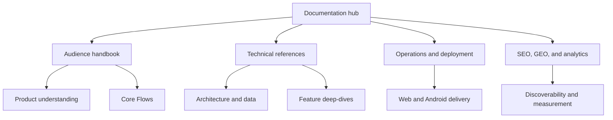

# LoadSaathi Documentation

Welcome to the LoadSaathi documentation. This directory contains everything you
need to understand the platform — from product intent and Core Flows to system
architecture, deployment, and future improvements.

## Choose your reading path

The [Repository Handbook](../REPO_HANDBOOK.md) is the shortest orientation. The
[Handbook Index](handbook/00-index.md) then routes each reader to the right depth.

For a complete visual catalog, see the [Diagram Directory](DIAGRAMS.md).

| Reader | Start with | Best for |
| --- | --- | --- |
| Non-technical reader | [Product overview](handbook/01-overview-non-technical.md) | Understanding the problem, users, and value |
| Developer | [Architecture and stack](handbook/02-architecture-and-stack.md) | Understanding folders, services, and boundaries |
| Product or engineering team | [Core Flows](handbook/03-core-flows.md) | Reviewing the preserved behavioral reference |
| Visual/product reader | [Screens and visuals](handbook/04-screens-and-visuals.md) | Exploring screenshots and brand assets |
| AI coding agent | [AI restructure brief](handbook/07-ai-restructure-brief.md) | Making safe, scoped repository improvements |
| Operations or handover | [Handover checklist](handbook/08-handover-checklist.md) | Running, deploying, and troubleshooting |

> The handbook is a navigation layer over the detailed technical references below. It does not replace the existing architecture, data-model, realtime, deployment, or SEO documents.

---

## Documentation map

## Project Overview

> LoadSaathi is India's AI-powered shared freight marketplace connecting
> shippers and truckers for PTL (Partial Truckload) and LTL (Less Than
> Truckload) loads across East India. AI matching, real-time GPS tracking,
> digital credit scores, and escrow-backed payments eliminate empty return
> trips and reduce freight costs by up to 40%.

For the quickest introduction, read the [README](../README.md).

## Documentation Index

### Core Reference

| Document                                          | Description                                       |
| ------------------------------------------------- | ------------------------------------------------- |
| [Architecture](architecture.md)                   | System architecture, tech stack, and system flows |
| [Getting Started](getting-started.md)             | Full local development setup guide                |
| [Data Models](data-models.md)                     | Complete database schema reference                |
| [Environment Variables](environment-variables.md) | All configuration variables                       |
| [Coding Conventions](conventions.md)              | Standards, style, and the CI quality gate         |

### Feature Deep-Dives

| Document                            | Description                              |
| ----------------------------------- | ---------------------------------------- |
| [Authentication](authentication.md) | Clerk ↔ Supabase auth flow               |
| [Matching Algorithm](matching.md)   | AI smart-matching scoring engine         |
| [Realtime](realtime.md)             | Supabase Realtime subscriptions          |
| [Edge Functions](edge-functions.md) | Supabase Edge Functions (Deno) reference |

### Operations

| Document                                | Description                               |
| --------------------------------------- | ----------------------------------------- |
| [Deployment](deployment.md)             | Vercel web + Capacitor Android deployment |
| [Mobile (Android)](mobile-android.md)   | Android build and release guide           |
| [SEO / GEO](seo/README.md)              | Search & AI-engine optimization strategy  |
| [Analytics](analytics/posthog-setup.md) | Analytics instrumentation report          |

### Planning & Strategy

| Document                                                      | Description                               |
| ------------------------------------------------------------- | ----------------------------------------- |
| [Product Roadmap](roadmap.md)                                 | Current status + phased product direction |
| [SEO/GEO Implementation Plan](seo/geo-implementation-plan.md) | Phased SEO roadmap                        |
| [Backlinks Strategy](seo/backlinks.md)                        | Backlink acquisition plan                 |

## Repository Maps

- [`CONTEXT.md`](../CONTEXT.md) — The definitive codebase context file (file
  tree, system flows, data models, coding standards, troubleshooting).
- [`AI_RULES.md`](../AI_RULES.md) — Coding agent rules and tech-stack
  conventions.

## Quick Navigation

- **Source code:** `src/` — pages, components, hooks, utils
- **Database & functions:** `supabase/` — migrations + Edge Functions
- **Android app:** `android/` — Capacitor project
- **Static assets:** `public/` — served as-is
