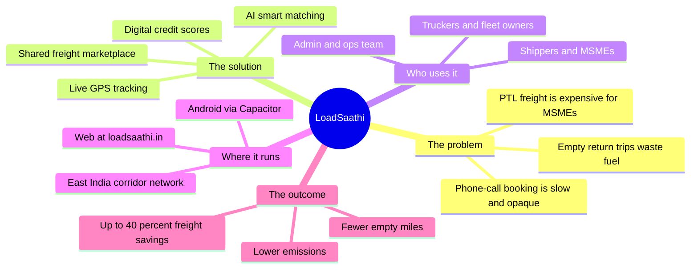
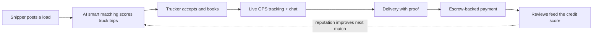
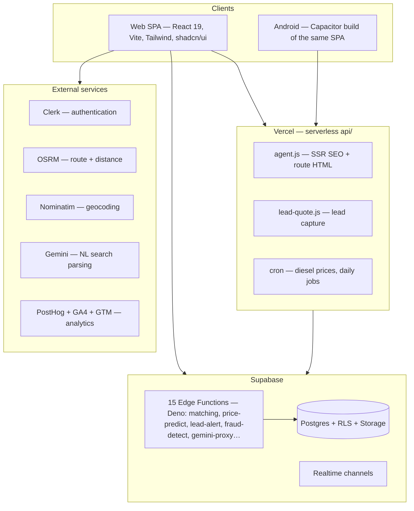
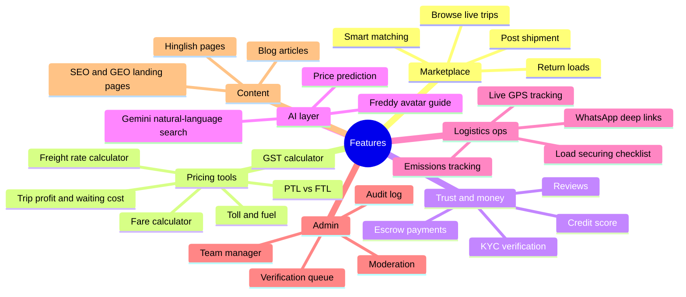
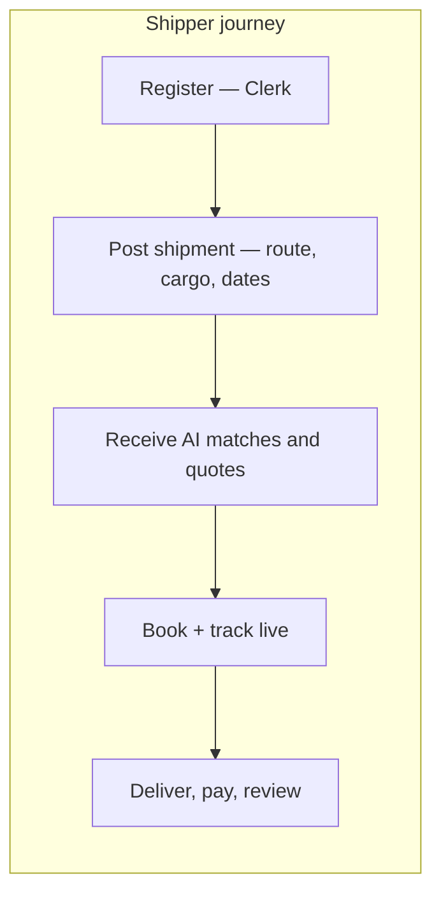
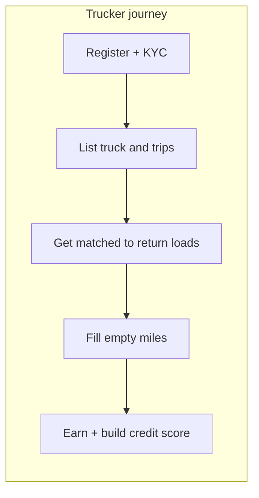
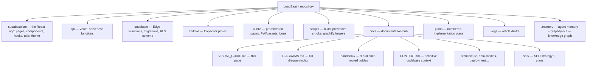
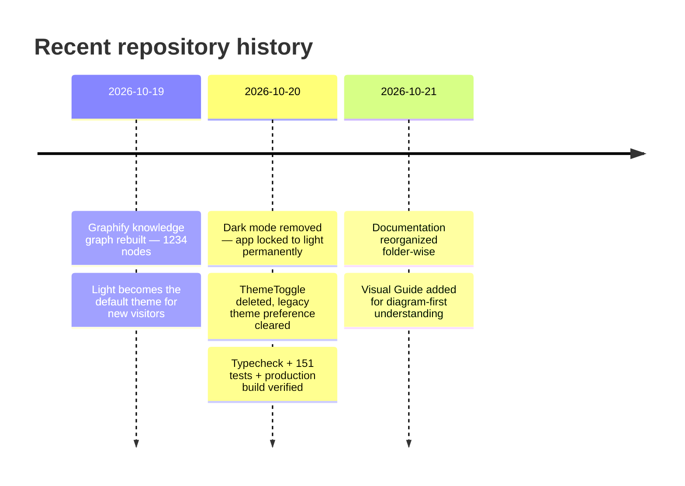

# LoadSaathi Visual Guide

**Understand the whole app in diagrams — without reading everything.**
Every diagram below renders natively on GitHub. For deeper per-topic diagrams, see the [Diagram Directory](DIAGRAMS.md).

---

## 1. What is LoadSaathi?

> **One sentence:** LoadSaathi is India's AI-powered shared freight marketplace connecting shippers and truckers for PTL/LTL loads across East India — AI matching, real-time GPS tracking, and digital credit scores eliminate empty return trips and cut freight costs by up to 40%.

---

## 2. How a load moves (the core marketplace loop)

---

## 3. System architecture at a glance

---

## 4. Feature map

---

## 5. Two user journeys

---

## 6. Where everything lives (repository map)

**Root stays minimal by design:** only `README.md`, `CHANGELOG.md`, `SECURITY.md`, `CODE_OF_CONDUCT.md`, `CONTRIBUTING.md`, `AI_RULES.md` and config files.

---

## 7. Recent change history

---

## 8. What to read next

| If you want to… | Read | Depth |
| --- | --- | --- |
| See every diagram in one place | [DIAGRAMS.md](DIAGRAMS.md) | Index |
| Understand the product non-technically | [handbook/01-overview-non-technical.md](handbook/01-overview-non-technical.md) | Short |
| Learn the flows in detail | [handbook/03-core-flows.md](handbook/03-core-flows.md) | Deep — 11 diagrams |
| Understand the code structure | [CONTEXT.md](CONTEXT.md) | Deep |
| Work on the architecture | [architecture.md](architecture.md) | Deep |
| Run the project locally | [getting-started.md](getting-started.md) | Practical |
| Deploy it | [deployment.md](deployment.md) | Practical |
| Contribute code | [../CONTRIBUTING.md](../CONTRIBUTING.md) | Short |
