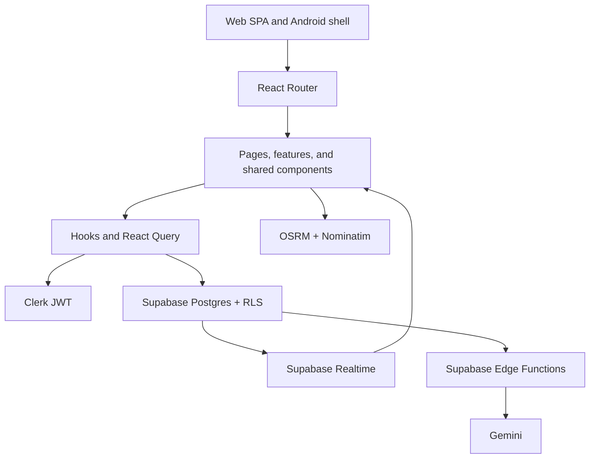

# LoadSaathi System Architecture

## Architecture at a glance



This document describes the system architecture of LoadSaathi, including the
tech stack, system flows, and how the pieces fit together.

## Overview

LoadSaathi is a modern single-page application (SPA) built with React 19 and
TypeScript, powered by a serverless backend (Supabase + Clerk) and deployed on
Vercel. A Capacitor wrapper packages the same web build as an Android app.

```
┌──────────────────────────────────────────────────────────────────┐
│                          Clients                                   │
│   ┌──────────────────────────┐        ┌────────────────────────┐   │
│   │  Web SPA (Vercel)        │        │  Android App (Capacitor)│  │
│   │  React 19 + TS + Vite    │        │  Same web build         │  │
│   └────────────┬─────────────┘        └────────────┬───────────┘   │
└────────────────┼────────────────────────────────────┼──────────────┘
                 │                    HTTPS + CSP headers
                 ▼
┌──────────────────────────────────────────────────────────────────┐
│                          Services                                 │
│  ┌────────────┐   ┌──────────────┐   ┌─────────────────────────┐  │
│  │   Clerk    │   │   Supabase   │   │    OSRM Router           │  │
│  │ Auth + JWT │──▶│ Postgres+RLS │   │  (routing engine)        │  │
│  │            │   │ Realtime     │   └────────────┬────────────┘  │
│  │            │   │ Edge Fns     │                │               │
│  └────────────┘   └──────────────┘                │               │
│                          │                         │               │
│                    ┌─────▼──────┐          ┌──────▼──────┐         │
│                    │  Nominatim │          │   Gemini    │         │
│                    │  Geocoding │          │   AI (proxy)│         │
│                    └────────────┘          └─────────────┘         │
└──────────────────────────────────────────────────────────────────┘
```

## Tech Stack

| Layer      | Technology                      | Purpose                               |
| ---------- | ------------------------------- | ------------------------------------- |
| Framework  | React 19.2 + TypeScript 5.5     | SPA with strict typing                |
| Build Tool | Vite 6.3                        | Dev server + production build         |
| UI Library | shadcn/ui + Radix UI            | Accessible component primitives       |
| Styling    | Tailwind CSS 3.4                | Utility-first CSS                     |
| State/Data | TanStack React Query 5.56       | Server state caching + mutations      |
| Auth       | Clerk 5.61                      | Authentication + user management      |
| Database   | Supabase 2.99 (PostgreSQL)      | Database + Realtime subscriptions     |
| Maps       | Leaflet + React-Leaflet         | Map rendering + GPS tracking          |
| Charts     | Recharts 3.9                    | Dashboard visualizations              |
| Forms      | React Hook Form + Zod           | Form state + validation               |
| Animation  | Framer Motion 12.43             | Page transitions + micro-interactions |
| Analytics  | PostHog + Vercel Analytics + GA | Event tracking + web vitals           |
| Mobile     | Capacitor 8.4                   | Android hybrid app wrapper            |
| Hosting    | Vercel                          | Static hosting + edge functions       |
| Routing    | React Router DOM 7.6            | Client-side routing                   |
| SEO        | React Helmet Async 3.0          | Dynamic meta tags + JSON-LD           |

### Key Services

- **Clerk** — sign-up/sign-in, JWT issuance, user profile management
- **Supabase** — PostgreSQL with Row Level Security (RLS), Realtime
  subscriptions, Edge Functions
- **OSRM** — Open Source Routing Machine for truck route calculation
- **Nominatim** — OpenStreetMap geocoding for city/state lookups
- **Gemini** — Google AI for natural-language freight search parsing + pricing
- **PostHog** — product analytics and session recording
- **Vercel** — hosting, deployment, and serverless functions

## Directory Structure

```
src/
├── App.tsx                    # Root component: ALL route definitions + providers
├── main.tsx                   # Entry point (React root)
├── globals.css                # Tailwind directives + CSS custom properties
├── features/                  # Feature-scoped modules
│   ├── home/sections/         #   Landing page sections (Hero, BentoGrid, FAQ…)
│   ├── marketing/screens/     #   Public app previews (Dashboard, Matching…)
│   └── shipper/components/    #   Shipper-dashboard widgets (LiveTruckMap…)
├── pages/                     # Route components (lazy-loaded via React.lazy)
│   ├── Index.tsx              # Homepage
│   ├── Login.tsx / Register.tsx / ChooseRole.tsx / ForgotPassword.tsx
│   ├── Profile.tsx / TripDetail.tsx / Favorites.tsx / CreditScore.tsx
│   ├── Chat.tsx / ChatList.tsx / NotFound.tsx
│   ├── public/                # Marketing pages (PublicLayout wrapper)
│   ├── trucker/               # Trucker role pages
│   ├── shipper/               # Shipper role pages
│   ├── admin/                 # Admin-only pages (role-protected)
│   └── blog/                  # Blog system
├── components/                # Shared reusable components
│   ├── Layout.tsx             # Authenticated app layout (sidebar + nav)
│   ├── PublicLayout.tsx       # Marketing pages layout
│   ├── GpsTracker.tsx / LiveMap.tsx / RouteMap.tsx
│   ├── PricePredictor.tsx / AIInsights.tsx
│   ├── CreditScore*.tsx       # Credit score components
│   ├── RoleProtectedRoute.tsx # Role-based route guard
│   ├── maps/                  # Leaflet map widgets
│   └── ui/                    # shadcn/ui components (40+ files)
├── hooks/                     # Custom React hooks (useSupabase, useCreditScore…)
├── contexts/                  # AuthContext, ThemeContext
├── integrations/supabase/     # Client + SQL schema + RLS scripts
├── config/env.ts              # Zod-validated environment variables
├── data/                      # Static data (routes, blog, locations)
├── lib/                       # cn(), logger, gemini
├── types/                     # Core data models
├── utils/                     # matching, osrm, geocode, format, emissions…
└── test/                      # Test files

supabase/
├── functions/                 # Edge Functions (Deno)
└── migrations/                # SQL migrations (date-stamped)

android/                       # Capacitor Android project
public/                        # Static assets (served as-is)
docs/                          # Documentation
scripts/                       # Utility scripts
```

## System Flows

### Flow 1: Authentication (Clerk → Supabase)

```
User → Clerk Sign-in/Sign-up
  → Clerk issues JWT
  → AuthContext.fetchProfile() called
  → createClerkSupabaseClient(token) creates authenticated Supabase client
  → Queries Supabase users table with Clerk user ID
  → Returns userProfile → available via useAuth() hook
```

### Flow 2: Post Trip (Trucker)

```
TruckerDashboard → PostTrip form
  → Geocode origin/dest cities → get lat/lng coordinates
  → OSRM getRoute() → calculate distance, duration, tolls
  → User fills: vehicle type, capacity, price, departure date
  → Supabase INSERT INTO trips → Realtime event
  → Shippers subscribed to trips table get notified
```

### Flow 3: Post Shipment (Shipper)

```
ShipperDashboard → PostShipments form
  → Geocode origin/dest cities → get lat/lng coordinates
  → OSRM getRoute() → calculate distance, duration
  → User fills: weight, budget, goods description, special requirements
  → Supabase INSERT INTO shipments → Realtime event
  → Truckers subscribed to shipments table get notified
```

### Flow 4: Smart Matching (AI Algorithm)

```
useSmartMatch hook → fetch active trips/shipments from Supabase
  → calculateMatchScore() for each potential pair:
    1. City match (+20 if same city)
    2. Proximity score (+15 for <20km from route)
    3. Route overlap (+20 if within 10km of origin/dest)
    4. Capacity fit (+10 if cargo ≤ truck capacity)
    5. Price alignment (+10 if within 20% of budget)
    6. Date match (+10 if departure within 3 days)
    7. Rating bonus (+15 for truckers with 4.5+ rating)
  → Sorted results with match % displayed to user
```

### Flow 5: Request & Accept

```
Shipper clicks "Request" on trip
  → INSERT INTO requests (trip_id, shipper_id, status='pending')
  → Trucker receives notification → reviews request
  → Trucker accepts → UPDATE requests.status = 'accepted'
  → UPDATE shipments.status = 'matched'
  → Chat enabled between shipper and trucker
```

### Flow 6: Real-time Chat

```
Chat component → Supabase Realtime subscription on messages table
  → User types message → INSERT INTO messages
  → Realtime event → recipient's UI updates instantly
  → Messages stored with request_id, sender_id, recipient_id, content, is_read
```

### Flow 7: GPS Tracking

```
AutoGpsTracker → navigator.geolocation.watchPosition() every 30 seconds
  → Supabase UPDATE trips SET origin_lat = lat, origin_lng = lng
  → LiveMap re-renders marker position
  → Geofence alerts via notifications table (when within 50km of destination)
```

### Flow 8: Credit Score Calculation

```
useCreditScore hook → Supabase RPC function (calculate_credit_score)
  → Factors:
    - Completion rate (30%)
    - On-time delivery (25%)
    - Communication quality (15%)
    - Review ratings (20%)
    - Account tenure (10%)
  → Returns score (300-900) + individual factor scores
```

### Flow 9: AI Price Prediction

```
usePricePrediction hook → Supabase edge function (gemini-proxy)
  → Sends: origin, destination, weight, goods type, date
  → Gemini API analyzes route + market demand
  → Returns: min price, max price, recommended price, confidence level
```

## State Management

```
NO Redux, NO Zustand, NO Jotai.

1. Global Auth State:
   - React Context (AuthContext) → useAuth() hook
   - Contains: Clerk user object + Supabase userProfile
   - AuthSync component keeps Clerk ↔ Supabase in sync

2. Server State:
   - TanStack React Query (useQuery/useMutation)
   - All database operations go through React Query
   - Automatic caching, retry, refetch on focus

3. Theme State:
   - React Context (ThemeProvider) → useTheme() hook
   - Persists to localStorage ('loadsaathi-theme')
   - Respects system preference on first visit

4. Component State:
   - useState/useReducer for local UI state
   - Form state via React Hook Form (useForm)
```

## Routing

- All routes defined in `src/App.tsx`
- Public routes wrapped in `<PublicLayout>`
- Protected routes wrapped in `<Layout>` + role checks
- Lazy-loaded via `React.lazy()` + `Suspense`

## Security

- **RLS:** All tables have Row Level Security enabled (see
  `src/integrations/supabase/final-schema.sql`)
- **Auth:** Clerk JWTs exchanged for Supabase tokens; RLS validates Clerk
  user ID in the JWT
- **Headers:** Strict CSP, HSTS, X-Frame-Options DENY (see `vercel.json`)
- **Secrets:** `.env` files never committed; only publishable keys in client

See [SECURITY.md](../SECURITY.md) for full details.
