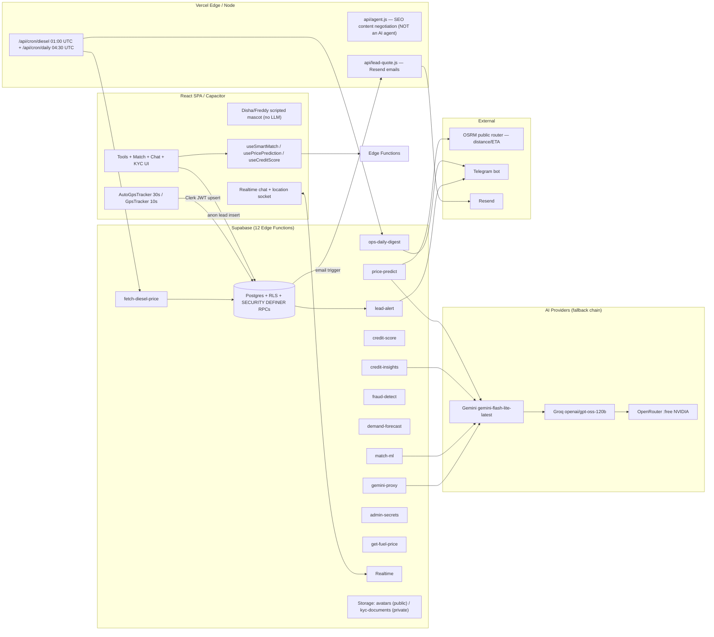

# LoadSaathi Audit Report — Read-Only Codebase Verification

> **Purpose:** Establish the exact, evidence-based current state of the LoadSaathi codebase for an **AI agent hackathon**, suitable for handoff to another AI assistant.
>
> | | |
> |---|---|
> | **Audit date** | Tue Oct 20, 2026 |
> | **Branch** | `seo-geo-aeo-aao-fixes` |
> | **Method** | Read-only. No edits, migrations, installs, production DB access, or paid API calls. Safe non-mutating checks only. |
> | **Checks executed** | `pnpm vitest run` → **151/151 passed** (8 files, ~31s) · `pnpm typecheck` → **passed** |
> | **Secrets policy** | Environment variables are reported **by name only** — values redacted throughout. |
> | **Evidence rule** | Every claim is grounded in source files read during the audit; marketing copy (escrow/UPI/POD) is verified against code and labeled accordingly. |

## Status Legend

- ✅ **VERIFIED IMPLEMENTED** — code read end-to-end and wiring confirmed.
- 🔶 **IMPLEMENTED BUT UNVERIFIED (runtime)** — implementation read, but no live traffic/runtime observation.
- ⚠️ **PARTIALLY IMPLEMENTED** — exists but incomplete, broken, or disconnected.
- ❌ **NOT IMPLEMENTED** — appears only in marketing/docs, or absent entirely.
- ❓ **UNKNOWN** — not determinable without production access.

---

## Table of Contents

1. [Scope, Method & Constraint Compliance](#1-scope-method--constraint-compliance)
2. [Repository Identity & Stack](#2-repository-identity--stack)
3. [Working-Tree State](#3-working-tree-state)
4. [Verified System Architecture](#4-verified-system-architecture)
5. [Back-end Inventory — 12 Supabase Edge Functions](#5-back-end-inventory--12-supabase-edge-functions)
6. [Frontend Feature Inventory](#6-frontend-feature-inventory)
7. [Agent-Capability Checklist](#7-agent-capability-checklist-the-core-hackathon-question)
8. [Security Assessment](#8-security-assessment)
9. [Data-Integrity Findings](#9-data-integrity-findings)
10. [Dead Code & Wiring Gaps](#10-dead-code--wiring-gaps)
11. [External / Free-Tier Facts (Web-Verified)](#11-external--free-tier-facts-web-verified-oct-20-2026)
12. [Recommendations — 3 Candidate Builds](#12-recommendations--3-candidate-builds-for-the-hackathon)
13. [Handoff Summary](#13-handoff-summary-self-contained-for-the-next-ai-assistant)

---

## 1. Scope, Method & Constraint Compliance

- **Mission:** establish the exact current state of LoadSaathi (Bharat-first freight-sharing marketplace) for an AI-agent hackathon, evidence-first.
- **Branch audited:** `seo-geo-aeo-aao-fixes` (uncommitted work present — see §3).
- **Read-only discipline:** no edits, no migrations, no installs, no production DB access, no paid API calls. Only safe non-mutating checks were run: `pnpm vitest run` (151/151 passed, 8 files, ~31s) and `pnpm typecheck` (passed).
- **Method:** every claim below is grounded in specific files/lines read during this audit; marketing claims were checked against code and marked as such. Free-tier quotas are web-verified against official docs where possible (§11).
- **Secrets policy:** env vars are reported **by name + configured/not**; values are redacted. The exact live production quota tier for the project's keys is not determinable from code.

---

## 2. Repository Identity & Stack

| Item | Value | Evidence |
|---|---|---|
| Branch / package manager | `seo-geo-aeo-aao-fixes`, pnpm 9.12.3 (`packageManager`), Node ≥22 | `package.json` |
| Frontend | Vite 6, React 19, TypeScript, Tailwind 3, `react-router` | `package.json`, `supabase/src/routes.tsx` |
| Auth | Clerk (`@clerk/clerk-react` 5.61.10) + JWT template `'supabase'` → Supabase RLS keyed on `auth.jwt()->>'sub'` | `supabase/src/contexts/AuthContext.tsx:53-77`, migrations |
| Back-end | Supabase (Postgres + RLS + Realtime + Storage + Edge Functions), ~55 migrations | `supabase/migrations/` |
| AI/LLM | Gemini API → Groq → OpenRouter fallback chain; keys server-side only | all edge functions |
| Email / notifications | Resend (`api/lead-quote.js`), Telegram (`lead-alert`, `api/cron/daily.js`) | code |
| Hosting / CI | Vercel (`vercel.json` crons), GitHub Actions CI (lint / typecheck / test / build) | `vercel.json`, `.github/workflows/ci.yml` |
| Build pipeline | prebuild = validate-env + generate-blog-meta + generate-sitemap + generate-llms-routes; build = `vite build` + prerender (~179 routes) + smoke | `package.json`, `.github/workflows/ci.yml:17-19` |
| Mobile | Capacitor Android project present | `package.json` |

### Environment variables (names only, values redacted)

| Location | Variables | Status |
|---|---|---|
| `.env` / `.env.example` | `VITE_CLERK_PUBLISHABLE_KEY`, `VITE_SUPABASE_URL`, `VITE_SUPABASE_ANON_KEY`, `VITE_ADMIN_USER_ID`, `VITE_OWNER_WHATSAPP`, `VITE_POSTHOG_*` | configured |
| `.env.local` | `VERCEL_OIDC_TOKEN` | configured |
| Server-side (Supabase / Vercel env, **not inspectable from repo**) | `GEMINI_API_KEY`, `GROQ_API_KEY`, `OPENROUTER_API_KEY` (manageable via `admin-secrets`), `SUPABASE_SERVICE_ROLE_KEY`, `SUPABASE_ACCESS_TOKEN`, `CRON_SECRET`, `TELEGRAM_BOT_TOKEN`, `TELEGRAM_CHAT_ID`, `RESEND_API_KEY`, `LIVE_PRICE_API_URL`, `FUEL_PRICE_STATE` | configured/not → ❓ UNKNOWN per-server |

---

## 3. Working-Tree State

**8 modified files (~+303 / −40):**

- `api/cron/daily.js`
- `supabase/config.toml`
- `supabase/src/components/LoadCardStack.tsx`
- `supabase/src/components/ui/sheet.tsx`
- `supabase/src/globals.css`
- `supabase/src/lib/leadCapture.ts`
- `supabase/src/pages/messaging/Chat.tsx`
- `supabase/src/components/FareCalculator.tsx`

(Upper-five are UI polish + "fare result materialize" / echo-and-generative-field work tracked in `plans/`.)

**Untracked:**

- `build_log.txt`
- `plans/`
- `supabase/functions/lead-alert/` — new, complete, verified (§5)

No secrets were observed inside any untracked file during inspection.

---

## 4. Verified System Architecture

**Key structural fact:** all AI calls are **single-shot request/response functions**. There is no tool registry, no model-driven function-calling loop, no task state, and no session memory anywhere in the repo.

---

## 5. Back-end Inventory — 12 Supabase Edge Functions

| Function | What it actually is | AI? | Auth / Limits | Verdict |
|---|---|---|---|---|
| `gemini-proxy` | NL→structured search-language LLM call; **invents fake "results"** (not DB data) | ✅ LLM | JWT + 5/min/IP | ⚠️ PARTIAL (caller dead code, §10) |
| `match-ml` | LLM scoring of load–truck matches + deterministic `localFallback` | ✅ LLM + heuristic | JWT + 20/min | ✅ VERIFIED IMPLEMENTED |
| `price-predict` | richest pipeline: DB history RPCs (`get_route_history`, `get_corridor_average`) + OSRM distance + fuel surcharge + corridor/seasonal/return multipliers + feature flags (`pricing_flags`) + 70% history / 30% AI blend + `data`/`config` local fallbacks; service-role server-side | ✅ blended | JWT optional + 10/min | ✅ VERIFIED IMPLEMENTED |
| `credit-score` | deterministic DB RPC `calculate_credit_score` (0–900 tier engine); own-user check enforced | ❌ not AI | JWT | ✅ VERIFIED IMPLEMENTED |
| `credit-insights` | LLM narrative over the credit profile (summary / strengths / improvements / tips); Gemini→Groq→OpenRouter chain + `data` tier fallback; accepts any `userId/userName` from body | ✅ LLM | JWT + 5/min | ✅ VERIFIED (note §8) |
| `fraud-detect` | 4 rule-based heuristics via service role; `body.userId \|\| authUser.userId` allows running on arbitrary users | ❌ not AI | JWT | ⚠️ VERIFIED with IDOR-shaped surface (§8) |
| `demand-forecast` | day-of-week statistics averaging | ❌ not AI | JWT or `allowPublic` | ✅ VERIFIED IMPLEMENTED |
| `lead-alert` | Telegram notify on new lead; freshness + flood + rate-limit anti-abuse; `verify_jwt = false` | ❌ | none (by design) | ✅ VERIFIED (new; works with `public.leads` anon INSERT) |
| `ops-daily-digest` | 24-hour snapshot JSON (leads / trips / shipments / diesel) | ❌ | anon OK (data only) | ✅ VERIFIED IMPLEMENTED |
| `admin-secrets` | Supabase Management API proxy to set/unset `GEMINI_API_KEY` / `GROQ_API_KEY` / `OPENROUTER_API_KEY` for `match-ml` + `gemini-proxy`; admin check via `users.user_type='admin'` (service role); needs `SUPABASE_ACCESS_TOKEN` | ❌ | JWT + admin + 10/min | ✅ VERIFIED IMPLEMENTED |
| `fetch-diesel-price` | cron upsert of exactly one row per (state, fuel_type) into `fuel_prices`; uses `LIVE_PRICE_API_URL` if set, else **last-known price unchanged** — the old compounding +0.5% uplift bug is explicitly removed and guarded by comments | ❌ | anon (cron) | ✅ VERIFIED |
| `get-fuel-price` | public read of latest fuel price (service role server-side) | ❌ | none | ✅ VERIFIED |

**Shared helpers** (`supabase/functions/_shared/`): `edgeHelpers.ts` — CORS allowlist, in-memory per-instance rate limiting, JWT verification via Supabase `/auth/v1/user`, request IDs; `osrm.ts` — OSRM public router wrapper; `fuel.ts` — fuel math.

### Vercel side

- **`api/agent.js`** (5,946 lines): a **SEO / content-negotiation edge function** (HTML↔Markdown for crawlers/LLMs + rewrites) — **not an AI agent**. Confirmed by `agentic-readiness.test.ts` / `site.js`.
- **`api/cron/diesel.js`** (01:00 UTC): triggers `fetch-diesel-price` with optional `CRON_SECRET` bearer auth.
- **`api/cron/daily.js`** (04:30 UTC): pulls `ops-daily-digest`, pings `https://loadsaathi.in/sitemap.xml` as an SEO liveness check, posts a **masked-PII** Telegram digest (phone keeps last 4; email local-part keeps first 2 — verified `daily.js:26-34`); graceful `telegram: 'not_configured'` path that never kills the sitemap ping.
- **`api/lead-quote.js`**: Resend email sender, fired by the DB email trigger on new leads; `CRON_SECRET` bearer required, input clipping.

> **Stale-comment note:** `api/cron/diesel.js:4` still says "fallback: last-known price + 0.5%" — outdated; the edge function explicitly forbids the uplift. Comment should be updated; behavior is correct.

---

## 6. Frontend Feature Inventory

| Feature | Verdict | Evidence |
|---|---|---|
| Full marketplace (trips + shipments, request/accept, trip lifecycle `active → in_transit → delivered → completed`) | ✅ VERIFIED IMPLEMENTED | `supabase/src/routes.tsx`, `20260903_add_trip_lifecycle_rpcs.sql`, `20260902_insert_trip_rpc.sql`, `20260902_insert_shipment_rpc.sql` |
| Realtime chat — two conversation shapes (`requests` / `shipment_requests`), XLS sanitizer, read receipts via UPDATE events, Clerk-authorized realtime socket | ✅ VERIFIED IMPLEMENTED | `supabase/src/utils/chat.ts` (full read) |
| GPS tracking — auto 30s writes, **only while an active/`in_transit` trip exists** (no parked-truck leaking; `is_sharing:false` on unmount, trip context refreshed every 60s); manual UI tracker (10s throttle) | ✅ VERIFIED IMPLEMENTED | `supabase/src/components/AutoGpsTracker.tsx`, `GpsTracker.tsx` |
| Live truck map + participant-scoped location reads (driver own / admin / matched shipper) + lat/lng bounds constraints | ✅ VERIFIED IMPLEMENTED | `20261015190952_harden_live_location_participant_rls.sql`, `useLiveDriverLocations.ts` |
| AI-assisted pricing / matching / credit score & insights in UI | ✅ VERIFIED (wiring; runtime 🔶) | `useSmartMatch.ts`, `usePricePrediction.ts` (React Query, 800ms debounce, 8s timeout), `useCreditScore.ts` |
| KYC verification — 7 doc types (**no Aadhaar, by design**), private bucket + signed URLs, admin review queue, profile status fields, self-verification blocked by trigger | ✅ VERIFIED IMPLEMENTED | `20261019_kyc_verification.sql`, `pages/trucker/TruckerVerification.tsx`, `pages/admin/VerificationQueue.tsx` |
| Role guard — users may hold only `shipper`/`trucker`; admin grant/leave requires existing admin or service role (trigger, SECURITY DEFINER, `search_path` pinned) | ✅ VERIFIED IMPLEMENTED | `20261018090000_role_guard_onboarding_safe.sql`, `AuthContext`, `RoleProtectedRoute` |
| Lead capture → Telegram alert + automated email quote | ✅ VERIFIED IMPLEMENTED | `lib/leadCapture.ts`, `20261019140001_lead_quote_email_trigger.sql`, `api/lead-quote.js` |
| 20+ public calculator tools, SEO surfaces (llms.txt, sitemap, FAQ schema, agentic-readiness tests) | ✅ VERIFIED IMPLEMENTED | `routes.tsx`, `supabase/src/test/` |
| Onboarding / role selection (`/choose-role`, `OnboardingFlow`) with profile-state guards | ✅ VERIFIED IMPLEMENTED | `pages/auth/ChooseRole.tsx`, `pages/auth/OnboardingFlow.tsx`, `AuthContext.tsx:97-99` |
| NL marketplace search ("find loads with AI") | ⚠️ PARTIALLY IMPLEMENTED — proxy exists but client caller is dead code and omits Bearer (§10) | `supabase/src/lib/gemini.ts` |
| Predictive ETA in admin command center | ⚠️ BROKEN PARTIAL — malformed single-point OSRM request; error fallback **fabricates "4h / on time"** | `pages/admin/command-center/PredictiveETA.tsx:87,131-142` |
| Payments / escrow / UPI / OTP / POD | ❌ NOT IMPLEMENTED — marketing copy only; no gateway in `package.json`; `shipment_requests` flow never moves money | checked throughout (blog, FAQ, `agent.js` SEO data) |
| Tool-using agent / function-calling loop / agent memory | ❌ NOT IMPLEMENTED | §7 |

**No seed/demo/mock data** Исследование of `src` found no fabricated datasets (only innocuous matches: OSRM note in `PredictiveETA.tsx`, "Sales & Demos" contact lines in `Contact.tsx`).

---

## 7. Agent-Capability Checklist (the core hackathon question)

| Capability | Present? | Evidence / Notes |
|---|---|---|
| LLM request/response with provider fallback | ✅ | gemini-proxy / match-ml / credit-insights |
| Structured output (JSON) enforcement | ✅ partial | `response_format: json_object` (Groq), prompt-enforced JSON (Gemini/OpenRouter); OpenRouter NVIDIA `:free` models support `structured_outputs` + `tools` (§11) |
| Tool registry (named callable functions exposed to the model) | ❌ none anywhere in repo | — |
| Function-calling loop (model decides tools → executor runs → results fed back) | ❌ | — |
| Execution engine for side-effecting actions | ❌ | — |
| Task state / conversation memory | ❌ stateless per-call only | — |
| Streaming UI | ❌ chat is DB-backed; Disha is scripted | `Disha.tsx`, `FreddyAvatar.tsx` |
| Deterministic local fallbacks | ✅ consistent pattern, worth preserving | all AI functions |

**Conclusion:** today's product is a set of high-quality, type-safe, **single-shot AI endpoints behind a real marketplace** — plus an SEO layer misnamed "agent". The agent complement to build is described in §12.

---

## 8. Security Assessment

### Strong (verified)

- All AI/impactful keys are **server-side** (Deno/Vercel env); client bundle carries only publishable keys.
- JWT verification pattern: edge functions call Supabase `/auth/v1/user` with the Clerk `'supabase'` template JWT; RLS keyed on `auth.jwt()->>'sub'` with Clerk user IDs.
- Admin authority is a single consistent definition: `public.is_admin()` (SECURITY DEFINER, `users.user_type = 'admin'`, `20260823_admin_rls_bypass.sql`) — used in RLS **and** mirrored in edge functions (`admin-secrets`).
- **`20260927_tighten_overly_permissive_rls_policies.sql` (documented in-file as a security fix, applied to live project):**
  1. Six "Service role full access" policies had leaked to `PUBLIC` — any signed-in user could **rewrite live pricing** (`corridor_multipliers`, `pricing_config`, `pricing_flags`, `pricing_surcharge_config`, `route_return_factor`, `seasonal_multipliers`) → "direct revenue manipulation". Fixed → service_role-only.
  2. "System can …" inserts on `credit_scores / notifications / price_history / ml_match_log` allowed any authenticated user to set their own credit score to 900 or poison history → now blocked; mutations flow through SECURITY DEFINER RPCs.
  3. `requests` / `shipment_requests` WITH CHECK repaired → no more participant reassignment (booking takeover).
  4. `team_members` / `users.admin-update` fixes.
- **`20261015190952_harden_live_location_participant_rls.sql`:** driver_locations SELECT now driver-own + admin + matched-shipper-participant only; `load_locations` scoped to active/owner/admin; coordinate bounds CHECK constraints.
- **`20261018090000_role_guard_onboarding_safe.sql`:** trigger `trg_prevent_illegal_user_type_changes` — no ordinary account may set itself to admin on INSERT/UPDATE; non-admin callers may hold only shipper/trucker.
- **KYC (`20261019_kyc_verification.sql`):** private `kyc-documents` bucket (owner/admin only, signed URLs), public-read avatars with folder-scoped writes `[1] = auth.jwt()->>'sub'`, self-verification blocked by trigger, status CHECK constraints, idempotent statements.
- Trip lifecycle RPCs (`start_trip`, `mark_trip_delivered`, `complete_trip`) are SECURITY DEFINER with trucker-or-admin checks and lock-step shipment state.
- `users` profile fetch is own-row only (`AuthContext`); `credit-score` enforces own-user mindset at edge.

### Issues found (specific, ranked)

| # | Issue | File | Severity |
|---|---|---|---|
| 1 | `fraud-detect` accepts `body.userId \|\| authUser.userId` → any authenticated user can trigger fraud analysis **about any user** (service-role query) | `fraud-detect/index.ts` | Priority低 — fix to own-user-or-admin |
| 2 | `gemini-proxy` returns LLM-**invented rows** presented as search results — data-integrity hazard if it ever goes live | `gemini-proxy/index.ts` | Medium |
| 3 | `credit-insights` trusts client-supplied `userId / userName / factors` (no ownership check; arbitrary `userName` text reaches the prompt — low impact: output text goes only to caller) | `credit-insights/index.ts:267-271,37-59` | Low |
| 4 | Rate limiting is **in-memory per instance** → per-region / per-cold-start reset; throttles bursts, not sustained abuse | `_shared/edgeHelpers.ts` | Accepted (document) |
| 5 | Crons are open when `CRON_SECRET` unset (documented founder-manual-runs tradeoff in code) | `api/cron/diesel.js:21-27` | Low |
| 6 | `get-fuel-price` deliberately unauthenticated public read of non-sensitive price data | `get-fuel-price/index.ts` | Acceptable |
| 7 | `PredictiveETA` shows a **fabricated "4h / On Time"** after silent failure | `PredictiveETA.tsx:131-142` | Medium (truthfulness) |

**No secrets were printed anywhere in this audit.** Only env var names appear in the report.

---

## 9. Data-Integrity Findings (critical before any on-stage demo)

Two places the product would show **invented numbers**:

1. **Fake-results proxy** (§8-2): `gemini-proxy` answers NL-search queries with LLM-fictional "loads" instead of DB rows.
2. **Fake-ETA fallback** (§8-7): `PredictiveETA` bug in detail — request URL contains a **single** coordinate and reuses *destination* coords as origin (`PredictiveETA.tsx:86-87`); OSRM requires ≥2 coordinates, so the live path effectively never runs and the silent `catch` produces `hoursRemaining = 4, status = 'on_time'`.

Both must be replaced or explicitly labeled "unavailable" before being shown to a judge.

---

## 10. Dead Code & Wiring Gaps

- **`supabase/src/lib/gemini.ts::parseNaturalLanguageSearch`** — defined but **never imported** by any component, and it **omits the `Authorization` Bearer header**, so even if wired it would 401 against `gemini-proxy` (which requires JWT). NL search is effectively **not shipped** despite the proxy being live.
- **`GpsTracker.tsx`** (manual) writes without an `is_sharing` field, while `AutoGpsTracker` manages it; the participant-visibility condition for the `shipment_requests` path requires `is_sharing = TRUE`. Manual tracking alone may therefore not surface in the command-center view. Minor inconsistency — the auto path (the one actually used by Layout) is correct.
- `build_log.txt` exists untracked; keep it out of the demo bundle.

---

## 11. External / Free-Tier Facts (Web-Verified Oct 20, 2026)

| Provider | Fact used by code | Verdict | Source |
|---|---|---|---|
| **Gemini** | `gemini-flash-lite-latest`, free tier at $0 | Free tier: ✅ verified (official pricing page lists "Free of charge"). Exact per-project quotas **no longer published in docs** — Google points to AI Studio per project. Third-party guides (verified Oct 2026) converge on ≈15 RPM / 1,000 RPD for Flash-Lite, ~250K TPM. | https://ai.google.dev/gemini-api/docs/rate-limits · https://ai.google.dev/gemini-api/docs/pricing |
| **Groq** | `openai/gpt-oss-120b`, JSON mode, ~800-token outputs | ✅ OFFICIAL free plan: **30 RPM · 1,000 RPD · 8K TPM · 200K TPD** per model; supports **tool use + JSON object mode**; 131k context. The **8K TPM is the real constraint** for a tool-calling agent. | https://console.groq.com/docs/rate-limits |
| **OpenRouter** | `nvidia/nemotron-3-super-120b-a12b:free`, `nvidia/nemotron-3.5-lightning:free` | ✅ Both models **exist and are live** (endpoints API: uptime 97–100%, pricing 0/0; tools + `structured_outputs` on Super, `tools` + `tool_choice` on Lightning; context 262k / 1M). `:free` caps: **50 req/day**, or **1,000/day** with ≥$10 lifetime credit. | https://openrouter.ai/docs/faq · https://openrouter.ai/api/v1/models/nvidia/nemotron-3-super-120b-a12b%3Afree |
| **OSRM** | public demo server `router.project-osrm.org` (price-predict via `_shared/osrm.ts`; PredictiveETA client-side) | Demo server rules itself out as a production backend (fair-use); acceptable at hackathon scale | OSRM project usage policy |
| Telegram / Resend / Vercel | bot digests, lead emails, 2 crons | Operating as designed per code | code |

**Dependency implication for an agent build:** a function-calling loop at ~3–5 model turns per session fits **Gemini free tier** comfortably; fits **Groq** (1k/day, 8K TPM) only with small system prompts and prompt caching; OpenRouter `:free` (50/day) is a demo-grade buffer only.

---

## 12. Recommendations — 3 Candidate Builds for the Hackathon

All three reuse the proven primitives already in the repo: provider fallback chain, deterministic local fallbacks, JWT→RLS identity, SECURITY DEFINER RPCs, rate limiting, and the Disha/Freddy mascot shell.

### Build 1 (recommended, highest hackathon value): "Freddy Copilot" — a genuine tool-using agent

Add one edge function **`agent-router`**:
- **Tool registry**, e.g. `{ search_market` (PostgREST-filtered, real DB rows — not LLM-invented), `predict_price` (reuse price-predict internals), `get_route_eta` (proper two-point OSRM), `create_lead`, `start_trip` / `complete_trip` (guided) `}`.
- **LLM loop** (max 5 steps) using OpenAI-style function calling: Gemini function calling → Groq gpt-oss-120b tools → OpenRouter Super `structured_outputs` (existing fallback chain unchanged).
- **Short-lived session-state table** (task state + tool trace).
- **Streaming into the existing Disha chat UI.**

This converts the repo's "one-shot AI" into the agent the brand claims.

### Build 2 (fastest honest AI win): Fix NL search for real

Replace `gemini-proxy`'s LLM-invented results with **NL → PostgREST filter translation**: the model emits JSON filters; the edge function executes them against `trips` / `shipments` and returns **DB rows**. Then wire the currently-dead `parseNaturalLanguageSearch` with the Bearer header — or delete it.

### Build 3 (polish day): Trust-and-truth pass

Fix `PredictiveETA` (two-point OSRM from current lat/lng; no fabricated fallback — show "unavailable"), `fraud-detect` own-user scoping, `credit-insights` ownership check, and remove the stale `+0.5%` comment in `api/cron/diesel.js`. Small diff, high polish-per-day.

### Minimum viable agent (fallback if time is short)

Build 1 cut to **two tools** (`search_market`, `predict_price`) + **one loop** + Disha UI; provider = Gemini function calling only, existing fallback chain untouched. Roughly: 1 edge function + 1 route + 1 hook.

---

## 13. Handoff Summary (self-contained for the next AI assistant)

**Repo:** LoadSaathi — Bharat freight-sharing marketplace at `D:\Users\sanja\dyad-apps\LOAD-SAATHI-APP-1-OSRM`, branch `seo-geo-aeo-aao-fixes`, with 8 modified + 3 untracked uncommitted items (UI polish per `plans/`). Stack: Vite 6 / React 19 / TS / Tailwind 3, Clerk auth + Supabase (Postgres/RLS/Realtime/Storage/Edge), Vercel hosting + GitHub Actions CI, Capacitor Android. **Tests 151/151 pass; typecheck passes.**

**Reality check:** `api/agent.js` is an SEO content-negotiation edge function, **not an AI agent**. The real AI surface is **12 Supabase edge functions**, all single-shot request/response with a consistent Gemini→Groq(gpt-oss-120b)→OpenRouter(`:free` NVIDIA) fallback chain and deterministic local fallbacks. `price-predict` is genuinely sophisticated (DB history via RPCs + OSRM + corridor/seasonal/return multipliers + feature flags + 70/30 history/AI blend). There is **no** tool registry, function-calling loop, execution engine, task state, or agent memory — **that is THE gap for an agent hackathon.**

**Working features (verified):** marketplace trips/shipments with lifecycle RPCs (SECURITY DEFINER), two-way realtime chat with sanitizer + read receipts, privacy-guarded GPS publish (only during active trips; participant-scoped RLS reads), lead pipeline (anon lead insert → Telegram `lead-alert` → DB email trigger → Resend quotes), KYC workflow (7 doc types, no Aadhaar, private bucket, admin review), AI pricing/matching/credit/insights UI via hooks, 20+ public tools, SEO/LLM surfaces, admin-secrets key manager, daily diesel cron + Telegram founder digest, role-guard trigger (no self-escalation to admin), RLS hardening migrations closing known privilege-escalation holes.

**Broken / fake — fix before demo:** (1) `gemini-proxy` returns LLM-invented search results (client caller `parseNaturalLanguageSearch` is dead code and omits the Bearer header → NL search effectively unshipped); (2) `PredictiveETA` issues a malformed one-point OSRM request and falls back to a fabricated "4h, on time"; (3) stale `+0.5%` comment in `api/cron/diesel.js` (behavior is fixed and correct).

**Security posture:** strong server-side keys and consistent admin definition (`is_admin()` / `users.user_type`); known small issues: `fraud-detect` accepts `body.userId` (needs own-user or admin check), `credit-insights` trusts client-supplied metadata, in-memory rate limiting is per-instance, crons open when `CRON_SECRET` unset.

**Payments:** none. Escrow/UPI/POD/OTP appear only in marketing copy — do not build a demo that claims they are integrated.

**Provider quotas (web-verified Oct 2026):** Groq free = gpt-oss-120b 30 RPM / 1,000 RPD / **8K TPM** / 200K TPD (tools + JSON mode; console.groq.com/docs/rate-limits). Gemini free tier exists; exact per-project quotas shown only in AI Studio (ai.google.dev/gemini-api/docs/rate-limits; third-party verified ~15 RPM / 1,000 RPD for Flash-Lite). OpenRouter `:free` = 50 req/day (1,000/day with ≥$10 lifetime credit; openrouter.ai/docs/faq); both referenced NVIDIA `:free` models live with tools + `structured_outputs` (262k / 1M context). OSRM public demo router: hackathon scale only.

**Recommended build:** implement an **`agent-router`** edge function — tool registry exposing real DB queries (`search_market` via PostgREST filters), `predict_price` (reuse price-predict internals), `get_route_eta` (proper OSRM), `create_lead`, trip actions — with a ≤5-step function-calling loop over the existing provider chain, session state in a new table, streaming into the scripted Disha/Freddy chat shell. **Minimum cut:** tools = `{search_market, predict_price}` + loop + Gemini primary. This is the single change that makes the "AI agent" claim true instead of aspirational.

**Unknowns (open questions):**
- ❓ Live per-project Gemini free-tier quotas (check the project's own AI Studio limits page).
- ❓ Actual server-side key configuration in Supabase/Vercel (not inspectable from code).
- ❓ Production DB data quality (untouched by this audit).
- ❓ OSRM demo-server behavior under sustained load at demo time.
- ❓ Runtime behavior of `lead-alert` in production (new, untracked function).

---

*End of audit report. The repository was not modified by this audit beyond safe read-only checks (vitest/typecheck) and this documentation file itself.*
