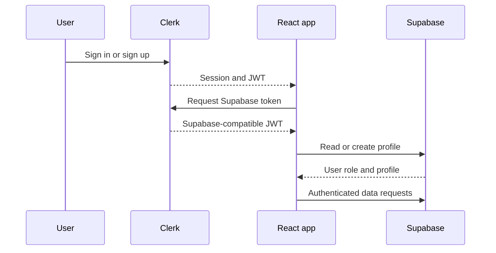

# Authentication

## Authentication handoff



LoadSaathi uses **Clerk** for authentication and **Supabase** for the database.
The two are bridged using Clerk's custom JWT template feature.

## Flow Overview

```
User → Clerk Sign-in/Sign-up
  → Clerk issues JWT (signed with Supabase JWT template)
  → AuthContext.fetchProfile() called
  → createClerkSupabaseClient(token) creates authenticated Supabase client
  → Queries Supabase users table with Clerk user ID
  → Returns userProfile → available via useAuth() hook
```

## How It Works

1. **Clerk manages identity** — sign-up, sign-in, session management, MFA,
   password resets, social login.
2. **Clerk issues a JWT** — configured with a custom JWT template that includes
   the Supabase project ref and the user's ID as the `sub` claim.
3. **Supabase accepts the token** — because it's signed by Clerk's JWT key
   (registered as a JWT secret in Supabase), the Postgres `auth.jwt()` function
   can read the user ID.
4. **RLS policies validate** — every query is filtered by `auth.uid()` matching
   the Clerk user ID stored in the `users` table.

## Key Files

| File | Purpose |
|------|---------|
| `src/utils/supabaseClient.ts` | Creates the Clerk-authenticated Supabase client |
| `src/contexts/AuthContext.tsx` | Global auth state (Clerk user + Supabase profile) |
| `src/components/AuthSync.tsx` | Keeps Clerk ↔ Supabase profiles in sync |
| `src/hooks/useSupabase.ts` | React hook returning the authenticated client |
| `src/integrations/supabase/client.ts` | Anonymous client for Realtime only |
| `src/pages/Login.tsx` / `Register.tsx` | Clerk-hosted sign-in / sign-up |
| `src/pages/ChooseRole.tsx` | Post-registration role selection |

## Using the Authenticated Client

```tsx
// ✅ Correct — always use the hook
const supabase = useSupabase();
const { data } = await supabase.from('trips').select('*');

// ❌ Never create clients directly in components
// const supabase = createClient(...)
```

## AuthSync Component

The `AuthSync` component runs on app mount and:

1. Waits for the Clerk user to be available.
2. Looks up the user in the Supabase `users` table.
3. If the user doesn't exist yet, creates the profile from Clerk data.
4. Updates `user_type` when the user picks a role on `/choose-role`.

## Role-Based Access

| Role | Capabilities |
|------|-------------|
| `shipper` | Post shipments, browse trips, request trips, chat, review |
| `trucker` | Post trips, browse shipments, accept requests, chat, review |
| `admin` | User management, moderation, gallery, team, monitoring |

Role-protected routes use `<RoleProtectedRoute allowedRoles={['trucker']}>`.

Admin status can be granted via the `VITE_ADMIN_USER_ID` environment variable
or the database.

## Security Notes

- Supabase client is configured with `persistSession: false` (Supabase auth is
  not used; Clerk owns sessions).
- Realtime subscriptions **must** use the anonymous client
  (`integrations/supabase/client.ts`), never the authenticated client.
- All RLS policies validate the Clerk user ID from the JWT.

## Setting Up Clerk JWT for Supabase

1. In Clerk Dashboard → **JWT Templates**, create a template (e.g.
   `supabase`) for the `Supabase` provider.
2. Ensure the template claims include `sub` (the user ID) and the Supabase
   project ref.
3. In Supabase Dashboard → **Settings → API → JWT Secret**, register Clerk's
   public signing key (from Clerk Dashboard → **API Keys → JWT Public Key**)
   as an additional JWT secret.
4. In `src/utils/supabaseClient.ts`, the token is obtained via
   `clerk.session.getToken({ template: 'supabase' })`.

See also `supabase/MIGRATION_NOTES.md` and `supabase/migrations/` for the
historical auth migration from Supabase Auth to Clerk.
