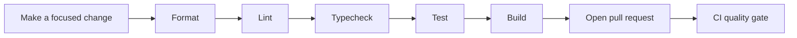

# LoadSaathi Coding Conventions

This document defines the standards every contributor must follow when working
in this repository. It is the enforcement companion to the rules documented in
[`CONTEXT.md`](../CONTEXT.md) and [`AI_RULES.md`](../AI_RULES.md).

---

## Change-quality loop




## 1. Language & Framework

- **TypeScript strict mode** — no `any` types. The `typecheck` script
  (`tsc --noEmit`) must pass before a PR is opened.
- **React 19 functional components only** — no class components, no lifecycle
  methods.
- **Hooks only** — custom hooks live in `src/hooks/`.

## 2. Styling

- **Tailwind CSS exclusively** — no inline styles, no CSS modules, no
  styled-components.
- Use `cn()` from `@/lib/utils` for conditional classes.
- Color tokens are defined in `src/globals.css` CSS custom properties.

## 3. Components

- **shadcn/ui** primitives live in `src/components/ui/` — never edit these files
  directly. Re-generate or copy in new ones from shadcn.
- Use `lucide-react` for all icons.
- **Feature-scoped** components go in `src/features/<feature>/`.
  Shared components go in `src/components/`.
- New components use **PascalCase** filenames (`UserProfile.tsx`).

## 4. Forms

- **React Hook Form** for all forms.
- **Zod** for validation schemas.
- Pattern: `useForm<ZodType>()` with `zodResolver`.

## 5. Data Fetching

- **TanStack React Query** for all server state — never raw `fetch()` for
  Supabase calls.
- Pattern: `useQuery({ queryKey: [...], queryFn: () => supabase.from('t').select() })`.
- Always use the `useSupabase()` hook for authenticated DB operations.
- Never create Supabase clients directly in components — the Clerk JWT is
  attached via `createClerkSupabaseClient()`.

## 6. Realtime

- Use the **anonymous** Supabase client from `src/integrations/supabase/client.ts`.
- Never use the authenticated client for Realtime subscriptions.

## 7. Routing

- All routes are defined in `src/App.tsx`.
- Public routes are wrapped in `<PublicLayout>`; protected routes in `<Layout>`
  with role checks.
- Lazy-load route pages via `React.lazy()` + `Suspense`.

## 8. SEO Requirements

- Every public page **must** use the `<SeoMeta>` component with `title`,
  `description`, and `canonical` props.
- Public pages must include a `<noscript>` fallback block.
- Follow the AEO/GEO content rules in `CONTEXT.md` §7.

## 9. Environment Variables

- All env vars are validated in `src/config/env.ts` via Zod.
- Access via `import { env } from '@/config/env'`.
- Never reference `import.meta.env` directly outside `env.ts`.
- **Never commit real secret values** — only `.env.example` is tracked.

## 10. File Naming

| Kind          | Convention | Example                         |
| ------------- | ---------- | ------------------------------- |
| Components    | PascalCase | `UserProfile.tsx`               |
| Hooks / utils | camelCase  | `useSupabase.ts`, `matching.ts` |
| Config        | kebab-case | `tailwind.config.ts`            |

## 11. Code Style

- Formatting is enforced by **Prettier** (`.prettierrc`): single quotes, no
  semicolons dropped, 100-char print width, LF endings.
- Run `pnpm format` before committing; CI runs `pnpm format:check`.
- Follow the existing import order in neighboring files.

## 12. Imports & Path Aliases

- Use the `@/` alias for absolute imports (`@/components/...`, `@/lib/utils`).
- Prefer `@/features/<feature>/...` for feature-scoped modules.
- No deep relative imports (`../../../`) unless unavoidable.

## 13. Quality Gate

CI runs on every push and PR. All four steps must pass:

```bash
pnpm lint          # ESLint
pnpm typecheck     # tsc --noEmit
pnpm test          # Vitest
pnpm build         # Vite production build
```

Run the whole gate locally with:

```bash
pnpm check
```

---

## Review Checklist

Before opening a PR:

- [ ] `pnpm check` passes locally
- [ ] No `any` types, no unused variables
- [ ] Public pages include `<SeoMeta>` + `<noscript>`
- [ ] Forms use React Hook Form + Zod
- [ ] Supabase calls go through React Query + `useSupabase()`
- [ ] Realtime uses the anonymous client
- [ ] No `.env` secrets or screenshots of private data in the diff
- [ ] `pnpm format` applied
