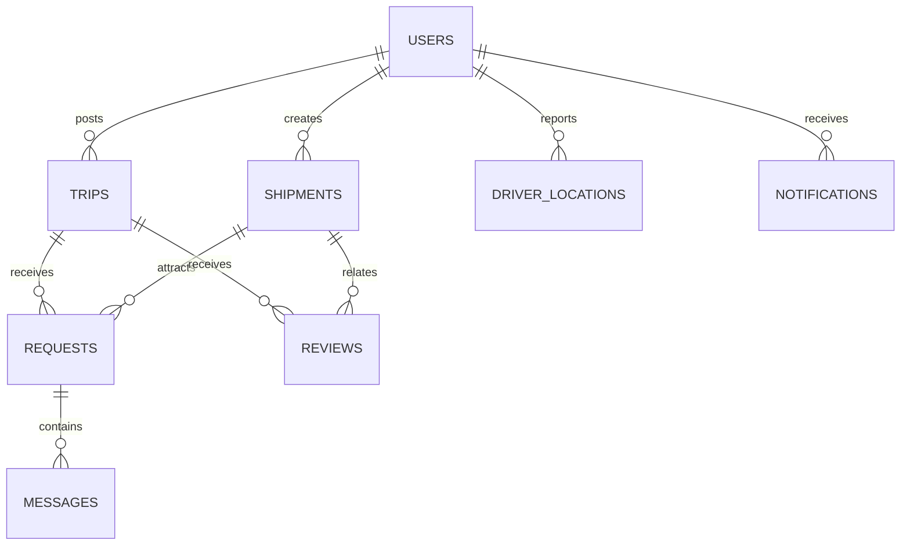

# Data Models & Database Schema

## Core data relationships



LoadSaathi uses **Supabase (PostgreSQL)** with Row Level Security (RLS) enabled
on all tables. This document describes the data models used by the application.

> The canonical schema lives at `src/integrations/supabase/final-schema.sql`.
> Date-stamped migrations are in `supabase/migrations/`.
> TypeScript types mirror these models in `src/types/index.ts`.

## Table Relationships

```
┌─────────┐      1:N      ┌─────────┐
│  users  │───────────────│  trips  │
└────┬────┘               └────┬────┘
     │                         │
     │                         │ 1:N
     │ 1:N                     ▼
     │                ┌─────────────┐   N:1  ┌─────────┐
     ├───────────────▶│  requests    │────────│  trips  │
     │                └─────────────┘        └─────────┘
     │
     │ 1:N            1:N        ┌──────────────┐
     └──────────────▶│ shipments  │◀────────────┘   (via shipment_id)
                      └─────┬─────┘
                            │ 1:N
                            ▼
                 ┌────────────────────┐
                 │ shipment_requests  │
                 └────────────────────┘
```

## Tables

### users

User profiles, keyed by the Clerk user ID.

| Column | Type | Notes |
|--------|------|-------|
| `id` | uuid / text (PK) | Clerk user ID |
| `email` | text | User email |
| `user_type` | text | `shipper` \| `trucker` \| `admin` |
| `full_name` | text | Display name |
| `phone` | text | Contact number |
| `company_name` | text | (optional) Business name |
| `vehicle_type` | text | Truckers only |
| `rating` | numeric | 0–5 |
| `total_trips` | int | Completed trips |
| `verified` | boolean | Verification status |
| `city` | text | (optional) User city |
| `created_at` | timestamptz | Default now() |

### trips

Trucker-posted availability.

| Column | Type | Notes |
|--------|------|-------|
| `id` | uuid (PK) | |
| `trucker_id` | FK → users.id | |
| `origin_city` | text | |
| `origin_state` | text | |
| `origin_lat` / `origin_lng` | float8 | Coordinates |
| `dest_city` | text | |
| `dest_state` | text | |
| `dest_lat` / `dest_lng` | float8 | Coordinates |
| `vehicle_type` | text | e.g. `container_truck`, `open_truck` |
| `capacity_kg` | numeric | Total truck capacity |
| `available_capacity_kg` | numeric | Remaining space |
| `price_per_kg` | numeric | Rate |
| `departure_date` | date | |
| `status` | text | `active` \| `full` \| `completed` \| `cancelled` \| `in_transit` \| `delivered` |
| `created_at` | timestamptz | |

### shipments

Shipper-posted cargo needs.

| Column | Type | Notes |
|--------|------|-------|
| `id` | uuid (PK) | |
| `shipper_id` | FK → users.id | |
| `origin_city` / `origin_state` | text | |
| `origin_lat` / `origin_lng` | float8 | |
| `dest_city` / `dest_state` | text | |
| `dest_lat` / `dest_lng` | float8 | |
| `weight_kg` | numeric | Cargo weight |
| `budget` | numeric | Budget per unit |
| `goods_description` | text | Cargo description |
| `pickup_address` | text | |
| `delivery_address` | text | |
| `status` | text | `open` \| `matched` \| `in_transit` \| `delivered` \| `completed` \| `cancelled` |
| `created_at` | timestamptz | |

### requests

Shipper → trucker requests to carry cargo on a trip.

| Column | Type | Notes |
|--------|------|-------|
| `id` | uuid (PK) | |
| `trip_id` | FK → trips.id | |
| `shipment_id` | FK → shipments.id | |
| `shipper_id` | FK → users.id | |
| `receiver_id` | FK → users.id | Trucker |
| `status` | text | `pending` \| `accepted` \| `rejected` \| `cancelled` |
| `created_at` | timestamptz | |

### shipment_requests

Trucker → shipper counter-offers on a shipment.

| Column | Type | Notes |
|--------|------|-------|
| `id` | uuid (PK) | |
| `shipment_id` | FK → shipments.id | |
| `trucker_id` | FK → users.id | |
| `shipper_id` | FK → users.id | |
| `proposed_price` | numeric | Trucker's offer |
| `status` | text | `pending` \| `accepted` \| `rejected` \| `cancelled` |
| `created_at` | timestamptz | |

### reviews

Post-trip bidirectional ratings.

| Column | Type | Notes |
|--------|------|-------|
| `id` | uuid (PK) | |
| `trip_id` | FK → trips.id | |
| `trucker_id` | FK → users.id | |
| `shipper_id` | FK → users.id | |
| `reviewer_role` | text | `shipper` \| `trucker` |
| `rating` | int | 1–5 |
| `comment` | text | |
| `created_at` | timestamptz | |

### messages

Real-time chat.

| Column | Type | Notes |
|--------|------|-------|
| `id` | uuid (PK) | |
| `sender_id` | FK → users.id | |
| `recipient_id` | FK → users.id | |
| `content` | text | |
| `request_id` | FK → requests.id | |
| `is_read` | boolean | |
| `created_at` | timestamptz | |

### notifications

| Column | Type | Notes |
|--------|------|-------|
| `id` | uuid (PK) | |
| `user_id` | FK → users.id | |
| `message` | text | |
| `is_read` | boolean | |
| `related_trip_id` | FK → trips.id | (optional) |
| `type` | text | `info` \| `match` \| `request` \| `message` |
| `created_at` | timestamptz | |

### Other Tables

Additional tables added through migrations (see `supabase/migrations/`):

| Table | Purpose |
|-------|---------|
| `driver_locations` | Realtime GPS locations for drivers |
| `credit_scores` | Digital freight credit scores + history |
| `favorites` | Saved trips/shipments |
| `templates` | Reusable trip/shipment templates |
| `trip_tracking` | Trip lifecycle tracking |
| `price_history` | Historical price data for AI prediction |
| `ml_match_log` | Smart-matching evaluation log |
| `team_members` | Admin-managed team (About page) |
| `gallery` | Admin-managed screenshot gallery |

## Row Level Security

RLS is enabled on all tables. Policies use Clerk user IDs extracted from the
JWT. The standard patterns:

- **Users:** users can read their own profile; public read for basic fields
- **Trips:** authenticated users can read active trips; trucker can
  create/update their own
- **Shipments:** authenticated users can read open shipments; shipper can
  create/update their own
- **Requests:** participants can read/update requests they're involved in
- **Messages:** only sender/recipient can read

See `src/integrations/supabase/final-schema.sql` and
`supabase/migrations/*.sql` for the exact policies.

## Realtime

Realtime is enabled for: `trips`, `shipments`, `requests`,
`shipment_requests`, `messages`, `notifications`, `driver_locations`.
Subscriptions must use the **anonymous** Supabase client (see
[realtime.md](realtime.md)).

## Credit Score Factors

The `calculate_credit_score` RPC computes a 300–900 score from:

| Factor | Weight |
|--------|--------|
| Completion rate | 30% |
| On-time delivery | 25% |
| Communication quality | 15% |
| Review ratings | 20% |
| Account tenure | 10% |
