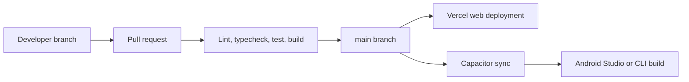

# Deployment

## Delivery pipeline



LoadSaathi deploys on **Vercel** (web) and **Google Play** (Android via
Capacitor).

## Web (Vercel)

### Configuration

`vercel.json` already configures:

- Build command: `pnpm run build`
- Output directory: `dist`
- Install command: `pnpm install`
- SPA rewrites (all routes → `index.html`)
- Security headers (CSP, HSTS, X-Frame-Options, Permissions-Policy, etc.)

### Deploying

```bash
# Install Vercel CLI (once)
pnpm add -g vercel

# Deploy preview
vercel

# Deploy production
vercel --prod
```

Or connect the GitHub repo in the Vercel dashboard for automatic deploys on
push to `main`.

### Environment Variables

Set these in Vercel → Project → Settings → Environment Variables
(Production, Preview, Development):

- `VITE_CLERK_PUBLISHABLE_KEY`
- `VITE_SUPABASE_URL`
- `VITE_SUPABASE_ANON_KEY`
- `VITE_ADMIN_USER_ID` (optional)
- `VITE_POSTHOG_API_KEY` (optional)
- `VITE_POSTHOG_HOST` (optional)
- `VITE_GA_MEASUREMENT_ID` (optional)

### CI/CD (Recommended)

Add a GitHub Actions workflow to lint, test, and build on every PR:

```yaml
name: CI
on:
  push:
    branches: [main]
  pull_request:

jobs:
  ci:
    runs-on: ubuntu-latest
    steps:
      - uses: actions/checkout@v4
      - uses: pnpm/action-setup@v4
        with:
          version: 9
      - uses: actions/setup-node@v4
        with:
          node-version: 22
          cache: pnpm
      - run: pnpm install --frozen-lockfile
      - run: pnpm lint
      - run: pnpm test
      - run: pnpm build
```

## Android (Capacitor)

### Prerequisites

- Android Studio (latest)
- Java 17+ (bundled with Android Studio)
- Android SDK

### Build & Release Steps

```bash
# 1. Build the web assets
pnpm build

# 2. Sync web build to the Android project
npx cap sync

# 3. Build a debug APK
cd android
./gradlew assembleDebug
# Output: android/app/build/outputs/apk/debug/app-debug.apk

# 4. Build a signed release AAB (for Play Store)
./gradlew bundleRelease
# Output: android/app/build/outputs/bundle/release/app-release.aab
```

### Signing (Release)

Create a keystore and configure signing in
`android/app/build.gradle` (or use Android Studio → Build → Generate Signed
Bundle). Store the keystore securely — never commit it.

### Google Play

1. Create a Google Play Console account (developer fee applies).
2. Create an app entry.
3. Upload the `.aab` to the **Production** track (or Internal testing first).
4. Complete the data safety / content rating declarations.
5. Roll out gradually (e.g., 5% → 25% → 100%).

### OAuth on Android

The Capacitor app uses `src/utils/capacitorOAuth.ts` to handle OAuth flows.
Ensure `capacitor.config.ts` `allowNavigation` includes all auth domains
(Clerk, Supabase, Google) and deep links are configured for the app scheme.

## Deployment Checklist

- [ ] `pnpm build` passes with zero errors
- [ ] Environment variables set in Vercel
- [ ] Supabase Realtime enabled for required tables
- [ ] Edge Functions deployed (`supabase functions deploy`)
- [ ] Android: `npx cap sync` run after web changes
- [ ] Release AAB signed with the correct keystore
- [ ] `public/sitemap.xml` & `public/robots.txt` current

## Rollback

- **Vercel:** Vercel keeps deployment history — redeploy a previous deployment
  from the dashboard.
- **Android:** Google Play requires version code bumps; rollback via staged
  rollout or using Google Play Console's release management.
