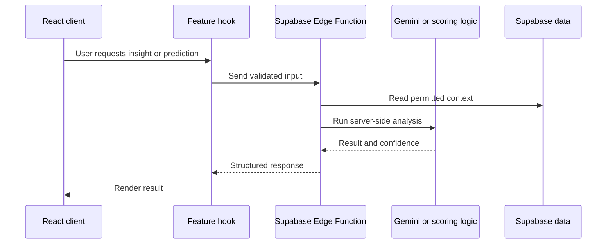

# Supabase Edge Functions

## Edge Function request path



LoadSaathi runs a set of serverless **Edge Functions** (Deno runtime) on
Supabase for AI-powered features that can't run client-side.

## Function List

| Function | Purpose |
|----------|---------|
| `gemini-proxy` | Multi-provider AI search proxy (Gemini, Groq, OpenRouter with fallback; in-memory cache + latency logging) |
| `price-predict` | AI price prediction engine |
| `credit-score` | Calculates digital freight credit scores |
| `credit-insights` | Generates natural-language credit insights |
| `match-ml` | Multi-provider match scoring (Gemini, Groq, OpenRouter, local fallback) with in-memory cache + observability logging |
| `demand-forecast` | Route/demand forecasting |
| `fraud-detect` | Fraud detection heuristics |

Shared helpers:
- `_shared/edgeHelpers.ts` — JWT verification, CORS, response helpers
- `_shared/osrm.ts` — OSRM routing helpers for the server

## Directory Layout

```
supabase/functions/
├── _shared/            # Shared server-side helpers
├── gemini-proxy/index.ts
├── price-predict/index.ts, pricing.ts, pricing_test.ts
├── credit-score/index.ts
├── credit-insights/index.ts
├── match-ml/index.ts
├── demand-forecast/index.ts
└── fraud-detect/index.ts
```

## Calling an Edge Function

```ts
const { data, error } = await supabase.functions.invoke('price-predict', {
  body: { origin, destination, weight_kg, goods_type, date },
});
```

## gemini-proxy & match-ml — Multi-Provider AI Stack

Both functions use the same **provider fallback chain**:

**Provider chain:**
1. **Gemini** (gemini-2.0-flash-lite) — primary
2. **Groq** (llama-3.3-70b-versaatile) — fallback
3. **OpenRouter** (dolphin3.0-mistral-24b → phi-3-mini-4k) — secondary fallback
4. **Local heuristic** — deterministic fallback when all AI providers are unavailable

If any provider returns 429 (rate limited), the function automatically tries the next provider. If all AI providers fail, a deterministic local heuristic produces a score so the UI never breaks.

### In-Memory Caching

Both functions cache successful results in a module-level `Map` with a 5-minute TTL:
- Cache key: `JSON.stringify(requestBody)`
- TTL: 300_000 ms (5 minutes)
- Max entries: 200 (LRU eviction)
- Cache hits return immediately without calling any provider

### Observability Logging

Each function emits structured `console.log` / `console.warn` entries containing:
- `requestId` (from `generateRequestId()`)
- Provider name and latency (`latency=Nms`)
- Status (`success`, `rate-limited`, `fallback`, `error`)

### Secrets Required

```bash
supabase secrets set GEMINI_API_KEY=your_key_here
supabase secrets set GROQ_API_KEY=your_key_here
supabase secrets set OPENROUTER_API_KEY=your_key_here
```

## Development

Run Edge Functions locally:

```bash
supabase start
supabase functions serve
```

Test with the local URL:

```bash
curl http://127.0.0.1:54321/functions/v1/price-predict \
  -H "Authorization: Bearer <anon-key>" \
  -d '{"origin":"Rourkela","destination":"Ranchi"}'
```

## Configuration

- `supabase/config.toml` — local project config
- Edge function environment variables are set in the Supabase Dashboard →
  **Edge Functions** → function → **Settings**, or via CLI:

```bash
supabase secrets set KEY=VALUE
```

## Security

- **Always** enable `verify_jwt` unless a function must be public.
- Never commit API keys to the repository.
- Use `_shared/edgeHelpers.ts` for consistent JWT verification and CORS.
