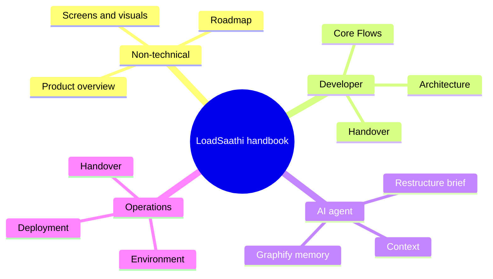

# Handbook Index

> Reading order depends on who you are. Pick your path below.

---

## Handbook navigation map

## Reading Paths

### Path A: Non-technical reader (founder, stakeholder, business partner)

1. **[`01-overview-non-technical.md`](01-overview-non-technical.md)** — What LoadSaathi is, who uses it, how it makes money, in plain language.
2. **[`04-screens-and-visuals.md`](04-screens-and-visuals.md)** — See the actual app screens.
3. **[`05-graphify-and-code-memory.md`](05-graphify-and-code-memory.md)** — How the AI "memorizes" the codebase.
4. **[`06-improvements-and-roadmap.md`](06-improvements-and-roadmap.md)** — What's next and what it costs.

### Path B: Developer (new to the codebase)

1. **[`02-architecture-and-stack.md`](02-architecture-and-stack.md)** — Tech stack, directory map, services.
2. **[`03-core-flows.md`](03-core-flows.md)** — Mermaid diagrams for every major flow.
3. **[`08-handover-checklist.md`](08-handover-checklist.md)** — How to get the app running locally.
4. **[`07-ai-restructure-brief.md`](07-ai-restructure-brief.md)** — What needs restructuring and why.

### Path C: AI coding agent

1. **[`07-ai-restructure-brief.md`](07-ai-restructure-brief.md)** — Start here. This is your mission brief.
2. **[`02-architecture-and-stack.md`](02-architecture-and-stack.md)** — Architecture context.
3. **[`03-core-flows.md`](03-core-flows.md)** — Flow diagrams to understand data movement.
4. **[`06-improvements-and-roadmap.md`](06-improvements-and-roadmap.md)** — Known issues to fix.

### Path D: DevOps / hiring handoff

1. **[`08-handover-checklist.md`](08-handover-checklist.md)** — Accounts, env vars, how to run.
2. **[`02-architecture-and-stack.md`](02-architecture-and-stack.md)** — Full architecture.
3. **[`05-graphify-and-code-memory.md`](05-graphify-and-code-memory.md)** — How to regenerate the knowledge graph.

---

## File Summary

| # | File | Lines (approx) | Audience |
|---|------|-----------------|----------|
| 01 | `01-overview-non-technical.md` | ~120 | Everyone |
| 02 | `02-architecture-and-stack.md` | ~250 | Developers |
| 03 | `03-core-flows.md` | ~300 | Developers |
| 04 | `04-screens-and-visuals.md` | ~80 | Everyone |
| 05 | `05-graphify-and-code-memory.md` | ~150 | Technical |
| 06 | `06-improvements-and-roadmap.md` | ~200 | Everyone |
| 07 | `07-ai-restructure-brief.md` | ~250 | AI agents |
| 08 | `08-handover-checklist.md` | ~100 | DevOps/hiring |

---

## Related Files (outside handbook)

| File | Purpose |
|------|---------|
| `REPO_HANDBOOK.md` | Master handover file (root) |
| `CONTEXT.md` | AI-agent context (needs updating — see 07) |
| `AI_RULES.md` | Coding agent rules |
| `README.md` | Public-facing project README |
| `docs/architecture.md` | Deep architecture docs |
| `docs/matching.md` | Matching algorithm docs |
| `docs/data-models.md` | Database schema reference |
| `graphify-out/GRAPH_REPORT.md` | Knowledge graph audit |
| `graphify-out/graph.html` | Interactive code graph |
