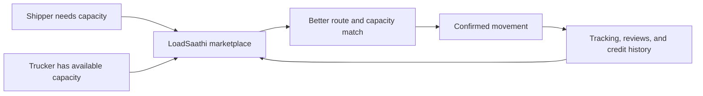

# LoadSaathi — Overview for Non-Technical Readers

> This document explains what LoadSaathi is, who uses it, and how it works — without any code jargon.

---

## Product value loop




## The Problem

India has ~10 million trucks. On any given day, many of them return **empty** after delivering a load. This wastes fuel, time, and money. Meanwhile, small businesses (MSMEs) struggle to find reliable, affordable trucks for their goods — especially for smaller loads (PTL/LTL) that big logistics companies ignore.

**The result:** Truckers earn less, shippers pay more, and the roads carry empty trucks that help nobody.

---

## What LoadSaathi Does

LoadSaathi is a **marketplace** — like a digital meeting point — where:

- **Shippers** (businesses that need to move goods) post their shipments
- **Truckers** (truck owners/drivers) post their available trips

The system then **automatically matches** them using AI, considering:
- Are they on the same route?
- Does the truck have enough space?
- Is the price fair?
- Do they have good ratings from past trips?

When matched, both parties can **chat in real-time**, negotiate, and confirm the booking.

---

## The Main Features

### 1. Posting Trips & Shipments
- Trucker says: "I'm going from Rourkela to Ranchi on Friday, I have 5 tonnes of space."
- Shipper says: "I need to send 3 tonnes of steel coils from Rourkela to Ranchi."
- The system finds the match.

### 2. AI Smart Matching
Instead of the shipper manually searching through hundreds of trips, the AI scores every possible match and shows the best ones first — like a "Netflix recommendation" for freight.

### 3. Real-Time GPS Tracking
Once a booking is confirmed, the shipper can watch their truck move on a live map — just like tracking a food delivery. ETAs update automatically.

### 4. Digital Credit Score
Every user gets a credit score (like a CIBIL score, but for freight). It's based on:
- How many trips you've completed
- Whether you delivered on time
- What other people say about you (reviews)

This builds **trust** between strangers.

### 5. AI Price Prediction
Not sure what to charge? The AI suggests a fair price based on the route, demand, fuel costs, and historical data.

### 6. In-App Chat
Matched parties can message each other directly in the app to negotiate, share details, or resolve issues.

### 7. Bidirectional Reviews
After every trip, both the shipper and the trucker rate each other. This creates accountability.

### 8. Admin Command Center
The LoadSaathi team can monitor all activity on a live dashboard — see where trucks are, manage users, and moderate content.

---

## Who Uses It

| User Type | What They Do | Why They Use LoadSaathi |
|-----------|-------------|------------------------|
| **Shippers** (MSMEs, factories, traders) | Post shipments, find trucks | Reliable transport at fair prices, no broker fees |
| **Truckers** (independent drivers, fleet owners) | Post trips, find loads | Fill empty capacity, earn more per trip, build reputation |
| **Admin** (LoadSaathi team) | Monitor, moderate, manage | Full visibility, user management, analytics |

---

## How the Matching Works (Simplified)

```
Shipper posts: "Need 3 tonnes from Rourkela to Ranchi, budget ₹25,000"
                    │
                    ▼
        ┌─────────────────────┐
        │   AI Matching Engine │
        │                     │
        │  Checks:            │
        │  ✓ Route overlap    │
        │  ✓ Truck capacity   │
        │  ✓ Price range      │
        │  ✓ Date match       │
        │  ✓ User ratings     │
        │  ✓ Geographic prox. │
        └─────────┬───────────┘
                  │
                  ▼
        "Best matches found!"
        Trucker A: 92% match (same route, 5T space, ₹24,000)
        Trucker B: 87% match (nearby route, 4T space, ₹26,000)
        Trucker C: 78% match (partial overlap, 6T space, ₹22,000)
```

---

## The Technology (In Plain Language)

The app runs on the internet (hosted on Vercel) and as an Android app (via Capacitor). It uses:

| Service | What It Does (Non-Technical) |
|---------|------------------------------|
| **Clerk** | Handles sign-in, sign-up, and keeps you logged in |
| **Supabase** | Stores all the data (trips, shipments, users, messages) |
| **OSRM** | Calculates driving routes and distances between cities |
| **Nominatim** | Looks up city names on a map (geocoding) |
| **Gemini AI** | Parses natural language searches ("find trucks from Rourkela to Kolkata next week") |
| **PostHog** | Tracks how people use the app (analytics) |
| **Vercel** | Makes the website available on the internet |

---

## Key Metrics

| Metric | Value |
|--------|-------|
| Cities covered | 50+ |
| Active corridors | 25+ |
| Core markets | Odisha, Jharkhand, West Bengal |
| Credit score range | 300–900 |
| GPS update frequency | Every 30 seconds |
| Match factors scored | 7 (route, proximity, capacity, price, date, rating, overlap) |

---

## Visual Tour

See [Screenshots & Visual Assets](04-screens-and-visuals.md) for actual app screens — dashboard, matching, chat, credit score, and more.

---

## What's Next

See [Improvements & Roadmap](06-improvements-and-roadmap.md) for:
- What's currently weak (honest assessment)
- Free fixes vs paid improvements
- Alternative technology options
- Future feature ideas

---

*Last verified: 2026-08-24*
