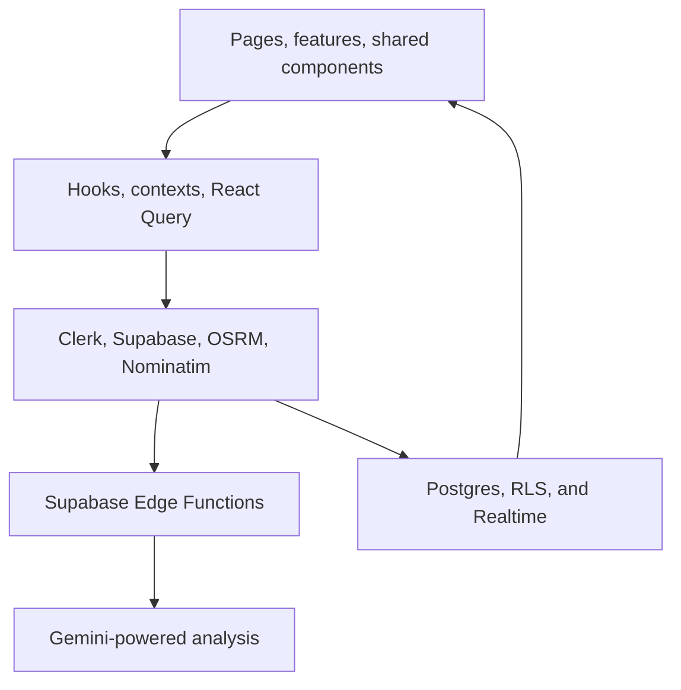

# Architecture & Tech Stack

> Full technical architecture for developers and AI agents.

---

## Layered system view




## Tech Stack

| Layer | Technology | Version | Purpose |
|-------|-----------|---------|---------|
| Framework | React + TypeScript | 19.2 / 5.5 | SPA with strict typing |
| Build | Vite | 6.3 | Dev server + production build |
| UI | shadcn/ui + Radix UI | latest | Accessible component primitives |
| Styling | Tailwind CSS | 3.4 | Utility-first CSS |
| State | TanStack React Query | 5.56 | Server state caching + mutations |
| Auth | Clerk | 5.61 | Authentication + user management |
| DB | Supabase (PostgreSQL) | 2.99 | Database + Realtime subscriptions |
| Maps | Leaflet + React-Leaflet | 1.9 / 5.0 | Map rendering + GPS tracking |
| Charts | Recharts | 3.9 | Dashboard visualizations |
| Forms | React Hook Form + Zod | 7.53 / 3.23 | Form state + validation |
| Animation | Framer Motion | 12.43 | Page transitions + micro-interactions |
| Analytics | PostHog + Vercel + GA | — | Event tracking + web vitals |
| Mobile | Capacitor | 8.4 | Android hybrid app wrapper |
| Hosting | Vercel | — | Static hosting + edge functions |
| Routing | React Router DOM | 7.6 | Client-side routing |
| SEO | React Helmet Async | 3.0 | Dynamic meta tags + JSON-LD |

---

## External Services

| Service | Integration Point | Purpose |
|---------|------------------|---------|
| **Clerk** | `@clerk/clerk-react`; `VITE_CLERK_PUBLISHABLE_KEY` | Auth, JWT issuance, OAuth (Google) |
| **Supabase** | `lib/supabase.ts` (anon + Clerk-authenticated client) | DB + Realtime + Edge Functions |
| **OSRM** | `utils/osrm.ts` → `router.project-osrm.org` | Truck route distance/duration/geometry |
| **Nominatim** | `utils/geocode.ts` → `nominatim.openstreetmap.org` | City geocoding (lat/lng) |
| **Gemini** | Edge Function `gemini-proxy` (key server-side) | NL freight-search parsing |
| **PostHog** | `utils/posthog.ts` + `components/PostHogProvider.tsx` | Product analytics |
| **Google Analytics** | `components/GoogleAnalytics.tsx` | GA4 pageviews + events |
| **Vercel** | `@vercel/analytics`, `@vercel/speed-insights` | Hosting + web vitals |

### Edge Functions (Supabase)

| Function | Purpose |
|----------|---------|
| `gemini-proxy` | NL search parsing via Gemini AI |
| `match-ml` | AI smart-matching scoring |
| `credit-score` | Calculate credit score (300–900) |
| `credit-insights` | Narrative credit insights |
| `price-predict` | AI price prediction |

---

## Provider Nesting (App.tsx)

The app uses a composition root pattern. Providers are nested outer → inner:

```
ErrorBoundary
  └─ PostHogProvider
      └─ ClerkProvider (VITE_CLERK_PUBLISHABLE_KEY)
          └─ QueryClientProvider (staleTime: 30s, retry: 2)
              └─ TooltipProvider
                  └─ ThemeProvider (localStorage persistence)
                      └─ AuthProvider (Clerk ↔ Supabase sync)
                          └─ BrowserRouter
                              └─ ScrollToTop
                              └─ GoogleAnalyticsTracker
                              └─ HelmetProvider
                                  └─ Suspense (skeleton fallback)
                                      └─ AppRoutes (all route defs)
```

---

## Directory Map (Verified 2026-08-24)

> **Note:** The old `CONTEXT.md` has a stale directory map. This is the corrected version.

```
LOAD-SAATHI-APP-1-OSRM/
├── src/
│   ├── main.tsx                         # Entry point + Capacitor cleanup
│   ├── App.tsx                          # Provider composition root
│   ├── globals.css                      # Tailwind directives + CSS vars
│   ├── routes.tsx                       # ALL route definitions (lazy)
│   │
│   ├── pages/                           # Route-level pages
│   │   ├── auth/                        #   Authentication pages
│   │   │   ├── Login.tsx
│   │   │   ├── Register.tsx
│   │   │   ├── ChooseRole.tsx
│   │   │   ├── OnboardingFlow.tsx
│   │   │   └── ForgotPassword.tsx
│   │   ├── public/                      #   Marketing/info pages (PublicLayout)
│   │   │   ├── Index.tsx                #   Homepage (~1039 lines)
│   │   │   ├── Features.tsx
│   │   │   ├── HowItWorks.tsx
│   │   │   ├── About.tsx
│   │   │   ├── Pricing.tsx
│   │   │   ├── Faq.tsx
│   │   │   ├── FareCalculator.tsx
│   │   │   ├── Contact.tsx
│   │   │   ├── SafetyTrust.tsx
│   │   │   ├── Privacy.tsx
│   │   │   ├── Terms.tsx
│   │   │   ├── Comparison.tsx
│   │   │   ├── SharedTrip.tsx
│   │   │   ├── SharedShipment.tsx
│   │   │   ├── Gallery.tsx
│   │   │   ├── AiLogistics.tsx
│   │   │   ├── ForMsmes.tsx
│   │   │   ├── Data.tsx
│   │   │   ├── commercial/             #   Commercial hub pages
│   │   │   │   ├── ReturnLoad.tsx
│   │   │   │   ├── PtlTransport.tsx
│   │   │   │   ├── LtlTransport.tsx
│   │   │   │   ├── TruckLoadBooking.tsx
│   │   │   │   └── FreightMarketplace.tsx
│   │   │   ├── tools/                  #   Calculator tools
│   │   │   │   ├── TransportCostCalculator.tsx
│   │   │   │   ├── TruckLoadCalculator.tsx
│   │   │   │   ├── PtlVsFtlCalculator.tsx
│   │   │   │   ├── FreightRateCalculator.tsx
│   │   │   │   └── ReturnLoadCalculator.tsx
│   │   │   ├── guides/                 #   Dynamic guide pages
│   │   │   │   └── GuidePage.tsx
│   │   │   └── locations/              #   Dynamic location pages
│   │   │       └── LocationPage.tsx
│   │   ├── trucker/                    #   Trucker role pages
│   │   │   ├── Dashboard.tsx
│   │   │   ├── PostTrip.tsx
│   │   │   ├── TruckerHub.tsx
│   │   │   ├── EditTrip.tsx
│   │   │   ├── TruckerTripDetail.tsx
│   │   │   ├── BrowseShipments.tsx
│   │   │   └── TruckerHistory.tsx
│   │   ├── shipper/                    #   Shipper role pages
│   │   │   ├── Dashboard.tsx
│   │   │   ├── PostShipments.tsx
│   │   │   ├── MyShipments.tsx
│   │   │   ├── ShipmentDetail.tsx
│   │   │   ├── EditShipment.tsx
│   │   │   ├── BrowseTrips.tsx
│   │   │   └── ShipperHistory.tsx
│   │   ├── trips/                      #   Trip detail (public)
│   │   │   └── TripDetail.tsx
│   │   ├── messaging/                  #   Chat system
│   │   │   ├── Chat.tsx
│   │   │   └── ChatList.tsx
│   │   ├── account/                    #   User account pages
│   │   │   ├── Profile.tsx
│   │   │   ├── Favorites.tsx
│   │   │   └── CreditScore.tsx
│   │   ├── admin/                      #   Admin-only pages
│   │   │   ├── Dashboard.tsx
│   │   │   ├── MonitoringDashboard.tsx
│   │   │   ├── CommandCenterLive.tsx
│   │   │   ├── UserManagement.tsx
│   │   │   ├── Moderation.tsx
│   │   │   ├── GalleryManager.tsx
│   │   │   └── TeamManager.tsx
│   │   ├── blog/                       #   Blog system
│   │   │   ├── BlogList.tsx
│   │   │   └── BlogArticle.tsx
│   │   └── NotFound.tsx
│   │
│   ├── features/                       # Feature-scoped modules
│   │   ├── home/sections/              #   Landing page sections
│   │   │   ├── HeroSection.tsx
│   │   │   ├── BentoGrid.tsx
│   │   │   ├── SectionNav.tsx
│   │   │   ├── HowItWorksSection.tsx
│   │   │   ├── PlatformTabs.tsx
│   │   │   ├── AppPreview.tsx
│   │   │   ├── FaqSection.tsx
│   │   │   └── CtaSection.tsx
│   │   ├── marketing/screens/          #   Public app previews
│   │   │   ├── DashboardPreview.tsx
│   │   │   ├── MatchingPreview.tsx
│   │   │   ├── ChatPreview.tsx
│   │   │   ├── CreditScorePreview.tsx
│   │   │   ├── ReviewsPreview.tsx
│   │   │   └── AdminPreview.tsx
│   │   └── shipper/components/         #   Shipper dashboard widgets
│   │       ├── LiveTruckMap.tsx
│   │       └── TruckDetailsPanel.tsx
│   │
│   ├── components/                     # Shared UI components
│   │   ├── ui/                         #   shadcn/ui primitives (~40 files)
│   │   ├── maps/                       #   Leaflet map widgets
│   │   │   ├── LoadSaathiMap.tsx
│   │   │   ├── TruckMarker.tsx
│   │   │   ├── LoadMarker.tsx
│   │   │   ├── RoutePolyline.tsx
│   │   │   ├── MapLegend.tsx
│   │   │   ├── ZoomControls.tsx
│   │   │   ├── TileLayerSwitcher.tsx
│   │   │   └── useMapUserInteraction.ts
│   │   ├── Layout.tsx                  #   Authenticated app layout
│   │   ├── PublicLayout.tsx            #   Marketing pages layout
│   │   ├── SeoMeta.tsx                 #   SEO meta tags + JSON-LD
│   │   ├── ErrorBoundary.tsx
│   │   ├── RoleProtectedRoute.tsx
│   │   ├── GpsTracker.tsx
│   │   ├── AutoGpsTracker.tsx
│   │   ├── LiveMap.tsx
│   │   ├── RouteMap.tsx
│   │   ├── NotificationBell.tsx
│   │   ├── FavoriteButton.tsx
│   │   ├── ReviewDialog.tsx
│   │   ├── ThemeToggle.tsx
│   │   ├── AuthSync.tsx
│   │   ├── PostHogProvider.tsx
│   │   ├── GoogleAnalytics.tsx
│   │   └── ... (more shared components)
│   │
│   ├── hooks/                          # Custom React hooks
│   │   ├── useSupabase.ts              #   Authenticated Supabase client
│   │   ├── useCreditScore.ts           #   Credit score data
│   │   ├── usePricePrediction.ts       #   AI price prediction
│   │   ├── useSmartMatch.ts            #   Smart matching logic
│   │   ├── useLiveDriverLocations.ts   #   Live truck GPS
│   │   ├── useLiveLoadLocations.ts     #   Live load GPS
│   │   ├── useNetworkStatus.ts         #   Online/offline detection
│   │   └── use-mobile.tsx              #   Mobile viewport detection
│   │
│   ├── contexts/
│   │   └── AuthContext.tsx              # Auth state (Clerk + Supabase profile)
│   │
│   ├── integrations/
│   │   └── supabase/
│   │       ├── client.ts               #   Anonymous Supabase client (Realtime)
│   │       ├── final-schema.sql        #   Full DB schema + RLS + indexes
│   │       └── apply-rls.sql           #   RLS migration script
│   │
│   ├── config/
│   │   └── env.ts                      # Zod-validated environment variables
│   │
│   ├── data/                           # Static data (build-time imports)
│   │   ├── routes.ts                   #   30+ freight route definitions
│   │   ├── vehicles.ts
│   │   ├── blog.ts                     #   Blog post metadata + content
│   │   ├── locations.json              #   City data for location pages
│   │   └── socialLinks.tsx
│   │
│   ├── lib/                            # Core utilities
│   │   ├── utils.ts                    #   cn() helper (clsx + tailwind-merge)
│   │   ├── supabase.ts                 #   Client factories (anon + Clerk)
│   │   ├── logger.ts                   #   Structured logging
│   │   └── gemini.ts                   #   NL search parser
│   │
│   ├── utils/                          # Business logic utilities
│   │   ├── supabaseClient.ts           #   Clerk-authenticated Supabase factory
│   │   ├── matching.ts                 #   AI match score calculator (7 factors)
│   │   ├── osrm.ts                     #   OSRM routing API + LRU cache
│   │   ├── geocode.ts                  #   Nominatim geocoding
│   │   ├── format.ts                   #   Date/number formatters
│   │   ├── chat.ts                     #   Chat CRUD + Realtime
│   │   ├── notifications.ts            #   Push notification helpers
│   │   ├── emissions.ts                #   Carbon emission calculator
│   │   ├── chartTheme.ts               #   Recharts theme config
│   │   ├── posthog.ts                  #   PostHog initialization
│   │   ├── capacitorOAuth.ts           #   OAuth for Capacitor
│   │   ├── toast.ts                    #   Sonner toast helpers
│   │   └── whatsapp.ts                 #   WhatsApp share link generator
│   │
│   ├── theme/
│   │   └── theme.tsx                   # Dark/light theme context
│   │
│   ├── types/
│   │   ├── index.ts                    # Core domain models
│   │   └── chat.ts                     # Chat-specific types
│   │
│   └── test/                           # Vitest test files
│       ├── utils.test.ts
│       ├── chat.test.ts
│       └── agentic-readiness.test.ts
│
├── public/                             # Static assets (served as-is)
│   ├── logo.svg, logo-*.webp/png      # Logo variants
│   ├── og-image.png                    # Default OG image
│   ├── hero-bg.webp                    # Hero background
│   ├── robots.txt                      # AI-crawler-friendly
│   ├── sitemap.xml                     # XML sitemap (60+ URLs)
│   ├── llms.txt                        # Machine-readable site summary
│   ├── pricing.md                      # Structured pricing data
│   ├── manifest.json                   # PWA manifest
│   ├── sw.js                           # Service worker
│   ├── loader.lottie                   # Lottie animation
│   ├── icons/icon-512.png              # PWA icon
│   ├── team/*.webp                     # Team member photos
│   └── blog/og/*.svg                   # 52 blog OG social cards
│
├── supabase/                           # Supabase CLI config
│   ├── functions/                      #   Deno Edge Functions
│   └── migrations/                     #   SQL migration files
│
├── android/                            # Capacitor Android project
├── docs/                               # Project documentation
├── graphify-out/                       # Knowledge graph artifacts
├── .memory/                            # PARA-style agent memory
├── Blogs/                              # Blog drafts & marketing content
├── scripts/                            # Build/utility scripts
│   ├── CONTEXT.md                       # AI-agent context (needs updating)
│   ├── REPO_HANDBOOK.md                 # This handbook (master file)
│   ├── VISUAL_GUIDE.md                  # One-glance visual story (diagrams)
│   └── ...
├── index.html                          # SPA entry point (JSON-LD schemas)
├── vercel.json                         # Vercel deployment config
├── vite.config.ts                      # Vite config (manual chunks)
├── tailwind.config.ts                  # Tailwind config
├── tsconfig.json                       # TypeScript config
├── capacitor.config.ts                 # Capacitor Android config
├── package.json                        # Dependencies + scripts
├── CONTEXT.md                            # AI-agent context (needs updating)
├── AI_RULES.md                           # Coding agent rules
├── REPO_HANDBOOK.md                      # This handbook (master file)
└── README.md                           # Public-facing README
```

---

## State Management

**No Redux, no Zustand, no Jotai.** Three mechanisms:

1. **Auth Context** (`contexts/AuthContext.tsx` + `useAuth()`):
   - Clerk user/session, `userProfile` (Supabase), `loading`
   - `getSupabaseToken()` (cached 60s, refresh 45s), `signOut()`, `refreshProfile()`

2. **Server State** (TanStack React Query):
   - All database operations go through `useQuery`/`useMutation`
   - Global `staleTime: 30s`, `retry: 2`, `refetchOnWindowFocus: false`
   - Hooks: `useCreditScore`, `usePricePrediction`, `useSmartMatch`, `useLiveDriverLocations`

3. **Theme Context** (`theme/theme.tsx` + `useTheme()`):
   - `mode` ∈ light/dark/system, persisted to `localStorage`
   - Toggles `<html class="dark">` + `data-theme` + `theme-color` meta

4. **Forms**: React Hook Form + Zod everywhere. Component-local state via `useState`/`useRef`.

---

## Core Data Models

| Model | Table | Key Fields |
|-------|-------|-----------|
| **User** | `users` | `id` (Clerk), `email`, `user_type` (shipper/trucker/admin), `full_name`, `phone`, `rating`, `verified` |
| **Trip** | `trips` | `id`, `trucker_id`, `origin/dest_*`, `vehicle_type`, `capacity_kg`, `price_per_kg`, `departure_date`, `status` |
| **Shipment** | `shipments` | `id`, `shipper_id`, `origin/dest_*`, `weight_kg`, `budget`, `goods_description`, `status` |
| **Request** | `requests` | `id`, `trip_id`, `shipment_id`, `shipper_id`, `receiver_id`, `status` |
| **ShipmentRequest** | `shipment_requests` | `id`, `shipment_id`, `trucker_id`, `shipper_id`, `proposed_price`, `status` |
| **Review** | `reviews` | `id`, `trip_id`, `trucker_id`, `shipper_id`, `rating`, `comment` |
| **Message** | `messages` | `id`, `sender_id`, `recipient_id`, `content`, `request_id`, `is_read` |
| **Notification** | `notifications` | `id`, `user_id`, `message`, `is_read`, `type` |
| **CreditScore** | (Edge Function) | `score` (300–900), `factors`: completion, reliability, communication, reviews, tenure |

---

## Realtime Subscriptions

Tables with Realtime enabled: `trips`, `shipments`, `requests`, `shipment_requests`, `messages`, `notifications`, `driver_locations`, `load_locations`

**Critical gotcha:** Every Realtime subscription must call `authorizeRealtime(getToken)` first — the shared anon Supabase socket is denied by RLS (`TO authenticated`).

---

## Performance Patterns

- **Code splitting:** Every route is `React.lazy()` imported
- **Deferred loading:** Heavy chunks (Supabase, PostHog, Capacitor, env) loaded via `requestIdleCallback`
- **Caching:** OSRM results in 500-entry LRU (10-min TTL), geocode results in 24h cache
- **Throttling:** Nominatim at 1 req/sec, GPS writes every 30s
- **Security:** HTML sanitization in chat, RBAC whitelist in `RoleProtectedRoute`, SECURITY DEFINER RPC for cross-user notifications
