# Core Flows (Mermaid Diagrams)

> Every major data flow in LoadSaathi, visualized. Render these on GitHub or any Mermaid-compatible viewer.

---

## 1. Authentication Flow (Clerk → Supabase)

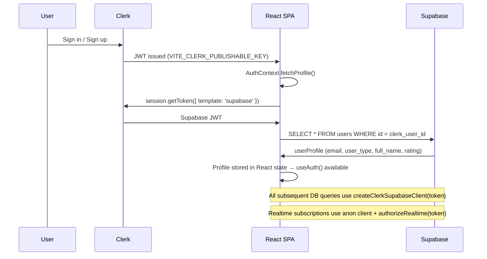

---

## 2. Post Trip (Trucker)

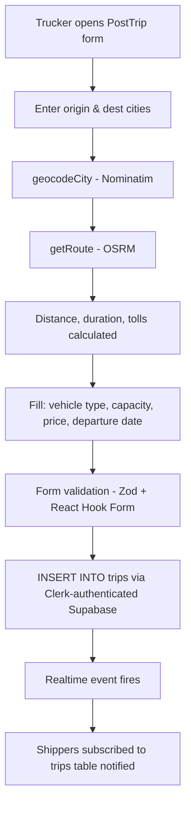

**Key files:** `pages/trucker/PostTrip.tsx`, `utils/osrm.ts`, `utils/geocode.ts`

---

## 3. Post Shipment (Shipper)

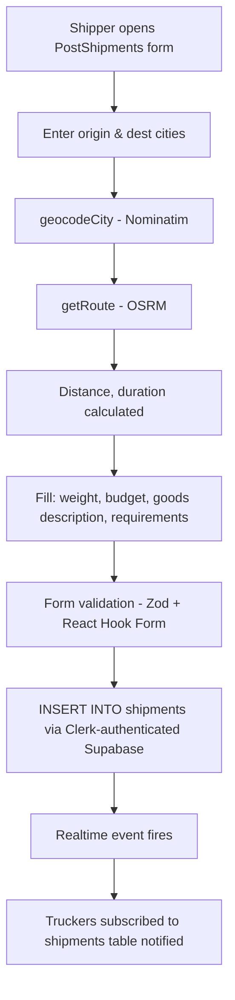

**Key files:** `pages/shipper/PostShipments.tsx`, `utils/osrm.ts`, `utils/geocode.ts`

---

## 4. Smart Matching Algorithm

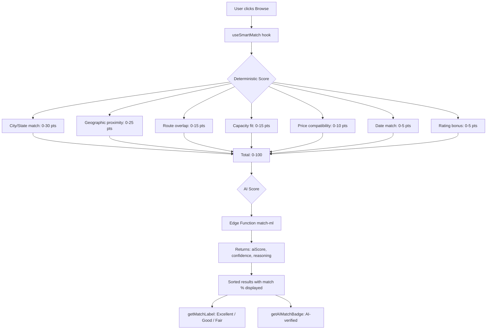

**Key files:** `utils/matching.ts`, `hooks/useSmartMatch.ts`

### Score Factors Detail

| Factor | Max Points | Logic |
|--------|-----------|-------|
| City/State match | 30 | Same city = 30, same state = 20, adjacent = 10 |
| Geographic proximity | 25 | Haversine distance from route: <20km = 25, <50km = 15, <100km = 8 |
| Route overlap | 15 | Within 10km of origin/dest = 15, 20km = 10 |
| Capacity fit | 15 | Cargo ≤ truck capacity = 15, <80% = 12, <60% = 8 |
| Price compatibility | 10 | Within 20% of budget = 10, <40% = 7, <60% = 4 |
| Date match | 5 | Same day = 5, within 3 days = 3, within 7 days = 1 |
| Rating bonus | 5 | Trucker rating ≥ 4.5 = 5, ≥ 4.0 = 3, ≥ 3.5 = 1 |

---

## 5. Request & Accept Flow

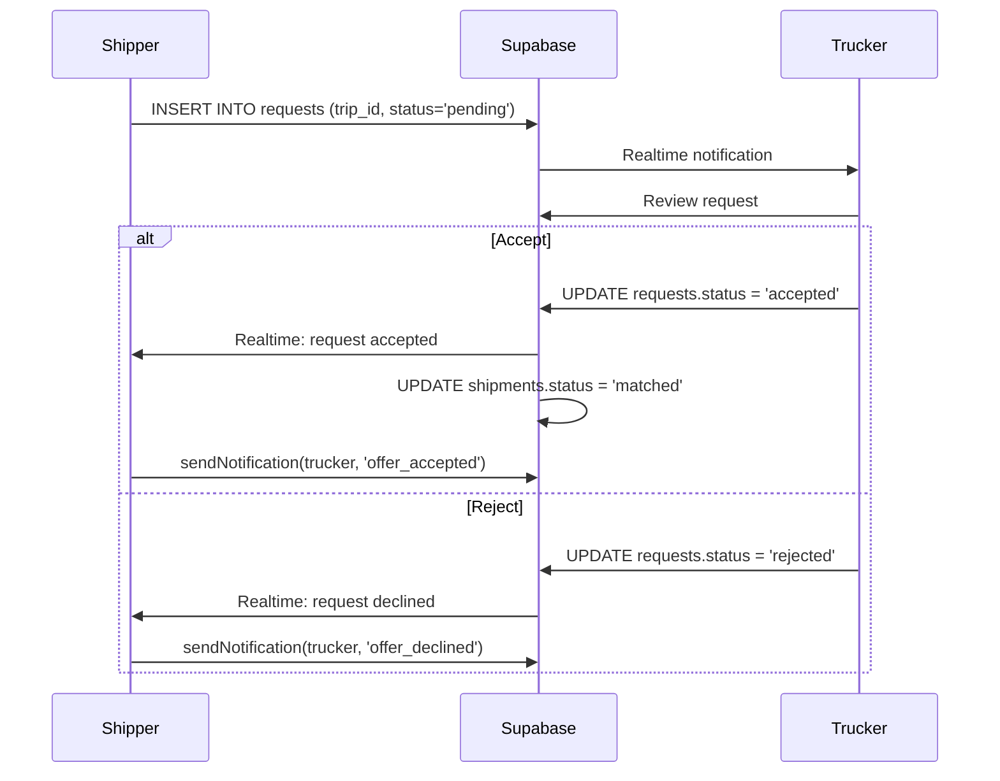

---

## 6. Real-Time Chat

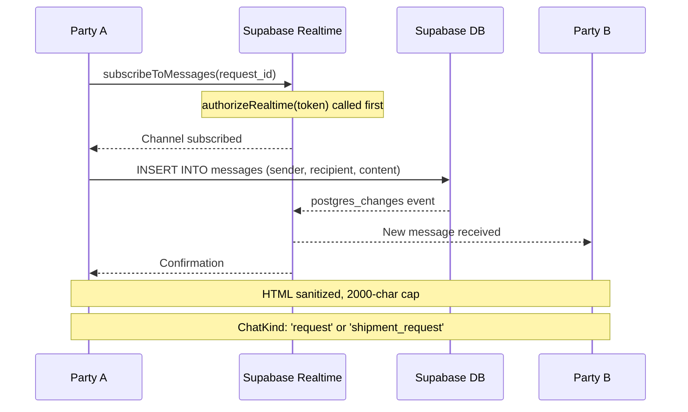

**Key files:** `utils/chat.ts`, `pages/messaging/Chat.tsx`, `pages/messaging/ChatList.tsx`

---

## 7. GPS Tracking

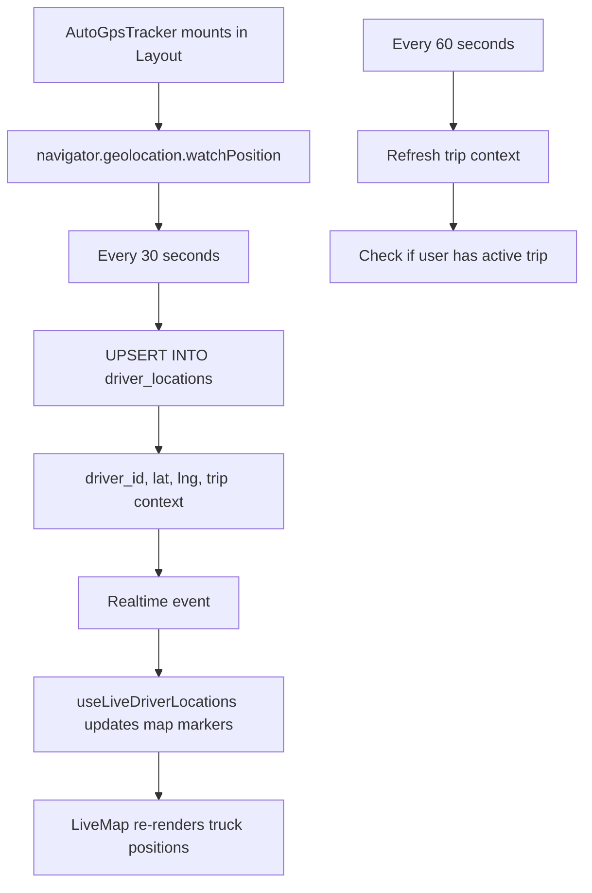

**Key files:** `components/AutoGpsTracker.tsx`, `hooks/useLiveDriverLocations.ts`, `components/LiveMap.tsx`

---

## 8. Credit Score Calculation

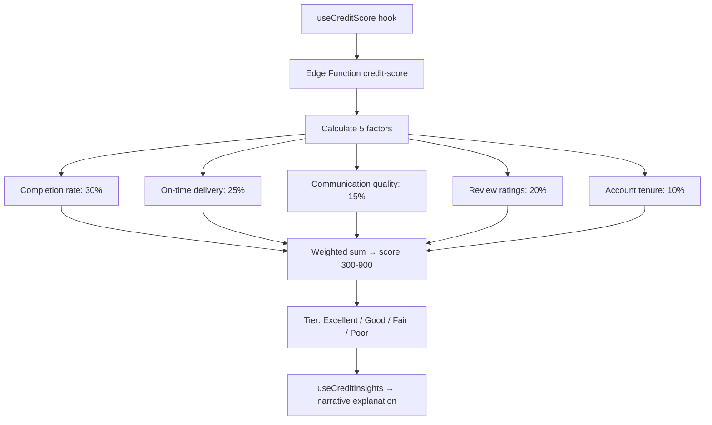

**Key files:** `hooks/useCreditScore.ts`, Edge Function `credit-score`

---

## 9. Price Prediction

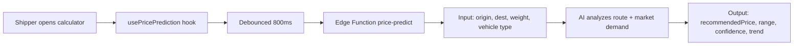

**Key files:** `hooks/usePricePrediction.ts`, Edge Function `price-predict`

---

## 10. Notification System

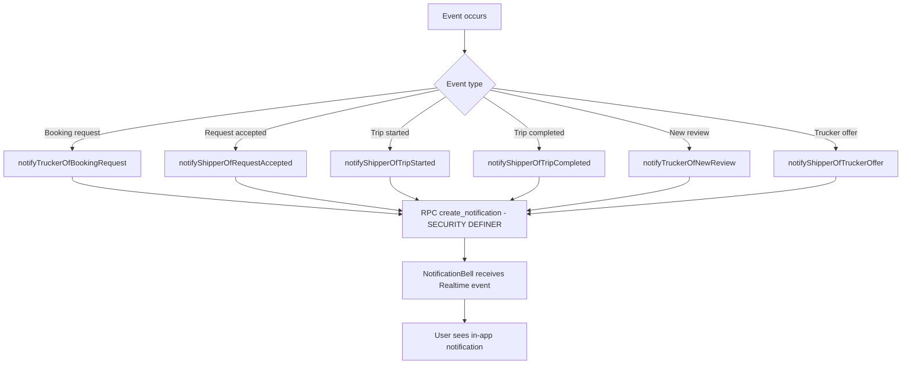

**Key files:** `utils/notifications.ts`, `components/NotificationBell.tsx`

---

## 11. Complete System Architecture

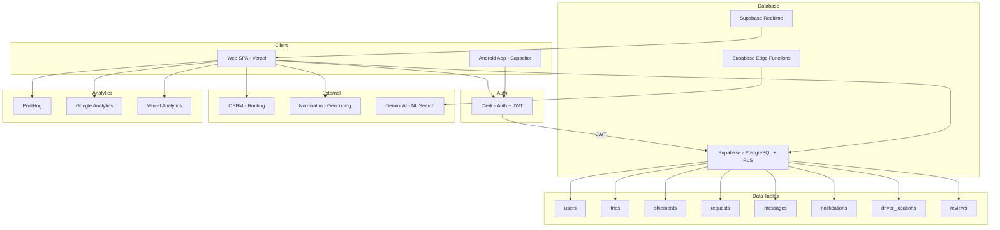

---

*All diagrams render in GitHub's Markdown viewer, VS Code, and any Mermaid-compatible tool.*
