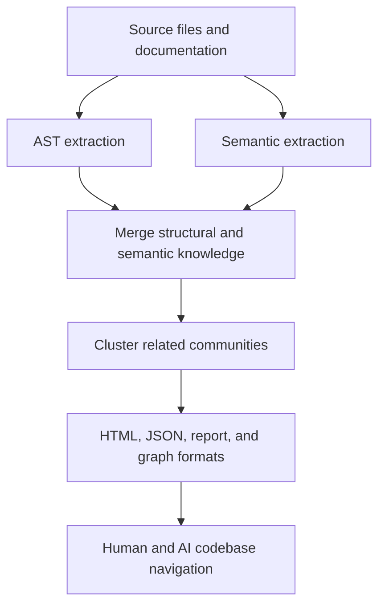

# Graphify & Code Memory

> How graphify "memorizes" the codebase, what artifacts exist, and how to regenerate/enrich them.

---

## Code-memory pipeline




## What Is Graphify?

Graphify is an AI-powered tool that converts a folder of files (code, docs, images) into a **navigable knowledge graph**. It reads your source code, extracts entities (functions, classes, components), maps relationships (calls, imports, references), and clusters them into communities.

**Think of it as:** A map of your entire codebase — every function, every connection, every cluster — stored as a graph that both humans and AI agents can navigate.

---

## How Graphify Memorizes Code

### Pipeline Steps

```
1. DETECT files (code/docs/images)
   ↓
2. EXTRACT (two paths):
   ├── Part A: AST parsing (FREE, no tokens)
   │   └── Reads code structure: functions, classes, imports, calls
   └── Part B: Semantic extraction (COSTS Claude tokens)
       └── AI reads file chunks, emits nodes/edges with meaning
   ↓
3. MERGE AST + semantic → final graph
   ↓
4. BUILD graph + CLUSTER (Louvain community detection)
   ↓
5. LABEL communities (AI writes 2-5 word names)
   ↓
6. ANALYZE → god nodes, surprising connections
   ↓
7. EXPORT → graph.html, graph.json, GRAPH_REPORT.md
```

### The Two Extraction Modes

| Mode | Cost | What It Captures | When to Use |
|------|------|-----------------|-------------|
| **AST-only** | $0 (free) | Code structure: function names, imports, calls, classes | Quick overview, no LLM spend |
| **Semantic** | Claude tokens | Meaning: what functions do, business logic, relationships | Deep understanding, richer graph |

**Your current graph:** AST-only (0 tokens spent). Good structural overview, but no semantic meaning.

---

## Existing Artifacts

All in `graphify-out/`:

| File | Size | Content |
|------|------|---------|
| `graph.json` | 401 KB | **600 nodes, 552 edges, 31 communities** — the full knowledge graph |
| `graph.html` | 407 KB | Interactive HTML visualization — open in browser, zoom/click/navigate |
| `GRAPH_REPORT.md` | 12 KB | Audit report: god nodes, surprising connections, community list |
| `cost.json` | 0.2 KB | Token usage: 0 input, 0 output (AST-only run) |
| `manifest.json` | 69 KB | File manifest with mtimes for incremental updates |
| `cache/ast/` | (hundreds) | Per-file AST cache keyed by content hash |

### Graph Report Highlights

**God Nodes (most connected — your core abstractions):**

| Rank | Function | Edges | What It Does |
|------|----------|-------|-------------|
| 1 | `showError()` | 27 | Toast error notifications |
| 2 | `showSuccess()` | 24 | Toast success notifications |
| 3 | `createClerkSupabaseClient()` | 22 | Authenticated DB client factory |
| 4 | `fetchData()` | 13 | Generic data fetching |
| 5 | `sendNotification()` | 13 | Cross-user notifications |
| 6 | `useAuth()` | 10 | Auth context hook |
| 7 | `trackEvent()` | 8 | PostHog analytics |
| 8 | `getRoute()` | 8 | OSRM route calculation |
| 9 | `main()` | 6 | App entry point |
| 10 | `handleSubmit()` | 6 | Form submission handler |

**Surprising Connections (cross-file dependencies you might not know):**

- `AutoGpsTracker()` calls `useAuth()` — GPS tracker depends on auth context
- `fetchUnread()` calls `createClerkSupabaseClient()` — notification count requires auth
- `LocationSelector` handlers call `onChange()` in `PublicLayout` — tight coupling

**Communities Detected:** 31 clusters of related code (e.g., "Auth & Profile", "Map & GPS", "Chat & Messaging", "Admin Dashboard").

---

## The .memory System (Separate from Graphify)

Located in `.memory/` — a PARA-style (Projects, Areas, Resources, Archives) memory system that tracks:

| File | Content |
|------|---------|
| `MEMORY.md` | User operating patterns (pnpm, bash-on-Windows, Clerk/Supabase preferences) |
| `index.md` | Memory index |
| `projects/load-saathi/summary.md` | Architecture facts (Clerk integration, dual Supabase clients, etc.) |
| `projects/load-saathi/items.yaml` | Structured project data |
| `2026-06-05.md` | Refactoring session log |

**Difference from graphify:**
- `.memory/` = human-curated facts about the project (manual)
- `graphify-out/` = auto-generated code structure graph (automatic)

---

## How to Regenerate/Enrich

### Quick Update (only changed files, free)
```bash
# Incremental update — only re-extracts changed files
graphify . --update
```

### Deep Extraction (semantic, costs tokens)
```bash
# Full re-extraction with AI semantic understanding
graphify . --deep
```
**Cost note:** Your codebase is ~566K words. Semantic extraction will use significant Claude tokens. Consider running on a subfolder first, or use `--no-semantic` for AST-only.

### Export Formats
```bash
# SVG image of the code graph
graphify . --svg

# GraphML for Gephi/Cytoscape
graphify . --graphml

# Obsidian-compatible markdown
graphify . --obsidian

# Neo4j import
graphify . --neo4j
```

### Query the Graph
```bash
# Ask a question about the codebase
graphify query "how does authentication work?"

# Find shortest path between two functions
graphify path createClerkSupabaseClient getRoute

# Explain a specific node
graphify explain useSmartMatch
```

### Watch Mode (auto-rebuild on file changes)
```bash
graphify . --watch
```

---

## Why This Matters for AI Agents

When an AI coding agent reads `graphify-out/graph.json`, it gets:

1. **Complete code map** — every function, class, and component
2. **Relationship graph** — what calls what, what imports what
3. **Community clusters** — which parts of the codebase belong together
4. **Core abstractions** — the god nodes that everything depends on
5. **Cross-file dependencies** — surprising connections between modules

This is far more useful than reading individual files one at a time. The graph gives an AI agent a "bird's eye view" of the entire codebase in a single data structure.

---

## Recommended Workflow

| When | Action | Cost |
|------|--------|------|
| After major code changes | `graphify . --update` | Free |
| Before handing off to a developer | `graphify . --deep` | ~$5-15 (Claude tokens) |
| For visual documentation | `graphify . --svg` | Free |
| For a quick architecture overview | Open `graphify-out/graph.html` | Free |
| For AI agent context | Point agent to `graphify-out/graph.json` | Free |

---

*Last verified: 2026-08-24 | Graphify version: 0.6.1*
