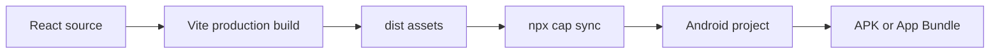

# Mobile (Android)

## Web-to-Android build path



LoadSaathi ships an Android app built with **Capacitor 8**, wrapping the same
React web build in a native WebView.

## Project Structure

```
android/
├── app/
│   └── src/main/
│       ├── java/in/loadsaathi/app/   # Native Java/Kotlin entry
│       ├── res/                      # Android resources
│       │   ├── drawable*/            # Splash screens
│       │   ├── mipmap*/              # Launcher icons
│       │   └── values/               # colors.xml, styles.xml, strings.xml
│       └── assets/                   # Capacitor config + copied web build
├── gradle/                           # Gradle wrapper + config
├── build.gradle                      # Root Gradle file
├── settings.gradle
└── capacitor.config.ts               # (at repo root) Capacitor config
```

## Prerequisites

- Node.js >= 22
- Android Studio (latest)
- Java 17+
- Android SDK (installed via Android Studio)

## Build Flow

```bash
# 1. Build the web assets (Vite)
pnpm build

# 2. Copy web build into the Android project
npx cap sync

# 3a. Open in Android Studio
npx cap open android

# 3b. OR build from CLI
cd android
./gradlew assembleDebug
```

The debug APK is written to:
`android/app/build/outputs/apk/debug/app-debug.apk`

## Regenerating Icons & Splash

Launcher icons and splash screens are generated from
`public/logo-512.png` by:

```powershell
powershell -ExecutionPolicy Bypass -File scripts/generate-android-assets.ps1
```

This regenerates:

- Legacy launcher icons (white background — no black corners)
- Adaptive icon foregrounds (logo in safe zone)
- All portrait/landscape splash screens (white bg + centered logo)

After regenerating, rebuild with `npx cap sync` + `gradlew`.

## Resource Files

| File | Purpose |
|------|---------|
| `res/values/colors.xml` | Brand colors (`colorPrimary` #F97316, splash bg white) |
| `res/values/styles.xml` | App theme + Android 12+ splash config |
| `res/values/strings.xml` | App name string |
| `res/mipmap-anydpi-v26/ic_launcher*.xml` | Adaptive icons (background/foreground/monochrome) |

## OAuth / Deep Linking

Capacitor OAuth handling lives in `src/utils/capacitorOAuth.ts`. Ensure
`capacitor.config.ts` `allowNavigation` includes the auth domains so the
WebView can redirect back to Clerk/Supabase.

## Troubleshooting

| Issue | Fix |
|-------|-----|
| App crashes on launch | Run `npx cap sync` after web changes; check logcat |
| OAuth fails on Android | Check `allowNavigation` includes Clerk + Supabase domains; configure deep links |
| White screen after update | Web build changed — run `pnpm build && npx cap sync` |
| GPS not updating | Android requires location permission + HTTPS; check runtime permissions |
| Icon shows black background | Regenerate assets (see above) — white bg icons are bundled |

## Releasing

See [Deployment → Android](deployment.md#android-capacitor) for signing and
Play Store release steps.
