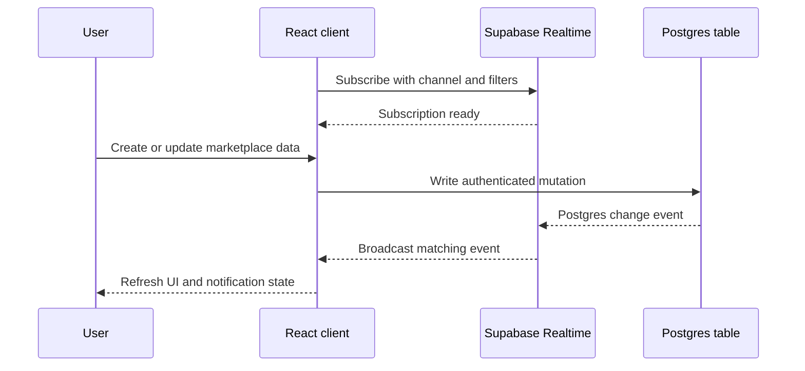

# Realtime Subscriptions

## Realtime event loop



LoadSaathi uses **Supabase Realtime** to push live updates to the UI —
notifications, chat messages, and GPS location updates arrive without page
refreshes.

## What's Realtime

Realtime is enabled for these tables:

- `trips`
- `shipments`
- `requests`
- `shipment_requests`
- `messages`
- `notifications`
- `driver_locations`

## Client Rules

| Rule | Reason |
|------|--------|
| Use the **anonymous** client | The anon key + RLS keep data safe while allowing public subscriptions |
| Never use the authenticated client for subscriptions | Authenticated clients shouldn't hold open channels |
| Clean up channels on unmount | Prevents memory leaks |

The anonymous client is in `src/integrations/supabase/client.ts`.

## Basic Pattern

```ts
import { supabase } from '@/integrations/supabase/client';

const channel = supabase
  .channel('notifications')
  .on(
    'postgres_changes',
    { event: 'INSERT', schema: 'public', table: 'notifications' },
    (payload) => handleNewNotification(payload.new)
  )
  .subscribe();

// Clean up when done
// channel.unsubscribe();
```

## Common Subscriptions

### Chat Messages

```ts
const channel = supabase
  .channel(`chat-${conversationId}`)
  .on(
    'postgres_changes',
    {
      event: 'INSERT',
      schema: 'public',
      table: 'messages',
      filter: `request_id=eq.${conversationId}`,
    },
    (payload) => appendMessage(payload.new)
  )
  .subscribe();
```

### GPS Driver Locations

```ts
const channel = supabase
  .channel('driver-locations')
  .on(
    'postgres_changes',
    { event: 'UPDATE', schema: 'public', table: 'driver_locations' },
    (payload) => updateMapMarker(payload.new)
  )
  .subscribe();
```

## Troubleshooting

| Symptom | Cause | Fix |
|---------|-------|-----|
| No realtime updates | Realtime not enabled for the table | Enable in Supabase Dashboard → Database → Realtime |
| Subscription fails silently | Using authenticated client | Switch to anonymous client |
| Updates only after refresh | Wrong filter or event type | Double-check `event`, `schema`, `table`, `filter` |

## Realtime + RLS

Realtime respects RLS policies. Ensure the anonymous role has the appropriate
`SELECT` grants for tables you subscribe to publicly (e.g., `trips`,
`shipments`), while sensitive tables (e.g., `messages`) filter by participant
via the RLS policies on `auth.uid()`.
