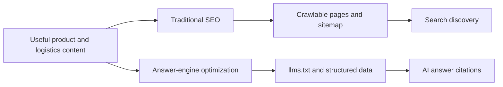

# SEO & GEO Optimization

## Search visibility system

LoadSaathi is optimized for both traditional search engines (Google) and AI
answer engines (ChatGPT, Perplexity, Claude, Gemini). This section documents
the strategy.

## Documents

| Document | Description |
|----------|-------------|
| [SEO/GEO Implementation Plan](geo-implementation-plan.md) | Phased roadmap for SEO + GEO |
| [Backlinks Strategy](backlinks.md) | Link building and directory submissions |

## Key Concepts

### Traditional SEO

- **Public pages** all use the `<SeoMeta>` component (title, description,
  canonical, Open Graph, Twitter cards, JSON-LD).
- `public/sitemap.xml` — 60+ URLs
- `public/robots.txt` — allows all AI crawlers + standard crawlers
- Global JSON-LD schemas in `index.html` (Organization, LocalBusiness,
  WebSite with SearchAction)

### AI Search (GEO)

- `public/llms.txt` — machine-readable site summary
- `public/pricing.md` — structured pricing data for AI extraction
- `<noscript>` blocks with full content on every public page (for bots that
  don't run JS)
- Self-contained answer paragraphs
- FAQ schema (`FAQPage`) and HowTo schema
- Statistics always include source + year

### Content Rules

See the AEO/GEO content rules in [`CONTEXT.md`](../../CONTEXT.md) section 7.

### Existing Content

- Blog system (`src/pages/blog/`) with BlogPosting schema
- 30+ freight route pages (`src/data/routes.ts` + `RoutesIndex`/`RouteDetail`)
- Location pages (`/location/:city`)
- Guides (`/guide/:slug`)
- Compare pages (LoadSaathi vs brokers)

## Machine-Readable Files

- `public/llms.txt` — site summary for AI bots
- `public/pricing.md` — pricing data
- `docs/llms.txt` / `docs/llms-full.txt` — working copies in the repo
