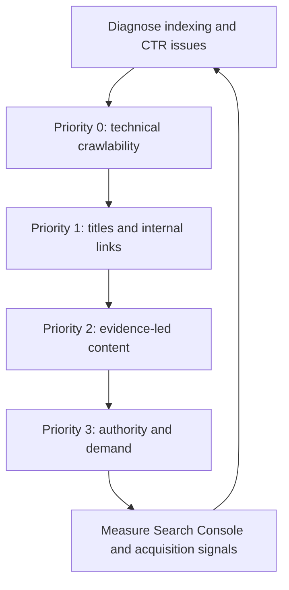

# LoadSaathi SEO Traffic Recovery Plan

## Recovery operating model

**Prepared:** August 16, 2026  
**Site:** [loadsaathi.in](https://loadsaathi.in/)  
**Author:** Manus AI

## Executive diagnosis

The traffic decline should not be treated as a simple “publish more blog posts” problem. Your Vercel Analytics dashboard shows 77 visitors and 329 page views over the last seven days, down 72% and 73% respectively, but those figures combine organic, referral, direct, and authenticated traffic. Google Search Console is the better source for organic diagnosis: over its displayed three-month report it shows 35 clicks, 938 impressions, a 3.7% average CTR, and an average position of 19.1. These are small numbers, so a handful of pages or queries can materially change the totals. The Vercel and Search Console periods and definitions are different and should not be compared as if they were the same metric. [1] [2]

The strongest evidence points to **three priorities**. First, your public route and blog pages contain **duplicate canonical tags**, including a homepage canonical plus a page-specific canonical. That creates conflicting signals about which URL should be indexed and may be contributing to the 28 not-indexed pages reported by Search Console. Google specifically warns that conflicting or multiple canonical tags can lead to unexpected results. [3] [4] [5] Second, your sitemap has **116 URLs**, while Search Console reports 56 indexed and 28 not indexed pages among the URLs it has processed; the three exclusion reasons must be opened and fixed rather than addressed by repeatedly requesting indexing. [6] [7] Third, the site has promising content and route pages, but its average organic position of 19.1 means many pages are not yet on page one. The quickest growth opportunity is to improve existing pages that already receive impressions, especially the article that Search Console has flagged as recently gaining impressions. [2]

> **Recommended order:** fix canonical and rendering signals first; then repair indexing coverage; then optimize pages already earning impressions; finally expand the route, city, guide, and evidence-based content clusters.

## What is already working

Your crawl controls are broadly sound. `robots.txt` allows normal crawling, blocks private application areas, and declares the sitemap. The sitemap is organized into useful topical directories: 28 route pages, 9 location pages, 3 guides, and 47 blog URLs, in addition to core pages. Key sampled pages returned HTTP 200 over HTTPS. [8] [9] [10]

Your route page for Rourkela to Ranchi is a good model for intent-focused SEO. It has a descriptive title, route-specific distance and transit information, FAQs, related routes, guides, and a booking CTA. Your truck-cost article also has a strong title, author, publication date, direct answer, FAQs, related articles, and a product CTA. Search Console has specifically highlighted that article as receiving more impressions than usual, so it should be optimized before producing many more similar posts. [5] [6] [11]

The audience and product fit also support a focused strategy. Vercel reports that 66% of visitors use mobile devices, while Google Search Console shows no Core Web Vitals data yet. Performance data should be enabled and monitored, but the more urgent SEO issue is ensuring that the content and canonical signals are correct before spending heavily on promotion. [1] [2]

## Priority 0: Fix the technical indexing signals within 48 hours

### 1. Make every public page emit exactly one correct canonical

The sampled route page currently contains both `https://loadsaathi.in/` and `https://loadsaathi.in/routes/rourkela-to-ranchi` as canonical URLs. The sampled blog page similarly contains both the homepage canonical and its own article canonical. The homepage itself also contained duplicate canonical tags in the captured DOM. [4] [5] [11]

For each indexable URL, the canonical must be that page’s own preferred HTTPS URL. The homepage should canonicalize to `/`; the route page should canonicalize to its route URL; the blog article should canonicalize to its article URL. Remove the global homepage canonical from the shared application shell, or make the head component route-aware. Also ensure that client-side hydration does not append a second canonical after the initial HTML has loaded.

A practical implementation rule is: build one SEO head function that receives `pathname`, `title`, `description`, `canonical`, `ogImage`, and JSON-LD, and renders one instance of each tag. Test the raw HTTP response and the rendered DOM separately. Google recommends setting the canonical consistently in HTML and warns against multiple conflicting canonical tags. [12]

### 2. Remove duplicate descriptions and social metadata

The sampled route and blog pages each contained two meta descriptions, and the homepage contained repeated Open Graph and Twitter metadata blocks. These duplicates can produce inconsistent snippets and previews. Keep one description, one `og:title`, one `og:description`, one `og:url`, one `twitter:title`, and one `twitter:description` per page. The `keywords` meta tag is not a meaningful ranking lever; it can be removed or left as a low-priority cleanup item.

### 3. Verify that public pages are crawlable before hydration

The homepage, route page, and blog page initially appeared as a blank app shell before JavaScript finished rendering in the browser. Google can render JavaScript, but Google’s own guidance states that server-side or pre-rendering is still preferable because it improves speed for users and crawlers, and not all bots execute JavaScript. [13]

For SEO-critical routes, make sure the initial HTTP response already contains the correct page-specific title, description, canonical, H1, meaningful body content, crawlable `<a href>` links, and JSON-LD. If your current architecture is a client-rendered SPA, consider prerendering or server-side rendering for `/`, `/routes/*`, `/location/*`, `/guide/*`, and `/blog/*`. Do not use a generic `index.html` shell with page metadata that is only corrected after hydration.

### 4. Correct structured-data inconsistencies

The captured route and blog JSON-LD includes BreadcrumbList data with duplicate “Home” positions. Clean each breadcrumb trail so it contains one Home item followed by the actual directory and page. Search Console currently reports 32 valid breadcrumb items, which is encouraging, but the duplicate breadcrumb entries should still be removed. It also reports three invalid Q&A enhancements; inspect those URLs and either make the structured data match visible question-and-answer content exactly or remove the invalid Q&A markup. [2] [6] [14]

### 5. Inspect the three Search Console exclusion reasons

Open **Search Console → Indexing → Pages → Not indexed** and expand all three reasons. Export the affected URLs. Classify each URL into one of four buckets: important and unique, duplicate or near-duplicate, private/application content, or low-value/thin content. Fix the first bucket, consolidate or redirect the second, keep the third blocked/noindexed, and improve or remove the fourth. Then validate the fix and resubmit the sitemap. Search Console’s official troubleshooting guidance recommends using Page indexing, URL Inspection, and page-level patterns rather than blindly requesting indexing. [7] [15]

## Priority 1: Improve click-through and page-one rankings within 7–14 days

### 1. Optimize pages that already have impressions

In Search Console, turn on **Clicks, Impressions, CTR, and Position**, then export the Queries and Pages tables for the last 3 months. Sort by impressions and identify pages with these patterns:

| Pattern | Meaning | Action |
|---|---|---|
| High impressions, CTR below about 2–3% | Google is showing the page but the result is not compelling | Rewrite the title and description around the exact query; add a clearer benefit, route, city, rate range, or use case |
| Average position 8–20 | The page is close to page one | Improve the answer above the fold, add original evidence, strengthen internal links, and update FAQs |
| High impressions, position above 30 | Relevance or authority is weak | Rework the page around a narrower search intent; add route-specific facts and links from stronger pages |
| Impressions and clicks both falling | Visibility, indexing, demand, or competition may have changed | Compare pages, queries, devices, countries, and dates; inspect indexing and Google Trends |
| Impressions stable but clicks falling | Snippet or SERP appearance is underperforming | Test title, description, breadcrumbs, and qualifying words such as “2026,” “rates,” “calculator,” or “book online” |

Google recommends comparing periods, segmenting by query, URL, country, device, and search appearance, and using a longer 16-month view to separate seasonality from a real decline. [15]

### 2. Rewrite titles and descriptions for the core pages

Use one primary intent per page rather than repeating the same broad “AI freight marketplace” language everywhere. Suggested starting points are:

| Page | Suggested title | Suggested description |
|---|---|---|
| Homepage | `PTL & LTL Freight Marketplace in East India — LoadSaathi` | `Book part-load and return-load transport across Odisha, Jharkhand, and West Bengal. Compare rates, connect with verified truckers, and track shipments live.` |
| Routes hub | `Freight Routes in East India — PTL, LTL & Return Loads` | `Explore freight rates, transit times, truck availability, and PTL/LTL options for major Odisha, Jharkhand, and West Bengal corridors.` |
| Rourkela–Ranchi | Keep the current route-specific structure | Add a tested rate date, source/methodology, and a more explicit “get a quote” promise |
| Fare calculator | `Truck Freight Rate Calculator India — PTL/LTL Quote` | `Estimate PTL, LTL, and full-truck freight costs by route, weight, truck type, and pickup window.` |
| Truck-cost article | Keep the current title | Add linked sources, assumptions, a visible “last reviewed” date, and a calculator CTA near the top |

Do not force keywords into every heading. Use the natural language of shippers and truckers: “part load transport,” “return load,” “truck freight rates,” “truck booking,” “Rourkela to Ranchi transport,” and “freight rate calculator.”

### 3. Strengthen internal linking around commercial intent

Every article should link to one relevant guide, one relevant route or location page, and one conversion page such as the fare calculator or shipper/trucker solution page. Every route page should link to its reverse route, origin and destination location pages, related routes, the rate calculator, and a relevant guide. Use descriptive anchor text such as “Rourkela to Ranchi freight rates” rather than generic “click here.”

Create a visible breadcrumb trail in HTML and JSON-LD with a single consistent path. This will help users understand where they are and make the route, city, guide, and blog hierarchy clearer to crawlers.

## Priority 2: Upgrade content quality and trust within 30 days

### 1. Turn the blog into an evidence-led logistics resource

The cost-per-kilometer article is a good traffic candidate, but its claims need stronger support. It cites “TruckGuru” and “Mordor Intelligence” without a visible linked reference list, and it makes time-sensitive claims about rate ranges, market size, driver shortages, empty kilometers, and savings. Add source links, the date accessed, geography, vehicle assumptions, fuel/toll assumptions, and a “last reviewed” date. Where you use LoadSaathi’s own data, label it as first-party data and state the sample size and date range.

Add an author page for Sanjaya Sahu with logistics experience, company role, editorial standards, and contact information. For rate content, provide a small methodology box such as: “Rates updated monthly; excludes GST/tolls unless stated; actual quote varies by truck body, payload, pickup window, fuel price, and return-load availability.” This makes the page more useful and more defensible than a generic SEO article.

### 2. Avoid thin programmatic route and city pages

The sitemap contains many route and location URLs, which is a useful structure but also a duplication risk. Each page should contain facts that are genuinely different for that corridor or city: industrial sectors, likely cargo types, pickup zones, toll or border considerations, transit variability, seasonal constraints, typical truck bodies, rate methodology, and actual marketplace availability. If two route pages are substantially identical except for city names, consolidate them or add meaningful unique information before asking Google to index them.

### 3. Build topic clusters around actual buyer and trucker questions

Prioritize content that can lead to a shipment or truck registration, not only broad industry commentary. A practical cluster is:

| Cluster | High-intent pages | Supporting content |
|---|---|---|
| Freight rates | `/fare-calculator`, route rate pages | How rates change by payload, truck type, tolls, fuel, and return load |
| PTL/LTL | PTL vs FTL guide, PTL route pages | Minimum shipment size, packaging, consolidation, claims, delivery windows |
| Return loads | return-load service page | How to find return loads from Rourkela, Ranchi, Jamshedpur, Kolkata, and Bhubaneswar |
| Industrial freight | steel, coal, machinery, textiles, FMCG pages | Packaging, permits, e-way bill workflow, loading and unloading checklists |
| Trust and safety | safety/trust page | Verification, GPS tracking, claims, credit score, payment workflow, dispute handling |

Each cluster should have one authoritative hub and several supporting pages that link back to it. Publish fewer, better pages: one deeply researched page that earns links and leads is more valuable than many near-duplicate pages.

### 4. Make claims precise and verifiable

Claims such as “98% match accuracy,” “95% price accuracy,” “100% live visibility,” “500+ verified truckers,” “10K+ loads completed,” and “save up to 40%” appear prominently on the site. [4] [5] If these figures are real, show the measurement period, denominator, and definition near the claim. If they are projections, examples, or product targets, label them accordingly. Unsupported numbers can reduce trust with both users and search engines, particularly on pages intended to influence commercial decisions.

## Priority 3: Build authority and demand over 30–90 days

Organic rankings will be constrained if the site has little external authority and very little search demand. Build links through real logistics relationships rather than paid or automated link schemes. Publish original corridor data, partner with transport associations and MSME bodies, interview fleet owners and shippers, create downloadable rate snapshots, and ask legitimate partners to cite the research where it is useful. Use founder-led LinkedIn and relevant logistics communities to distribute the research, not just product announcements.

For local and regional demand, create and maintain legitimate business profiles and partner pages for the corridors you actually serve. Do not create fake city offices or doorway pages. The strongest regional SEO asset will be a combination of useful route data, real customer stories, verifiable coverage, and a clear way to request a quote.

## Measurement plan

Use a single weekly dashboard with the following measures. Search Console should be the source of truth for organic performance, while Vercel Analytics should be used for all-channel behavior and product conversion. Keep the date range and definitions consistent.

| KPI | Baseline observed | 30-day target | Where to measure |
|---|---:|---:|---|
| Indexed pages | 56 indexed; 28 not indexed among processed pages | Increase valid indexed pages after fixing exclusions; no target number until reasons are known | Search Console Page indexing |
| Organic clicks | 35 in the displayed 3-month report | Establish a clean 28-day baseline, then grow month over month | Search Console Performance |
| Impressions | 938 in the displayed 3-month report | Grow impressions for route, location, guide, and calculator pages | Search Console Performance |
| Average CTR | 3.7% | Improve pages with high impressions and low CTR | Search Console Performance |
| Average position | 19.1 | Move priority pages toward positions 1–10 | Search Console Performance |
| Core Web Vitals | No data | Enable Speed Insights and collect mobile/desktop data | Vercel Speed Insights/Search Console |
| Qualified CTA actions | Not yet separated in Vercel | Track `quote_started`, `shipment_posted`, `trucker_signup_started`, and `signup_completed` | Product analytics/Vercel |
| Organic conversion rate | Not available | Establish after event instrumentation | Product analytics |

Do not judge the recovery after only one week. Recheck technical fixes within 7–14 days, but evaluate ranking and organic traffic trends over at least 28 days. Google’s own traffic-drop guidance recommends comparing periods, page groups, queries, devices, countries, search appearances, and broader search demand before attributing a decline to a single cause. [15]

## Recommended execution sequence

| When | Owner action | Definition of done |
|---|---|---|
| Today | Remove duplicate canonicals, descriptions, Open Graph tags, and duplicate breadcrumbs | Raw HTML and rendered DOM each show one correct canonical and one metadata set on sampled pages |
| Today | Open all three Search Console not-indexed reasons and export URLs | Every excluded URL is classified as fix, consolidate, block, or improve |
| Within 48 hours | Verify raw HTML for homepage, route, location, guide, and blog pages | Page-specific title, description, H1, canonical, body copy, links, and JSON-LD exist before or during rendering |
| Within 7 days | Fix high-impact indexing issues and validate in URL Inspection | Important sitemap URLs are submitted and validation is started after fixes |
| Within 7 days | Enable Speed Insights and add conversion events | Mobile performance and funnel data begin collecting |
| Within 14 days | Rewrite titles/descriptions for high-impression pages | Each priority page has one clear intent and a differentiated snippet |
| Within 30 days | Upgrade the cost article and three highest-value route pages with sources and methodology | Pages show author, update date, assumptions, references, FAQs, internal links, and CTA |
| Within 60 days | Build one authoritative cluster around rates, PTL/LTL, and return loads | Hub pages and supporting pages are internally linked and differentiated |
| Within 90 days | Earn regional authority through original data and legitimate partnerships | Qualified referring domains and branded search demand are increasing |

## Bottom line

The first fix is **not** another batch of articles. It is to correct the duplicate canonical and metadata implementation, understand the three Search Console exclusion reasons, and make sure each important public page is rendered with its own content before hydration. After that, use Search Console to optimize pages already receiving impressions—especially the truck-cost article and the route pages—then expand only the content clusters that connect directly to rate discovery, shipment requests, and trucker registrations. This sequence gives LoadSaathi the best chance of recovering visibility while turning organic visits into marketplace activity.

## References

[1]: https://vercel.com/sanjayofficial-glitchs-projects/load-saathi-osrm/analytics "LoadSaathi Vercel Analytics"

[2]: https://search.google.com/search-console/performance/search-analytics?resource_id=sc-domain%3Aloadsaathi.in "LoadSaathi Google Search Console Performance"

[3]: https://search.google.com/search-console/index?resource_id=sc-domain%3Aloadsaathi.in "LoadSaathi Google Search Console Page Indexing"

[4]: https://loadsaathi.in/ "LoadSaathi homepage"

[5]: https://loadsaathi.in/routes/rourkela-to-ranchi "LoadSaathi Rourkela to Ranchi route page"

[6]: https://loadsaathi.in/blog/truck-transport-cost-per-km-india-2026 "LoadSaathi truck transport cost article"

[7]: https://loadsaathi.in/sitemap.xml "LoadSaathi XML sitemap"

[8]: https://loadsaathi.in/robots.txt "LoadSaathi robots.txt"

[9]: https://developers.google.com/search/docs/monitor-debug/debugging-search-traffic-drops "Google: Debugging drops in Search traffic"

[10]: https://developers.google.com/search/docs/fundamentals/seo-starter-guide "Google: SEO Starter Guide"

[11]: https://developers.google.com/search/docs/appearance/structured-data/intro-structured-data "Google: Introduction to structured data"

[12]: https://developers.google.com/search/docs/crawling-indexing/javascript/javascript-seo-basics "Google: JavaScript SEO basics"

[13]: https://developers.google.com/search/docs/crawling-indexing/javascript/javascript-seo-basics "Google: JavaScript SEO basics — rendering and pre-rendering"

[14]: https://search.google.com/search-console/enhancements/q-a?resource_id=sc-domain%3Aloadsaathi.in "LoadSaathi Search Console Q&A enhancements"

[15]: https://developers.google.com/search/docs/monitor-debug/debugging-search-traffic-drops "Google: Search traffic-drop diagnostic process"
