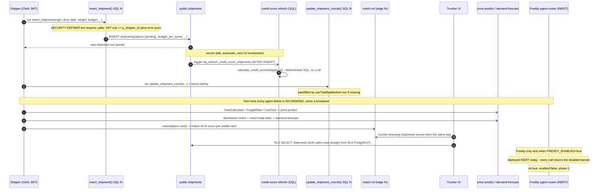
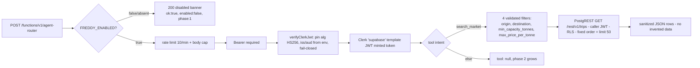

# What Actually Happens When a Shipment Gets Posted

> **Evidence-based documentation of LoadSaathi's shipper pipeline and agents.**
> Every claim below was verified against source on 2026‑10‑20 (files cited inline).
> Status badges: 🟢 **LIVE** (reachable in production today) · 🔵 **INERT**
> (deployed, disabled by kill switch) · ⚙️ **CRON** (scheduled) · 🔶 **ON-DEMAND**
> (fires only when a user/agent asks).

---

## Part 1 — Two different "posts" (don't confuse them)

| | **A. Quote lead** (anonymous visitor) | **B. Shipment post** (logged-in shipper) |
|---|---|---|
| Where | Public pages → `QuoteLeadCard` / lead forms | `/shipper/post-shipment` form |
| Code | `supabase/src/lib/leadCapture.ts` | `supabase/src/pages/shipper/PostShipments.tsx` |
| Write path | `anon INSERT` into `public.leads` (RLS: **INSERT-only**, can't read back) | Postgres RPC `insert_shipment()` (SECURITY DEFINER) |
| Identity | none (anon key only) | Clerk-issued Supabase-template JWT |

---

## Part 2 — Flow A: anonymous quote lead → human alert

```mermaid
sequenceDiagram
    autonumber
    participant V as Visitor (anon browser)
    participant RLS as public.leads (RLS: INSERT only)
    participant TG as trg_lead_quote_email (DB trigger)
    participant LA as lead-alert (edge fn)
    participant TgBot as Telegram founder chat
    participant Crn as api/cron/daily.js (10-00 Vercel cron)

    Note over V: shipper type form -> submit
    V->>RLS: INSERT lead (phone, name, message, page_path, user_id, email?)
    Note over RLS: cannot be read back by anon; write-only
    RLS-->>V: insert ok

    par best-effort alert (does not block page)
        V-)LA: POST /functions/v1/lead-alert (verify_jwt=false)
        LA->>LA: freshness: matching lead row exists and is <= 10 min old? (service-role SELECT)
        LA->>LA: flood guard > 12 leads / 2 min -> skip; per-IP 10/min
        LA-)TgBot: Telegram ping to founder
    and email lead (when email present)
        RLS-)TG: on-insert trigger fires
        TG-)V: instant quote email via Vercel /api/lead-quote
    end

    Note over RLS,TgBot: row + digest are the authoritative record; the Telegram ping is optional

    Crn-)TgBot: 10-00 daily digest (auth: Bearer CRON_SECRET when set)
```

**Why it is safe even when forged:** `lead-alert` never trusts the POST body — it re-verifies that a fresh `leads` row actually exists, so fabricated payloads are dropped silently (`supabase/functions/lead-alert/index.ts`).

**What agents do here:** none of the LLMs. This is plumbing + anti-abuse + human-in-the-loop (founder replies on WhatsApp within the 2-hour promise).

---

## Part 3 — Flow B: logged-in shipper posts a shipment → agents wake up



### The one server-side *reactive* agent almost nobody spots

`20260702_credit_scores.sql` wires **Postgres triggers** on `shipments`, `trips`, `reviews` and `requests`:

```sql
CREATE TRIGGER trg_refresh_credit_score_shipments
  AFTER INSERT OR UPDATE OF status OR DELETE ON public.shipments
  FOR EACH ROW EXECUTE FUNCTION public.refresh_credit_score();
```

`refresh_credit_score()` → `calculate_credit_score(user_id)` — **deterministic SQL, not an LLM**, recomputed on every shipment/trip/review change. The LLM-based `credit-insights` only *narrates* that score on demand.

---

## Part 4 — Agent inventory (13 edge functions + Vercel APIs)

| Agent | Layer | Trigger | Status | Honest? |
|---|---|---|---|---|
| `match-ml` | matching | on-demand per marketplace card (Clerk JWT) | 🟢 LIVE | ✅ graceful local-heuristic fallback (`buildLocalAiMatch`) |
| `price-predict` | pricing | on-demand (3 calculators + `usePricePrediction`) | 🟢 LIVE | ✅ |
| `demand-forecast` | market | on-demand (charts, return-load odds) | 🟢 LIVE | ✅ |
| `credit-score` / `credit-insights` | trust | DB trigger recompute + on-demand narration | 🟢 LIVE | ✅ ownership guard: foreign `userId` → 403 |
| `fraud-detect` | trust | **no caller today**; self-scoped to own account | 🟢 LIVE | ✅ IDOR closed 2026‑10‑20 |
| `fetch-diesel-price` / `get-fuel-price` | fuel | ⚙️ daily cron + on-demand | 🟢 LIVE | ✅ no synthetic uplift (old +0.5% compounding removed) |
| `lead-alert`, `ops-daily-digest` | ops | ⚙️ lead→Telegram; cron digest 10‑00 | 🟢 LIVE | ✅ freshness/anti-forgery guards |
| `admin-secrets` | ops | admin console CRUD | 🟢 LIVE | ✅ JWT + admin + 10/min |
| `gemini-proxy` | NL normalize | on-demand (no active caller) | 🟢 LIVE | ✅ narrowed to *intent→filters*; can no longer return invented loads; all providers down→503 |
| `agent-router` (Freddy) | agent | on-demand (kill switch) | 🔵 INERT | ✅ deterministic `search_market` on `/rest/v1/trips`, caller-JWT RLS, fixed limit 50 |
| `api/lead-quote` (Vercel) | email | DB-triggered on lead insert | 🟢 LIVE | ✅ |
| `api/cron/daily.js`, `diesel.js` | cron | vercel.json schedule | ⚙️ LIVE | ✅ `CRON_SECRET` Bearer when set |

**Not an agent:** the Disha/Freddy on-screen mascot is a scripted React component (no LLM, no backend calls). Freddy-the-agent only exists at `/functions/v1/agent-router`.

---

## Part 5 — What Freddy will do when the flag flips (still off today)



*Design decision:* the LLM never touches the database query. It can only pick a tool + fill validated filters; the data itself always comes from RLS-scoped PostgREST under the caller's own JWT.

---

## Part 6 — What does *not* happen (so judges don't get fooled)

1. **No LLM replies to a posted shipment.** Nothing auto-writes messages, prices or matches.
2. **No broadcast.** A new shipment does not push notifications to truckers; they discover it themselves via RLS SELECTs + match-ml scoring.
3. **No invented rows anywhere.** The one function that used to invent rows has been rewritten to a honest intent normalizer (2026‑10‑20).
4. **No silent failures.** match-ml down → visible local heuristic; credit-insights without token → `null`; gemini all-providers-down → 503; lead-alert forged → dropped.
5. **Freddy cannot read or mutate anything yet.** Flag off; when on, it stays read-only with fixed guards.

---

*Related: `docs/freddy-search-market-plan.md` (Freddy staged rollout), `docs/audit-2026-10-20-agent-hackathon-readiness.md` (full repo audit).*
