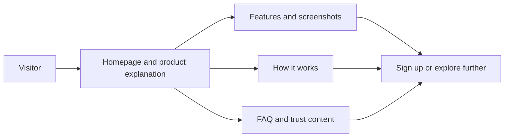

# LoadSaathi

## Public information path

**Last updated:** August 2026.

LoadSaathi is India's AI-powered shared freight marketplace connecting shippers and truckers for PTL (Partial Truckload) and LTL (Less Than Truckload) loads across East India. The platform uses AI matching, real-time GPS tracking, and digital credit scores, with escrow-backed payments planned. It helps reduce empty return trips by matching available truck space with open loads.

## Who It's For

- **Shippers**: SMEs and enterprises in Odisha, Jharkhand, and West Bengal who need to move goods on the Rourkela–Ranchi–Burdwan corridor and beyond.
- **Truckers & Fleet Owners**: Independent truckers and fleet operators looking to fill empty capacity, find return loads, and build a digital reputation.

## Key Features

- **AI-Powered Matching**: Multi-factor scoring engine (route, capacity, price, reliability) that matches shippers with truckers in seconds.
- **Real-Time GPS Tracking**: Live location sharing with ETAs, route visualization, and geofence alerts.
- **Digital Freight Credit Score**: 300–900 score for every participant based on completion rates, on-time performance, and reviews.
- **AI Price Prediction**: Market-aligned pricing suggestions based on route, demand, fuel costs, and historical data.
- **Escrow Payments (planned)**: Milestone-based payment releases with dispute resolution are on the roadmap.
- **Bidirectional Reviews**: Both shippers and truckers rate each other after every completed trip.

## How It Works

1. **Post a Trip or Shipment**: Truckers list available capacity; shippers post load requirements.
2. **AI Matches**: The scoring engine finds the best matches in seconds.
3. **Request & Accept**: Shippers request trips; truckers accept or negotiate.
4. **Track & Chat**: Real-time GPS tracking and in-app messaging keep both parties informed.
5. **Complete & Review**: Milestone-based escrow releases payment; both parties leave reviews.

## Pricing

- Free to join for both shippers and truckers.
- Transaction fee: a fee applies on completed shipments; the final schedule will be published here.
- No subscriptions, no hidden fees, no minimum commitments.
- Enterprise pricing available for 50+ loads/month.

## Cities Served

Rourkela, Ranchi, Bhubaneswar, Kolkata, Jamshedpur, and 50+ cities across Odisha, Jharkhand, and West Bengal in our freight coverage data. Published corridors include Rourkela–Ranchi–Burdwan, Rourkela–Kolkata, and Bhubaneswar–Kolkata.

## Key Pages

- [Features](https://loadsaathi.in/features) - Platform capabilities
- [How It Works](https://loadsaathi.in/how-it-works) - Step-by-step guide
- [Pricing](https://loadsaathi.in/pricing) - Plans and transaction fees
- [FAQ](https://loadsaathi.in/faq) - Frequently asked questions
- [Blog](https://loadsaathi.in/blog) - Articles and guides
- [For Shippers](https://loadsaathi.in/solutions/shippers) - Shipper-focused landing
- [For Truckers](https://loadsaathi.in/solutions/truckers) - Trucker-focused landing
- [LoadSaathi vs Traditional Brokers](https://loadsaathi.in/compare) - Comparison page
- [About](https://loadsaathi.in/about) - Company story and team
- [Contact](https://loadsaathi.in/contact) - Get in touch
- [All Freight Routes](https://loadsaathi.in/routes) - 48 freight corridors
- [Privacy Policy](https://loadsaathi.in/privacy) - Data handling and privacy
- [Terms of Service](https://loadsaathi.in/terms) - Platform terms

## FAQ

**Q: What is LoadSaathi?**
A: LoadSaathi is India's AI-powered shared freight marketplace connecting shippers with verified truckers for PTL, FTL, and return loads across East India. The platform uses AI matching, real-time GPS tracking, and digital credit scores, with escrow-backed payments planned.

**Q: How is LoadSaathi different from a broker?**
A: LoadSaathi connects shippers directly with truckers using AI matching, eliminating middlemen so you pay only for the truck space you use. It is not a loan consultancy and is unrelated to LoanSathi or LoadSarthi.

**Q: Which cities does LoadSaathi serve?**
A: LoadSaathi covers Rourkela, Ranchi, Bhubaneswar, Kolkata, Jamshedpur, and 50+ cities across Odisha, Jharkhand, and West Bengal in its freight coverage data, with multiple published corridors.

**Q: How much does LoadSaathi cost?**
A: LoadSaathi is free to join. A transaction fee applies on completed shipments; the final schedule will be published. There are no subscriptions or hidden fees.

**Q: How does LoadSaathi's AI matching work?**
A: The AI scoring engine analyzes route alignment, capacity fit, price compatibility, timeliness, historical performance, communication responsiveness, and tenure to match shippers with the best-suited truckers.

## Contact

- Website: https://loadsaathi.in
- Email: support@loadsaathi.in
- LinkedIn: https://www.linkedin.com/company/loadsaathi
