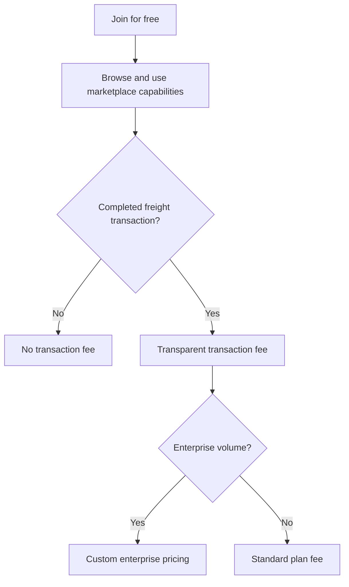

# LoadSaathi Pricing

## Pricing model

LoadSaathi uses transparent, pay-per-transaction pricing. Free to join, pay only when you move freight. Escrow-backed payments protect funds until delivery confirmation.

## For Shippers

- **Price**: Free to join
- **Transaction Fee**: A fee applies on completed shipments; the final schedule will be published
- **What's Included**:
  - Free account registration and profile setup
  - AI-powered transporter matching
  - Real-time shipment tracking with GPS
  - Digital documentation and e-way bill integration
  - Access to verified transporter network
  - Escrow-backed payment protection (live)
  - Analytics dashboard and reports
- **Fee Details**: Varies by shipment size, route complexity, and credit score. Exact fee displayed before confirming any transaction.

## For Truckers & Fleet Owners

- **Price**: Free to join
- **Transaction Fee**: A fee applies on completed trips; the final schedule will be published
- **What's Included**:
  - Free account and fleet registration
  - AI-matched load discovery
  - Route optimization and planning
  - Live GPS tracking integration
  - Milestone-based payment releases
  - Digital Freight Credit Score building
  - Earnings dashboard and trip history
- **Fee Details**: Reduced rates for repeat performers with high credit scores (700+). Exact fee displayed before confirming any transaction.

## Enterprise

- **Price**: Custom pricing
- **Eligibility**: 50+ loads per month
- **What's Included**:
  - Everything in the Shipper plan
  - Reduced transaction fees
  - Priority support
  - API access for ERP/TMS/WMS integration
  - Dedicated account manager
- **Contact**: sales@loadsaathi.in

## What You Don't Pay

- No registration fees
- No monthly subscriptions
- No minimum commitments
- No charges for browsing loads
- No fees for creating an account
- No hidden costs

## Payment Methods

- Bank transfers (NEFT/RTGS/IMPS)
- UPI
- Credit/debit cards
- Digital wallets
- Invoice-based billing (Enterprise, net payment terms available)

## Comparison with Traditional Brokers

| Feature | LoadSaathi | Traditional Broker |
|---------|-----------|-------------------|
| Registration Cost | Free | Often free but hidden fees |
| Pricing Transparency | AI-powered fair pricing | Opaque, negotiable margins |
| Matching Speed | AI match in seconds | Hours of phone calls |
| Payment Protection | Escrow-backed | Cash/credit dependent |
| Real-Time Tracking | Live GPS tracking | Phone call updates |
| Platform Fee | Transaction fee on completed shipments | 10–20% broker margin |
